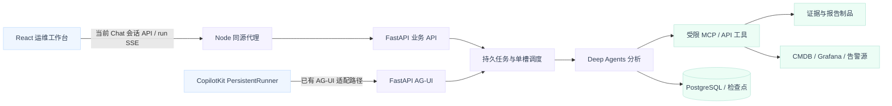

# AIOpsStudio 完整设计（最新整合版）

更新日期：2026-10-27，Asia/Shanghai。

名称修订：产品与 GitHub 仓库统一为 **AIOpsStudio**，Python 包为 `aiopsstudio`，环境变量主前缀为 `AIOPSSTUDIO_`；完整设计文件已更名为本文。此次更名沿用原架构、E01–E21 验收和 R01–R13 工作包，不改变功能完成状态。

整合来源基线为 `dda65118f00531fba5b495b0ec34a07d82372a64`，品牌基线为 `bd9a949`；M1（R01–R04、R07）及审查修复已通过 PR #15 合并并更新 Mac。架构沿用 v0.5；代码/主规格、部署核验与业务接受分别记录。

本轮在 `fa91b92` 基线上集成 M2（R05/#6、R06/#7、R08/#9、R09/#10）：一个 PR、四份 OpenSpec、分项验收。本文记录开发分支已经落盘的机制；联合回归、真实 MiniMax、PostgreSQL 恢复、浏览器、发布安全检查及用户审查分别记录，不能由本文推定通过。M2 尚未合并或更新原 Mac 运行实例，既有配置、对话和附件保持独立。共享实施边界见 [M2 集成实施契约](M2集成实施契约.md)。

本文是完整设计的统一阅读入口，整合产品、架构、交互、管理、数据、执行、分析方法、安全、部署、验收和开发工作包。原四份文档保留来源记录，文内引用随品牌更名更新，后续设计修订优先维护本文。当前可执行契约仍以 [OpenSpec 主规格](../../openspec/specs/)为准；待开发目标须通过各自实现 change 才能成为现有能力。历史结果见[交付状态](../status.md)，M1 当前验证与未覆盖项见[审查与升级验证](../validation/2026-10-23-pr15-review-upgrade.md)，初次实现首败保留在[原验证](../validation/2026-10-23-m1.md)。

## 阅读目录

- [1. 产品目标与边界](#1-产品目标与边界)
- [2. 当前能力与开发状态](#2-当前能力与开发状态)
- [3. 架构与实际请求路径](#3-架构与实际请求路径)
- [4. 运维工作台与多轮 Chat](#4-运维工作台与多轮-chat)
- [5. 账号、私有历史与附件](#5-账号私有历史与附件)
- [6. Skill、MCP、模型与发布管理](#6-skillmcp模型与发布管理)
- [7. 数据接入、对象身份与时间](#7-数据接入对象身份与时间)
- [8. 证据、事实、假设与报告](#8-证据事实假设与报告)
- [9. 执行、预算、取消与恢复](#9-执行预算取消与恢复)
- [10. 三类分析流程](#10-三类分析流程)
- [11. 源权限与模型数据出站](#11-源权限与模型数据出站)
- [12. 告警事件、Case 与显式共享](#12-告警事件case-与显式共享)
- [13. 存储、API 与部署运行](#13-存储api-与部署运行)
- [14. 质量评估与验收](#14-质量评估与验收)
- [15. 开发阶段、依赖与工作包](#15-开发阶段依赖与工作包)
- [16. 来源映射与维护规则](#16-来源映射与维护规则)

## 1. 产品目标与边界

AIOpsStudio 是面向已有监控和 CMDB 的、中文优先、可自主部署的只读运维分析工作台。用户在同一工作空间提问、选择目标/告警和时间窗、调用已发布 Skill、查看报告与证据，并管理 Skill、MCP 和模型配置。主入口统一叫“运维工作台”，用户流程统一叫“分析”；内部已有 `investigation` 等标识保持兼容。

| 业务场景 | 用户输入 | 目标结果 | 当前阶段 |
| --- | --- | --- | --- |
| 告警影响分析 | 具体告警或目标、固定时间窗 | 对应资源、登记依赖上的潜在影响、实际观测异常、缺口及后续检查 | 首版链路已有；完整可信分析由 M1 补齐 |
| 变更影响分析 | 变更记录、计划/实际执行窗口 | 实施前风险与实施后观测分别解释，提供验证/回退检查建议 | 待开发 R10/R11 |
| 故障根因分析 | 症状、对象、故障窗口 | 候选原因、支持/反证、排除项、分级结论及人工裁决 | 完整流程待开发 R12 |

运维平台负责关联、取证和解释；监控采集、遥测存储、CMDB 权威数据、值班排班及生产执行继续由既有系统承担。当前应用、数据库、执行器及应用验证面向 Mac 本机，外部系统只读接入。产品界面使用工作空间、连接和业务范围，不把部署机器写成工作空间身份。

默认一个分析 Agent、数据库控制的一个执行槽。多个 Skill 表示多种方法，不等于多个 Agent。当前不提供自动修复、任意 Shell/SSH、自动审批、源系统写回或代码执行兜底；多 Agent、全量向量知识库、通用低代码编排、多执行器高可用及更换运行框架均不作为本轮前置。

## 2. 当前能力与开发状态

### 2.1 状态含义

- **已实现**：源码与主规格中存在机制，既有公开验证可支持其限定范围；不表示本次重新运行或任意部署可直接通过。
- **已实现，待验证/补齐**：已有可用基础，但组合、完整业务或异常边界尚未验收，必须保留对应工作包。
- **本分支已实现，待集成验收**：开发副本已有代码和相应规格，仍须分项验收、PR 审查及后续授权更新；不等于原实例已经具备。
- **待开发**：目标契约已明确，尚无完整实现；不能从已有 UI、数据字段或 prompt 推导为具备该能力。
- **本轮不纳入**：候选扩展或明确排除项，不能算作十三项工作已经包含。

### 2.2 状态矩阵

| 模块 | 已实现机制 | 尚未完成及责任 | 依据 |
| --- | --- | --- | --- |
| Chat 与画布 | 既有会话、上下文和画布；M2 分支增加 analyze/explain/followup、父轮关联、费用及报告修复入口 | R06 长流程/证据导航、重连及窄屏联合验收；Case/Verdict 入口随 R13/R12 | `improve-long-running-chat`；`Workbench.tsx`、`AnalysisCanvas.tsx` |
| 身份与私人资源 | 独立账号、admin/operator、服务端 session；会话/run/消息/事件/调用/证据/附件 owner 校验 | 本分支已增加 R07 source/egress 策略、逐次撤权与派生历史保护；真实源分区/业务覆盖仍须环境验收 | `user-history`；`identity.py`、`main.py` |
| 服务端历史与附件 | M2 分支增加 owner 内数据库搜索/筛选/游标、归档恢复、含附件 JSON 导出、预览确认删除、配额对账及孤立文件回收 | R08 集成验收；显式 legacy_archive 保持只读；Case 引用待 R13，PDF/Office 解析不纳入 | `manage-history-attachment-lifecycle`；`lifecycle.py`、`conversations.py`、`attachments.py` |
| Skill 管理 | 既有版本/试运行；M2 分支增加文本包路径/大小与本地 schema 限制、差异及服务端发布质量评价 | R05 管理/权限/资料组合验收；不支持安装或执行任意 Skill 脚本 | `complete-management-acceptance`；`config.py`、`management_quality.py` |
| MCP 管理 | 连接/TLS/认证、探测发现、白名单/别名、schema 快照及 JSON 试调；M2 分支补齐目录与依赖变化约束 | R05/R07 真实协议与异常组合；复杂 schema 使用 JSON，不宣称全部传输或 OAuth 已支持 | `connectors.py`、`config.py` |
| 模型与凭据 | OpenAI 兼容配置/工具样本、Vault 独立密钥与撤销；M2 分支增加版本化价格和候选质量门禁 | Provider/真实业务接入及 R05 组合分别核验；不代表全 Provider 功能相同 | `config.py`、`management_quality.py`、`runtime.py` |
| 分析与证据 | 单 Agent、有界工具调用、原响应保存副本/阅读视图分离、引用及截断检查、模型报告/平台模板区分 | R02/R03/R04 已实现固定上下文、定向补读及 Fact/Claim 结构核对；完整根因 Hypothesis/Verdict 流程仍属 R12 | `managed-readonly-execution`；`runtime.py` |
| 数据连接 | 远程 MCP 与 Ongrid 告警查询基础，可按部署配置 CMDB/Grafana 只读源 | 实际目录/权限/查询正确性按环境核验；完整告警时间线工具契约及覆盖按 R02/R04 补齐；GLPI 尚未接入 R10 | `connectors.py`；源端配置不在仓库 |
| 队列与检查点 | M2 分支统一 queue_limit，增加租约 generation、数据库/事件/文件/PG 检查点 fencing、中断终结与显式新轮重试 | R09 故障/恢复联合验收；running 不自动重放源或模型；完整断电和高可用不在本轮承诺 | `store.py`、`runtime.py`、`fenced_checkpoints.py`、`backup.py` |
| 费用与发布质量 | M2 分支按 owner 展示 attempt 耗时/请求/已知及未知 token、版本化估价；服务端固定回放与候选运行评价约束发布 | R05/R06 适用比较与费用联合核验；缓存缺价、缺回执、供应商重试保持未知，评价不等于业务/RCA 接受 | `usage.py`、`management_quality.py`、`release_baseline.py` |
| 自动事件与协作 | 当前人工发起与个人会话可用 | Webhook、事件去重/恢复、AnalysisCase、显式共享/撤回待开发 R13 | R13；当前不存在完整 Case 流程 |
| 人工裁决与经验 | 可阅读模型报告和证据 | 独立人工 Verdict 待开发 R12；审核经验库仍为候选 | R12；用户接受不等于人工根因裁决 |

### 2.3 M1 当前实现与升级边界

M1 由 `establish-analysis-baseline`、`unify-analysis-context`、`add-targeted-evidence-reading`、`ground-alert-impact-reports` 和 `enforce-source-access-scope` 五个 OpenSpec 共同交付，见已合并的[PR #15](https://github.com/john-ops-lab/AIOpsStudio/pull/15)；审查另增旧历史档案 OpenSpec。代码在独立 Mac 开发副本与隔离数据库验证后，原实例已切换 API/Web。原配置、独立密钥、历史与附件逐项比对保持，数据库、持久卷与源转发未改。部署核验与限定 MiniMax 端到端结果见[审查与升级验证](../validation/2026-10-23-pr15-review-upgrade.md)，不等同真实业务源验收或用户接受。

新业务分析必须配置版本化身份映射、查询目录、source/egress 策略。缺映射先补输入；缺策略默认拒绝，不把旧平台账号权限授予全部用户。配置管理页提供 JSON 编辑和版本校验，具体字段/API 见 [协作合同](../../CONTRACT.md#当前增量m1-可信分析与数据边界)。

旧实例升级通过 `preserve-legacy-history-on-upgrade` 的离线一次性清单保存原 owner 的只读访问；清单绑定原 ID 与完整内容摘要，原会话、报告与附件内容不改，界面标记来源未按新契约核验。归档会话禁止继续执行、补读、继承或自动送入模型；继续分析需新建会话并补齐新契约。清单不自动扩容，也不将旧账号权限转换为新授权。审查与实际升级记录见[PR #15 验证](../validation/2026-10-23-pr15-review-upgrade.md)。

请求对象和返回对象分开：`result_identity` 逐行/逐序列核对身份、环境、集群、namespace 和类型，缺声明保持未知。没有真实时间绑定的当前拓扑不能证明故障时关系。补读回执的原始下标和字段投影组成锚点，不能引用未读取的行或字段；完整包计量，源覆盖、保存完整性与模型实际阅读范围分开。

结构化结论的数值通过只核对已声明字段；自然语言 `model_text` 仍标为未核验解释。程序生成描述与模型措辞分开展示；事实/候选不自动变成已确认根因、恢复或用户接受。R05/R06/R08/R09/R10–R13 的完整验收继续沿用路线图。

正式源工具成功和错误返回先按来源字段规则生成允许的模型视图，补读仍服从独立材料规则；有界原文不会直接作为协议正文出站。当前 attempt 只在内存保留最近两组完整助手/工具往返，合计最多48 KiB，并计入输入预算；持久证据账本保持。最新策略变化后不重发旧协议正文，兼容供应商的推理字段必须显式登记出站权限，且不进入页面、报告、事件或检查点。每次模型请求在剩余总预算内最多180秒，探索保留报告时间；已派发中断的用量标为未知。此行为由 `preserve-model-tool-turns` 规定，真实调用首败及补修复验单独记录。

### 2.4 历史验证与当前文档的边界

公开 Chat 验证曾记录后端 84 项、PostgreSQL HTTP 16/16、浏览器/服务端联合 19/19，以及两轮真实外部模型 `partial` 报告。最初超时、模型报告失败、阅读视图漏尾部/漏序列及缩写引用等首败均保留，后来的通过不覆盖这些失败。此前其他检查的计数各有范围，不能叠加成根因准确率。

首次文档整合只做静态实现/规格核对和文档验证，没有重新执行这些应用测试，没有调用模型或源系统。代码机制、协议通过、实际查询、分析正确、完整业务覆盖、部署可用和用户接受分别记录；目前用户接受仍不能代称全部通过。品牌变更与 M1 分别记录检查，不把历史结果改称为本轮 MiniMax 或业务验证。

### 2.5 M2 集成范围与后续边界

| 工作项 | 本分支机制 | 分项验收和后续边界 |
| --- | --- | --- |
| R05/#6 管理组合 | 版本差异、文本 references 包约束、MCP 目录/schema/依赖、统一队列限额；候选实际运行的服务端评分和固定 R01 回放证明共同约束正式发布 | 真实协议、撤权、旧新版本比较和固定资料组合分别核验；固定回放中的共享、人工裁决及一致恢复不适用项继续列为 unknown，不算通过 |
| R06/#7 长流程 Chat | 普通分析、只解释已有结果、补查新证据三种模式；持久回执/父轮、证据导航、耗时费用、报告制品修复 | 解释是有预算的新模型轮，禁来源/工具；补查总是新轮；Case 共享和人工裁决入口分别留 R13/R12 |
| R08/#9 历史附件 | 稳定游标和 owner/状态/时间过滤、归档恢复、导出、revision/引用绑定的预览确认删除、配额与孤立文件回收 | 运行中/保留报告引用阻止删除；删除先失效再重试物理清理；显式旧档案仍不可修改，不自动改写旧行或原实例 |
| R09/#10 中断恢复 | generation fencing 覆盖数据库/事件/新文件与 PG 检查点；保留旧用量/终态、独立报告保存修复、一致备份和空目标恢复隔离 | 中断任务明确终结，重试新建关联轮；恢复先核对最新外部授权/撤销事实，未确认前工作空间 API 拒绝；真实断电、远端在途读取及模型未知消耗保留边界 |

本轮完成以上实现不代表 M3/M4 已启动。R10 工单、R11 变更影响、R12 假设验证与独立人工 Verdict、R13 告警自动接收/Case/显式共享仍待开发。PDF/Office 提取、SSO、更多传输/认证、经验库、多执行器高可用与自动修复继续作为候选。

## 3. 架构与实际请求路径

### 3.1 组件职责

| 层 | 职责 | 状态与约束 |
| --- | --- | --- |
| React/Vite + CopilotKit Provider | 中文工作台、会话与上下文、画布、管理界面 | 已实现；当前 Chat 主组件主要调用业务 API/SSE |
| Node 同源服务 | 静态页面、固定 Python 上游代理、CopilotKit runtime/PersistentRunner 适配 | 已实现；不能成为第二个 Agent 调度器 |
| Python FastAPI | 会话/用户/配置/附件/任务 API、AG-UI 适配、鉴权 | 已实现；所有执行入口统一进入任务记录/调度 |
| Deep Agents / LangGraph | 按固定 Skill 和工具范围分析，调用模型并留存检查点 | 已实现；检查点存在不代表已实现 running 自动续跑 |
| PostgreSQL + 制品目录 | 权威配置、owner、会话、任务、事件、检查点、证据元数据及文件 | M2 分支增加一致备份/恢复隔离，R08/R09 联合验收分别记录 |
| MCP/API 连接层 | CMDB、Grafana、告警源只读访问 | 基础已实现；目录/权限/历史能力由部署核验；工单 Provider 待 R10 |

### 3.2 两条已有入口与一个执行器

图中箭头表示请求/订阅方向，响应和事件返回省略。AG-UI 是代码中已有的协议适配路径，当前 Chat 页面没有被描述为全部经它执行。当前 UI 从 conversations 消息 API 提交，读取 run 级 SSE 并可用轮询恢复；没有单独会话级 SSE，也不把保存后的状态/文本投影宣称为模型逐 token 流式 Chat。两条入口均复用持久记录，不因浏览器重连或不同协议订阅再派发一次模型调用。前端/Node 内存与共享状态不替代 PostgreSQL 权威状态。

外部数据路径为 CMDB MCP → Veops；Grafana MCP → Grafana 数据源代理 → Prometheus/Loki/Tempo；进程内告警客户端 → Ongrid HTTP API。它们不依赖 Ongrid AI 代跑分析。GLPI/其他工单 Provider 是后续可替换来源，不应画成当前已接入部署。

## 4. 运维工作台与多轮 Chat

### 4.1 已实现交互

桌面布局为侧栏、Chat、可折叠分析画布；画布提供报告、证据和执行记录。窄屏优先保留输入框，通过明确控件打开画布。侧栏显示当前用户与账号操作，不显示“Mac 本地”“本机工作空间”。

用户可以从告警/Skill 携带上下文进入，也可中文提出问题。Skill、对象/告警、环境和绝对时间窗为可见输入；缺必需参数时先保存消息并说明缺项，不伪造已启动的分析。上下文选择不直接改变正在执行的范围。

服务端保存 conversation、message 与 run 的关系。当前一条会话可关联多个 run，每个 run 携带自身 attempt_id，parent_run_id 关联前轮；不要把旧设计中“一个 run 内任意多 attempt”直接当作现有数据结构。thread_id 是会话/协议关联，不应与业务 run_id 混同。

运行中上下文未改变的补充消息关联当前轮次；消息在可消费边界处理，不能承诺模型即时打断并回答。主目标、Skill、主时间窗变化，或终态后继续发送，会建立关联新轮次；旧消息、报告和证据不覆盖。旧材料作为有界历史输入，目前只取最近 3 轮、每轮至多 4 条问题与报告摘要，不自动成为本轮新证据。

client_message_id/client_request_id 的幂等作用域包含可信用户及相关父对象。刷新、离页和断流读取持久快照并续接事件；断流不等于取消。报告卡片与证据引用打开原轮次内容，输入状态和焦点保持可用。页面、错误、超时、重连与报告使用简体中文，技术字段和源原文保真。

### 4.2 M2 长流程模式与验收边界

消息顶层 `mode` 为 analyze、explain 或 followup，省略保持 analyze 兼容行为。explain 和 followup 选择同会话已完成且仍有权限的 `parent_run_id`，总是新建独立预算轮；explain 只解释保存结果，不构造来源工具、加载目录或重新查询，拒绝新附件；followup 可按当前授权补查新证据。旧报告、原累计用量和文件保持。

工作台提供解释/补查选择、父轮关联、证据导航和每轮费用面板；进度依据持久事件和回执，不展示隐藏推理。失败重试、中文输入法、键盘焦点、窄屏和重连按 R06 联合验收；人工裁决与 Case 入口在 R12/R13 就绪后另验。

## 5. 账号、私有历史与附件

### 5.1 已实现身份和归属

独立用户名/口令、服务端 Cookie session 与 admin/operator 角色已实现。admin 管理共享配置和普通用户，operator 读取允许的配置、提交已发布方法并访问自己的历史。owner 来自服务端 session，客户端的 owner/thread/parent/attachment 等参数不能授予权限；不可访问的私人对象统一返回不存在，管理员配置权限不自动取得他人内容。

归属约束覆盖会话、消息、run、取消/重试、SSE、AG-UI 绑定、调用记录、证据、附件，以及概览/队列/最近运行列表。旧无 owner 数据仅归初始管理员，新增用户不继承这些历史。平台资源私有与上游环境/业务范围是两层判断；后一层由 R07 补齐。

### 5.2 已实现材料能力

附件字节、名称/类型/大小/摘要、会话和 owner 持久保存；服务端生成存储键，用户文件名不作为磁盘路径，接口不回显真实路径，下载按附件处理。单文件 5 MiB、每用户 100 MiB、请求体上限 8 MiB；UTF-8 文本单件至多 12000 字符、单次合计 24000 字符，截断明确标记。

仅同用户同会话附件可被引用；模型材料由服务端按附件 ID 读取，不接受客户端伪造全文。二进制可保存下载，但未实现解析必须显示未提取。用户材料不是源系统证据，也不是可执行指令。最终报告生成 Markdown 附件，按 run 幂等保存，前轮文件不被后轮覆盖；失败修复边界仍需 R09 验证。

### 5.3 M2 历史与附件生命周期

会话关联轮次现已排除旧独立任务的七天清理，不应把所有聊天历史按七天自动删除。独立任务的保留策略不等于完整的用户删除/归档能力。

现有配额检查是基础，R08/R09 的统一容量契约需覆盖全部 `investigation/skill_test/tool_test/model_test`：磁盘水位或证据留存配额不足时拒绝需要持久保存的新任务，在途任务保留有界失败并结束，不能只拦分析而让试调继续占满存储。配置历史按引用保留，过期结果保留明确元数据，不提供看似仍有效的下载；对应组合不能当作已全量验收。

本分支已补 owner/状态/时间的 SQL 过滤、绑定过滤条件与快照上界的稳定游标、搜索、归档/恢复及含授权附件字节的 JSON 导出。归档阻止新分析/上传但可查看、下载和恢复；已删除记录不可继续发消息或通过旧链接下载。普通旧行读取不回写，显式操作按版本兼容；离线登记的 legacy_archive 仍只读，可查看/导出/下载，归档或删除返回 `legacy_archive_readonly`，不会改变原摘要。

会话/附件删除先生成五分钟预览令牌，确认时重新核对 owner、revision 和引用关系。运行中和仍被保留报告引用的材料阻止删除；会话内部已结束轮次可随会话一并失效。提交最小 tombstone 后再清文件/精确检查点，失败保留 pending 并可幂等重试。容量同时核对元数据和实际字节，孤立文件只在当前 owner 目录、按服务端固定命名和二次预览确认回收；文件发布与回收共用写事务。输入框移除待发送附件不代表服务器删除。Case 共享引用在 R13 接入后另验。

## 6. Skill、MCP、模型与发布管理

### 6.1 Skill：已有基础与待补齐

已实现 Skill 草稿、正文和文本 references、输入 schema、工具依赖、校验、发布版本查看、回退、停用与试运行。内容标准使用 SKILL.md，AIOpsStudio 自有输入/预算/依赖配置与标准内容分别保存。allowed-tools 或正文要求不能授予权限；只读工具范围由平台确定。

所选 Skill 正文确定性进入当前 attempt；本分支装载所选正文和固定通用 CMDB 方法，references 仅提供固定版本清单并按需读取，不是加载整个 Skill 库。仅方法文本和平台注册工具可执行，不自动安装或执行包中脚本、任意代码或依赖。M2 文本包先在临时目录校验后原子激活，核对 frontmatter/相对引用、文件数/大小，拒绝越界、符号链接、路径别名及文件/目录碰撞；版本差异可查看，仍不接受任意可执行 Skill 包。

正式运行使用已发布且有效版本；草稿试运行冻结测试快照，以 skill_test 进入同一队列，保留身份、输入、预算和证据；草稿后续编辑不改变已提交试运行。必需工具缺失阻止启动，可选来源缺失可交付适用的部分分析并说明未查。

**R03 固定版本资料与 M2 发布约束：** manifest 绑定 Skill ID/版本、受限路径和摘要；正文必载，大资料按范围补读。仅允许当前版本清单内文件，读取记录范围、锚点及预算。候选发布评价要求声明的 references 具有模型实际消费且匹配版本/路径/锚点的回执；未读到不能仅凭 manifest 宣称满足，恢复/回退不能混入新版。导入、补读和固定资料对照继续按 R05 联合验收。

### 6.2 MCP 管理与只读试调

已有独立 server_id、URL、服务端凭据引用、CA/TLS、超时、目录/工具 schema、白名单和工具别名。远端服务器名不作为全局唯一身份。首版以远程 Streamable HTTP 和所配置认证为基础，不能将任意传输、OAuth 或所有复杂 schema 表单列为已经支持。

当前 MCP 调用按次创建会话，没有持久连接池。R05 的目标约束是：如实施连接复用，按 server、配置版本及凭据版本隔离，并遵循主体/范围校验，不能仅凭同 URL 混用认证会话；旧 attempt 引用释放后关闭旧连接，撤销和立即阻止优先于连接复用，并在 R05/R07 联合验收。

连接配置通过业务 API 保存，Python 服务端探测与发现，不让浏览器或模型直接连接源。连接成功、协议/认证、目录完整、工具调用成功和业务查询正确分别记录。tools/list 分页与目录变化须按协议核验；新增工具默认不开放，readOnlyHint 不能替代实际效果与源端权限检查。

别名绑定 server_id + original_tool_name，调用远端仍使用原名。M2 核对完整目录、重复工具、白名单、依赖 schema/定义摘要/版本，拒绝远程 `$ref`；发现不完整不替换为完整可发布目录，schema 变化不能自动开放工具。必需/可选依赖、重连与并发变更仍按 R05 组合验收；远端实现不可由本地快照冻结，不承诺完整复现未知行为。

手工 JSON 参数试调创建 tool_test，经统一任务调度和同一只读工具包装器执行，默认单次业务工具请求，不启动模型。参数、原生 content/structuredContent/isError、协议错误、耗时、字节、截断与来源可查看；schema 自动表单属于目标交互，复杂项保留 JSON。试调与正式任务都受范围、预算、owner 与留存限制，不因“调试”绕过。

### 6.3 配置版本、生效与撤销

已有修订并发控制、不可变发布版本、任务配置快照、凭据引用与审计基础。需要区分草稿 revision、发布 content/tool/model 版本、组合 config_revision、源端自报版本及本轮查询输入；内容摘要用于一致性，不证明质量或真实性。

目标生效契约由 R05 完整验证：先固定并验证候选及依赖，再原子切换生效引用；并发编辑不静默覆盖；旧 attempt 沿用所提交版本。普通停用阻止新任务，已有任务按快照继续；立即阻止和撤销在后续派发前优先生效，在途读取尽力取消且状态可追踪。回退重新指向仍有效版本，不能复活已撤销凭据或改写历史。

凭据输入只提交受认证后端，已有值不回显、不落浏览器持久存储/AG-UI/提示词/证据/导出；Vault 服务端加密保存，主密钥独立注入。轮换生成新引用而非修改旧版本。凭据历史、引用释放、依赖兼容和独立密钥恢复的全部组合仍需 R05/R09 验收。

### 6.4 模型设置、质量发布与费用

已实现 OpenAI 兼容模型配置和独立 model_test，用固定非敏感测试工具检查中文工具往返。模型 ID、endpoint、认证、输出上限和采样参数分别配置；协议样本不等于真实 MCP/业务理解通过。失败不静默切换 Provider；后续真实验证优先 MiniMax，由仓库外提供配置。

**M2 正式发布双门槛：** 新发布默认 formal，并要求 revision CAS；同时满足绑定当前实现/suite/scorer 的受控 R01 流水线证明，以及服务端保存的本配置实际候选运行/必要基线运行合同评分。客户端只提交运行引用，不能上传分数、pass 或任意评价 JSON。关键失败、未知或退化为零，token/耗时有冻结退化阈值；发布前重新核对底层运行与制品。实验版本不切换 current，历史正式版本继续保留。固定回放是确定性实现检查，实际运行评价仅覆盖已观测合同，不代表通用业务正确率或根因接受。

**M2 费用展示：** 按 owner 与 attempt 返回排队/执行耗时、模型/工具/源请求、已知累计 token 和未知项。价格来自本轮固定模型配置，注明币种、单价版本/日期；缺完整用量或价格返回 `estimate=null`，有缓存用量但无缓存价格同样未知，缓存只计一次。供应商内部重试与 MCP 上游请求没有完整回执时保持未知。当前费用只面向私人运行，Case 权限随 R13 接入；费用未知不冒充零成本，也不自动抵消已知质量失败。

## 7. 数据接入、对象身份与时间

### 7.1 源能力与部署核对

| 数据源 | 当前接入基础 | 设计契约及待完成部分 |
| --- | --- | --- |
| Veops CMDB MCP | MCP 客户端按配置使用现有目录 | 保持六工具原契约：cmdb_list_models、cmdb_get_model_schema、cmdb_search_cis、cmdb_get_ci、cmdb_query_aggregates、cmdb_query_relations；发现→schema→定位→关系/统计→对账；不把某现场目录当全局默认 |
| Grafana MCP | 可配置官方 MCP 读取数据源 | 以实际 tools/list 和锁定版本为准；query_prometheus、query_loki_logs、search_tempo_traces、get_tempo_trace 等仅为候选确切工具名，实际注册需核验；不另建通用转发网关 |
| Ongrid 告警 API | 已有告警列表与详情/受限时间线读取及进程内 alert_detail 分析入口 | alert_search/alert_get/alert_get_timeline 是完整目标命名，不与当前内部入口混为一谈；筛选、分页、时间线和源权限按版本验证 |
| GLPI / 工单 Provider | 尚未接入 | R10 核验版本、认证、故障/Change/跟进记录及字段，保留 Provider 替换路径；不安装或修改外部工单系统作为本次文档工作的一部分 |

Grafana 通过实际部署中的数据源 UID/查询代理访问 Prometheus、Loki、Tempo；数据源 UID、路径前缀、证书、标签、单位和端点由部署者在仓库外提供。保留 PromQL/LogQL/TraceQL 查询目录，不让模型按服务名猜指标。指标区分 instant/range、start/end/step；日志有绝对窗口和 limit；Trace 搜索与详情分开，缺字段/采样不补造。

Tempo 的模型友好简化响应不自动成为稳定程序事实契约；保存 MCP 原生返回及解释版本，必要字段不足报告缺口，只有案例确实需要时才新增标准 JSON 补充。MCP 原生响应也不等于未经转换的后端原始遥测。

Ongrid 告警的 fired_at（初次触发）、last_fired_at（最近触发）与“该窗口内曾告警”分别解释，不能用其中一个时间字段冒充整段事件覆盖。历史核对中 total 可能退化为本页数量，时间线 total 仅表示本次返回数，只有受限 limit、没有已核对续读游标，达到上限需标局部；这些限制仍须按部署版本重新核验。

Ongrid 源端筛选和 total/时间线 limit 可能不提供全量证明；未生效的参数不能宣称已下推，受限扫描保留已读页和未覆盖范围，不把失败变成零告警。源时间表示、前缀和认证按实际版本核验；产品内部 AI 工具不被假定为对外 MCP。

### 7.2 已实现身份契约 R02 与部署核对

本分支已实现版本化 identity_mapping/query_catalog、完整对象范围、历史有效期和歧义处理；不自动将旧配置升级成可信映射。身份不明确先 needs_input，源与模型零派发。目标映射记录源实例/对象类型/原生 ID、环境/集群/namespace、canonical CI/service、匹配依据、验证时间、不可变映射版本和已知 valid_from/valid_to；验证时间不能替代历史生效时间。

优先显式 ID；名称仅在环境等约束下唯一匹配时可辅助，同名、重建 Pod/Node、缺映射不得静默选首项。Veops CI ID、源 device_id、K8s UID 不直接等同。关系区分业务依赖、部署、归属、管理，保留边方向和来源。服务A→服务B→数据库表示前者依赖后者，影响分析反向找调用方；共享主机只表示共同风险。

当前 CMDB 不能倒推故障时拓扑。未来历史关系从可证明的快照/变更开始积累；更早故障无该时点关系就留未知。必要身份冲突进入澄清/needs_input 或覆盖不足，不冒充业务正常。

### 7.3 时间与覆盖

平台保存 UTC/RFC3339，界面以 Asia/Shanghai 为默认展示。主窗口在提交前明确，本分支 R02 已固化 fault/baseline/change/validation 具名窗口及选取原因；源不支持的历史范围或偏差明确记录。默认告警附近窗口只是可验证起始策略，不能覆盖用户选择或隐藏不同工具的 now 漂移。

保留发生、采集/观察、修改及本次读取时间；统计采样/告警延迟和时钟误差不等于发生顺序。基线要检查流量和健康可比性，不能因“更早”就当健康；扩窗是显式补查。空结果、无权限、超时、陈旧、源历史不支持、未完页和存储/阅读截断各自表达，complete 仅代表声明查询范围，不代表全局无异常。

## 8. 证据、事实、假设与报告

### 8.1 已有证据与报告机制

每次工具调用保存 invocation、run/attempt、工具/配置版本、实际参数、源身份引用/读取时间、响应副本、evidence_id、摘要与完整性。模型报告前先保存证据；预检拒绝等没有响应的调用不能补造原件。凭据和认证头经安全处理不进入模型证据。

源返回、保存副本、模型阅读视图和报告是不同对象。存储自身受字节/磁盘配额限制，超限时可仅留明确标记的片段；阅读视图还有独立长度预算。当前不能宣称“所有原件无条件完整保存”。保存前脱敏/删减时明确处理范围和核验影响；摘要用于内容一致性，不能证明源数据真实或因果成立。

本分支确定性摘要保留多序列与尾部变化，并提供对已保存JSON/固定文本资料的受限补读；不支持的逻辑分段与源端续读协议仍保持未知。报告保留引用、覆盖、截断及失败；平台模板与 source=model/model_generated 的模型报告区分，失败不能通过可读正文冒充成功。当前 business_acceptance 保留 unverified、root_cause_confirmation 保留 undetermined，不宣称已确认根因。

### 8.2 已实现定向补读 R03

已存证据只按当前 attempt 的 evidence_id、JSON 字段/序列、行/字符/时间段等受限选择器补读，检查 owner、最新源权限和预算；跨轮或 Case 引用属于后续独立授权流程，不由本接口放行，返回位置、剩余范围、完整性与稳定引用。证据和 Skill reference 使用不同资源类型，不接受任意服务器路径或 URL。

完整证据目标契约要求：被拒绝、校验失败，或单个逻辑响应的传输分段尚未收齐时，不得引用其内部片段作为事实；CMDB delivery 续读需完成该逻辑响应的整体校验。业务分页则可在每个独立页面已完整保存并验证后引用个体记录，同时保留全局 partial；传输分段与业务分页不能混用。此门槛按 R03/R04 验证，不因已有证据文件就宣称完整实现。

源端分页、保存副本截断、模型视图截断分开；已丢弃或不可取得的源数据不能伪造恢复。游标绑定源、主体范围、原查询与窗口，续读不换条件。日志切窗要处理边界重叠/同时间戳/多流，不用“最后时间加一点”冒充可靠翻页；Trace 搜索不宣称穷举。完整保存且验证的页面可支持个体事实，不支持全量名单或全局不存在。

### 8.3 已实现结构字段核对 R02/R04，根因流程待 R12

| 对象 | 最小内容 | 来源与判断规则 |
| --- | --- | --- |
| Fact | 对象、值/单位、窗口/范围、source/evidence、片段、确定性计算规则 | 由源或确定性计算支持，缺值不补零 |
| Claim | 一条结论、引用 Fact/证据、支持/反对信息、校验结果及报告版本 | 引用存在不等于内容支持，区分失败/未知/未执行 |
| Hypothesis | 机制、目标、支持/反证、缺口、next_check、open/supported/rejected/unresolved | 可并列、可否定、可保持未知，不强选一个 |
| Verdict | 人工判断、依据、操作者、时间、范围、报告/claim 或 hypothesis 版本 | 独立于模型，修订追加记录，不自动当真值 |

优先用程序核对单位、计数、极值、窗口、身份、分页、关系方向、引用位置和覆盖；一般因果不能靠 schema 自动证明。不同工具复述同一底层数据仍是一个来源，要保存血缘，不能制造独立佐证。模型自报百分数不等于经校准准确率。

### 8.4 报告与人工裁决目标

完整目标报告包括主结论、对象和窗口、潜在/已观测影响、时间线、候选及支持/反证、根因等级、未知/未查范围、下一步和证据索引。自然语言忠实度单独验收，程序检查通过不代替业务事实正确。

根因目标等级为 suspected（有线索缺关键验证）、supported（对象/时间/机制相符且检查替代解释）、confirmed（直接机制及可核对恢复/对照/等效独立验证）、undetermined（不足或冲突）。任务 succeeded 与根因 confirmed、业务恢复是独立状态；当前不能因图已跑完就升格。

R12 人工确认/驳回/证据不足需关联 immutable attempt/report_version/claim 或 hypothesis，保存依据、当前服务端身份和时间。操作者须有权读取和裁决；修改/撤销追加记录，不覆盖模型报告。旧裁决不自动确认新报告，不绕过后续撤权；点赞或接受本次交付不自动创建裁决。经核实内容以后可候选进入经验，但需另行审核、权限、失效和回放规则，当前不自动写入共享知识库。

## 9. 执行、预算、取消与恢复

### 9.1 已有持久执行

`investigation`（用户界面称分析）、`skill_test`、`tool_test`、`model_test` 共用数据库单执行槽，任务先持久接收再执行。状态集合 queued/running/succeeded/partial/failed/needs_input/cancelled；partial 表示有可交付内容且覆盖不足，needs_input 表示缺关键条件。具体终态还须保留实际失败原因，不能仅凭同名枚举推断完整状态机已验收。

队列/消息幂等、租约、心跳、累计用量、事件序号和检查点已存在。排队中取消无需执行，运行中取消记录请求并停止后续派发，尽力处理在途调用。取消不表示源操作回滚；只读请求也可能在客户端断开后已完成。显式重试建立新关联记录并保留首败，不覆盖旧报告。

默认新任务预算包括工具 40 次、源请求 40 次、模型请求上限、wall 300 秒、累计 token 100000 和有界证据字节。分析最多 4 个探索模型回合，并为禁工具报告回合保留 token/时间。报告回合预算与精确输出参数以当前 settings 和源码为准，不能用旧设计的“5 分钟加 30 秒”概括所有现有分支。发现/续读/重试按规定计数，MCP 控制请求和应用源请求分别记录，MCP 内部向源请求次数未知不补零。

本分支入队与概览统一读取 settings.queue_limit，减少限额只限制新入队，不取消已经接收的任务；重启继续使用持久设置。控制探测不构成额外分析执行槽，未来自动入口仍须复用同一规则。

### 9.2 M2 中断策略与执行隔离

queued 任务可由新 worker 领取；running 不从检查点自动重放源或模型。租约过期将旧运行明确标为 `execution_interrupted`、关闭在途调用，保留已知累计用量；已派发但无完整回执的模型消耗转为未知。取消/超时继续按有效证据保留适用的 partial/failed/cancelled 边界，显式重试创建关联新 run/attempt，不覆盖旧记录。

领取的执行槽绑定 owner、run、generation 与到期时间。执行 scope 内数据库/事件修改在事务入口与提交前校验；新制品先临时写入、校验后发布并登记事务回滚清理；PG 检查点在同一 advisory lock 和代次检查内写入。旧 worker 丢失租约后拒绝后写；模型已返回但未持久化的内容保持未知，不承诺端到端 exactly-once。

执行状态与 `delivery_status` 分开。`repair-report` 仅重存同一报告附件并修复会话关联，不调用模型或来源；已存在的不同内容拒绝覆盖。以上机制仍须按 R09 分别核验状态竞争、取消/超时、失效 worker、制品修复及恢复；合成故障、真实进程退出和未覆盖断电边界分别记录，原实例不用于故障注入。

## 10. 三类分析流程

### 10.1 告警影响：已有链路与 M1 结构核对

方法顺序为定事件→定对象→列潜在影响→验证实际异常→补业务信息→分层报告。按实际告警目标和固定窗口取证，依赖图反向找调用方，保留关系层/方向、来源与展开边界；取指标后按明确问题补日志/Trace，不为凑信号盲查。

输出分别列登记关系上的潜在风险、遥测支持异常、已查询但未观察异常、未查询/无法判断。抽查某个服务只证明该服务，不能推广全图；无工单接入写“该维度未查”，不写“无近期变更”。交易损失只有已验证业务指标支持时才估算。名单、方向、分页和引用应由 R02/R04 程序核对；完整业务影响验收尚未完成。

### 10.2 变更影响：待 R10/R11

计划与实际实施分别判断。读取变更目标、内容、计划/实际起止、步骤、回退计划及执行记录；审批、关闭、更新时间不等于已执行。实施前只给风险假设、指标基线、验证条件和回退观察项，不虚构未来遥测。

实施后按实际窗口比较前/中/后指标和事件、日志/Trace，核对流量、版本、同期变更和原有故障。无关、未执行及并发变更是负例；“刚发布过”只算线索。需要根因验证时调用同一候选方法并保留旧证据和窗口，变更影响报告不直接升级为根因确认。不执行变更或回滚。

工单契约保留 source_status/source_priority 与规范化状态，未知不硬映射；change_phase 与 execution_state 分开。GLPI 版本、API、认证、分页、实际时间与附件元数据核验后接入；不假设新版 API/OAuth 与旧版等价，不同步第二套权威 CMDB。

### 10.3 根因假设：待 R12

症状界定→对齐基线和时间线→提出少量候选→有目的取证→反证/替代解释→分级报告。每个候选写“成立应看到什么、什么会反驳、下一步查什么”，允许排名改变、被否定或始终未知。初始至多 3 个活动候选和约 18 次调用收敛仅为待验证方法起始值，不是正确率或强制结束门槛，仍受硬预算约束。

最早异常可能受采样/延迟影响；最慢客户端 span 不等于数据库内部耗时；最高 CPU、最近变更、拓扑尽头均不能单独确认根因。日志/Trace 样本不直接推算全量比例。至少主动检查适用竞争解释或明确无法检查，恢复对照只使用真实发生且可核对的记录，不由分析 Agent 注入故障。

连续无新增证据/失败时检查标签、源与窗口，转向有依据的新问题或停止。合法翻页、明确窗口对照不能机械当重复空查；成功固定快照查询可复用，超时/数据更新/用户要求新观察不得无条件缓存。缓存若引入须包括主体范围、窗口、连接/工具版本和新鲜度，不能跨用户按问题文字复用。

## 11. 源权限与模型数据出站

**状态：本分支已实现 R07 的 source/egress 策略、逐次派发/历史撤权与实际 HTTP 字段检查；真实连接和多团队业务接入仍须配置与验收。** 不同权限团队开放前必须完成这一门槛，不以私人聊天隔离代替上游源授权。

### 11.1 主体、连接与范围

服务端主体关联 Connection、上游身份/凭据版本、允许工具、环境、服务/对象、窗口及策略版本。共享源账号能读取的范围不得直接授予每个用户；无法可靠收紧的工具拒绝或登记不支持。试调、分析、补查、历史证据、下载/导出和 Case 每次核对当前范围。

提交、排队领取和每次派发核对最新授权；历史报告/派生物按来源范围再检查，不能用旧证据绕过撤权。在途请求尽力取消，返回先按当前规则检查再保存/交付。连接目的地、TLS、重定向与凭据绑定独立核验，未经批准重定向不携带凭据，模型不提供任意目标地址。

### 11.2 模型可见内容

区分平台凭据、资源标识、业务日志/字段和用户附件，定义允许、替换/缩减、禁止及未登记类型处理。业务材料能被当前用户读取，不自动表示可全量发给远程模型。

必要关联使用授权会话内一致别名，映射只留服务端，不采用可直接反推原值的编码，不把原值和映射表一起发送；不进入工具描述/返回、模型上下文、日志、普通导出或客户端制品。展示还原在服务端按权限执行，默认不建立跨用户全局别名。

attempt 和评估保存内容/映射/策略版本，同时每次派发执行最新更严格的禁止与撤权。旧上下文不再允许发送时明确 partial/failed 或需新 attempt，不静默放行、换模型或回退策略。无法读取策略不能被当作“无额外限制”。

### 11.3 实际出站验证

隔离 Mac 的合成敏感标记覆盖实际模型 HTTP system/user/历史、tool schema/描述/返回、摘要、重试、附件、源错误与异常分支；日志、事件及导出同时核查。测试出站实际字节，不只测脱敏函数。隐私处理前后用 R01 比较身份关联和事实质量；双用户、排队/运行撤权、历史访问与读者变化都有允许/拒绝案例。

## 12. 告警事件、Case 与显式共享

**状态：本章为待开发 R13；已有人工会话、请求幂等和队列不等于告警去重或团队 Case。**

### 12.1 可靠事件入口

首批一个来源、少数告警类型，验认证/签名、重放防护、持久接收、归一化、去重，再入队并返回可查回执，Webhook 不等待 LLM。优先使用源事件 ID；无稳定 ID 时由源实例/incident/事件类型/原始发生时间/稳定载荷摘要组合，明确碰撞边界，不能只按 incident ID 吞恢复/重开事件。

SourceEvent→AnalysisCase→run/attempt，事件版本与运行请求幂等分开。完全重复不再派发，关键内容变化、乱序、恢复与再次触发按规则留档关联。合并窗口、cooldown、Manual/Auto/Paused、每源/服务预算、背压、失败重试及状态可见。自动事件用可审计服务主体、冻结 Skill/MCP/模型配置及 R07 范围，不归入管理员私人会话，也不接受载荷自指定高权限身份。

恢复通知更新事件事实，不证明业务已经恢复；有界只读复查另设策略。当前不向外发送通知、不改告警状态、不执行修复。接收成功、持久入队、报告交付和结论正确分别验收。

### 12.2 Case 与共享契约

Case 作为事件/轮次/结果容器，具有稳定 ID、范围、主体和事件版本。用户显式选择报告/证据形成不可变共享快照，固定 attempt/report/claim/证据锚点、脱敏策略、发布者、时间和修订；补查产生新快照，不覆盖旧版本。

私人 conversation 关联不开放 Chat、附件或历史轮次。原附件默认不在共享包中；确需分享其受限内容须另行显式选择、权限检查、预览并生成单独制品，不复用私人下载地址。

发布范围不超过发布者可分享材料和所有选定读者当前源范围的交集。无权内容拒绝发布，或经用户明确预览后发布更小范围的新快照；删减副本须标明，不冒充全文。列表、报告、片段、下载/导出每次重核 Case 读者、材料授权与来源范围，匿名链接或猜 ID 不能授权。

撤回共享、移除读者或源撤权后旧入口立即受限，撤回不删除私人原件，不承诺收回已下载副本。共享引用、删除/过期、GC 与恢复在 R06/R07/R08/R09 联合验收；Case 的恢复是 R13 就绪后增量场景，不能让 R09 反向等待 R13。

## 13. 存储、API 与部署运行

### 13.1 权威对象与持久化

| 对象 | 当前机制 | 后续增量 |
| --- | --- | --- |
| 用户/session、会话/message、run/event | PostgreSQL JSON 文档、稳定主键/get、owner、事件游标；M2 增加 SQL 筛选游标、迁移版本和 generation fencing | R08/R09 联合验收及后续规模容量测量 |
| Skill/MCP/model/settings、版本、audit、secret | 草稿/发布引用、config_revision、Vault 密文与独立主密钥 | 发布质量 R05，模型出站 R07，恢复清单 R08/R09 |
| Invocation/Evidence/report | 调用元数据、保存制品及有界视图、报告附件 | 精确事实/引用 R04，定向补读 R03 |
| Fact/Claim/Hypothesis/Verdict、SourceEvent/Case/share snapshot | 没有完整目标模型 | R02/R04/R12/R13 分别开发，不能当作已存在的正式表/API |

Store 提供主键、精确 get、事件游标与 `query_documents`；会话列表使用数据库 owner/状态/时间/搜索过滤、created_at/id 稳定排序及绑定范围的游标。其他既有 list(kind) 路径不因此变成全库分页服务。schema 迁移幂等登记，旧业务行不在启动时回写。全局写锁与执行单槽是不同层面的串行，达到明确负载后再优化，不预先承诺性能容量。

### 13.2 当前 API 总览

下表为已有路由族及本分支 M2 增量，均由服务端鉴权；具体字段以主规格、进行中的 change、[协作合同](../../CONTRACT.md)及源码为准。Case/Verdict API 仍未提供。

| 路由族 | 当前能力 |
| --- | --- |
| `/api/session`、`/api/login`、`/api/logout`、`/api/users` | session、登录退出、管理员创建/停用用户 |
| `/api/conversations`、`/api/conversations/{id}/messages` | SQL 搜索/筛选/游标、创建/详情/修订、analyze/explain/followup 与幂等轮次关联 |
| `/api/conversations/{id}/archive`、`/export`、`/deletion-preview`、`/delete` | 归档恢复、授权 JSON 导出、预览和确认删除 |
| `/api/conversations/{id}/attachments`、`/api/attachments/{id}`、`/download` | 上传、元数据、owner 下载及删除失效检查 |
| `/api/attachments/usage`、`/orphans/deletion-preview`、`/orphans/delete`、`/{id}/deletion-preview`、`/{id}/delete` | 配额/实际字节对账、owner 范围预览与幂等回收 |
| `/api/skills`、`/api/mcp-servers`、`/api/model-configs` | 草稿/版本与对应校验、发布、状态、探测/发现/测试操作 |
| `/api/settings`、`/api/secrets`、`/api/config-audit` | 运行设置、只写凭据及审计；不能把历史拟定 runtime-configs 独立 API 当现有接口 |
| `/api/access-policies/source`、`/api/access-policies/egress` | 管理员维护版本化源授权/模型出站策略，按 revision 保存且版本不可改写 |
| `/api/alerts`、`/api/alerts/{id}` | 告警查询/详情及受限来源信息 |
| `/api/runs`、`/{id}/messages`、`/cancel`、`/retry`、`/events` | 持久提交、详情、消息、取消、重试、run SSE |
| `/api/tool-tests`、`/api/invocations`、`/api/evidence/{id}`、`/api/overview` | 只读试调、调用/证据及按 owner 的概览 |
| `/api/runs/{id}/usage`、`/repair-report` | owner 费用投影与仅修复报告制品/消息关联 |
| `/api/{skills,mcp-servers,model-configs}/{id}/quality`、`/api/quality/pipeline` | 管理员查看/生成服务端评价与固定回放证明，不能由客户端提交通过结论 |
| `/api/restore-status` | 登录后仅返回 authorization_verified，恢复隔离期其余工作空间接口拒绝 |
| `/api/ag-ui` 相关适配 | 已有协议绑定与持久事件投影，复用任务，不替代当前 Chat 业务路径 |

### 13.3 当前 Mac 部署

Node 同源 Web、Python API/执行器、独立 PostgreSQL 和状态/制品目录部署在 Mac；官方 Grafana MCP 等源服务位置由部署者配置，不把历史预研容器位置当当前默认部署。正式工作台要求 PostgreSQL，隔离单测可用 SQLite。PostgreSQL 同时承担初期队列，不额外依赖 Redis/RabbitMQ。

`deploy/local.py` 管理本应用进程和独立数据库/卷，部署 JSON、AIOPSSTUDIO_STATE_DIR、AIOPSSTUDIO_DEPLOY_CONFIG、AIOPSSTUDIO_DATABASE_URL 等外置，默认仅回环绑定，SSH 转发默认关闭。实际端口、证书、模型、源地址及身份映射不写入公开设计；通用安装入口见[仓库 README](../../README.md)。首次独立口令和主密钥保留已有文件，启动/停止不清空历史；当前没有随 Mac 登录/重启自动恢复进程的承诺。

全新安装使用 `~/.local/share/aiopsstudio` 状态目录，以及 `aiopsstudio-db` 容器、`aiopsstudio-db-data` 卷和 `aiopsstudio` 库/用户默认名。更名不自动迁移已有状态、数据库、附件或凭据；未显式指定状态目录时只读识别唯一的当前或旧版目录，多个并存则拒绝并要求显式选择。已有安装的端口、连接与其他部署参数仍由仓库外提供，主密钥必须匹配原数据。旧环境变量前缀仅由后端和 Node 配置边界兼容，新旧同项不同值拒绝启动。CopilotKit 的 Provider 和 Node agent 注册名统一为 `aiopsstudio`；隔离验证不能替代原实例升级验收。

自定义状态目录仅使用新配置键时，必须显式提供 `AIOPSSTUDIO_DATABASE_URL` 或部署 JSON 的 `database.container/volume/user/name` 四项，首次与后续启动规则一致。保留旧 `STATE_DIR`（同值新键可共存）时继续选择旧默认资产；不读取私有文件来猜测数据库身份。

当前兼容边界包括：数据库完整旧表继续复用，新旧表混用或不完整时拒绝初始化；数据库容器/卷须有匹配状态目录的归属标签，缺标签不能自动接管，可显式作为外部数据库连接。有效旧 Cookie 升级为当前 Cookie，不能超过原会话到期时间或创建后 12 小时；新旧 Cookie 值冲突时清除并要求重新登录。以上是有界更名兼容，不代表 R08/R09 的完整数据迁移、恢复或生命周期验收已经完成。

开发和测试不部署到外部源，不重启或迁移既有系统。实验数据准备与故障注入独立授权且限于指定对象，不能由分析工具执行。普通用户只看到工作空间身份，部署主机属于管理员配置。

### 13.4 M2 一致备份恢复及隔离

本分支离线备份在共享写事务内捕获应用数据库与 PG 检查点、制品字节/SHA、Skill 版本及引用；存在 queued/running 任务时拒绝捕获。清单由独立主密钥校验签名，密钥单独提供，不放进包或公开摘要；备份本身含私有材料，不能作为普通 HTTP 导出公开。

恢复只允许空隔离目标，预检并在写事务内重新核对应用文档、事件、执行槽和已有检查点数据；缺数据库/制品/必要密钥或摘要不符即失败。恢复丢弃旧登录 session、清空租约并设置 `restore_guard`。未知最新撤权事实时，除登录/session/退出及只含核对标记的 restore-status，工作空间 API 统一返回 503 `restore_unverified`，包括目录探测、告警、配置、质量、旧档案和附件；保留期清理也暂停。管理员须离线提供备份外的最新 source/egress、撤销凭据与停用用户事实后才解除隔离，不能从旧包自行推断有效。

备份完整性须覆盖逻辑附件和 Skill 引用，而不只核对清单中碰巧存在的文件；恢复目标不能与源备份目录重叠。缺件、路径隔离、真实 PostgreSQL 恢复与中断边界按 R09 分别验收，具体首败和修复见对应验证记录。Case/共享恢复在 R13 后另验；原运行实例不用于故障注入，本文不把开发机制记作恢复演练已经通过。

声明的制品路径按规范化源根映射到目标，用户正文中的相同路径文本不改。旧只读档案在恢复时先核对签名备份内原记录、entry 与 plan 摘要，再建立重定位后的目标摘要绑定，并保留原摘要与备份签名证明链；通用档案校验不放宽，原源不回写。

## 14. 质量评估与验收

### 14.1 固定案例与发布门槛

R01 首先建立固定可回放输入、故障当时可见的源快照、独立预期/允许结论等级和评分器；建议从 20–30 个高价值脱敏案例起步，这不是统计充分性或必须凑齐的数字。当前基线可以暴露未来能力失败，不能删失败案例、注入答案或等所有未来功能完成才关闭 R01。

固定模型、Skill、摘要器、工具/schema、查询目录、映射和隐私策略版本；当前版/候选版在同一输入和可见性下比较。事后才知的根因、恢复和变更不提前供 Agent。指标分别报告事实正确、引用支持、覆盖/缺口、错误因果、反证、诚实拒答、权限/出站、恢复、人工核对耗时和每个有效案例成本，记录分母、严格与分项、首败/重试及未知项。LLM 评委可辅助文字评价，不替代独立事实标准答案。

R05 已在本分支接入第 6.4 节双门槛；固定回放保持完整分母，尚未支持的共享/人工裁决/一致恢复检查明确列为不适用 unknown，不算通过、不替代 R09 独立验收。门禁不反向要求 R11/R12 先完成。R06 展示计量和核查入口；不同权限用户、附件注入、截断/缺页、无 Trace、多序列/尾部、时区、身份歧义、源错误及中断仍分别保留边界样本。

### 14.2 E01–E21 完整验收索引

以下是适用验收条件，不是二十一项均已通过的声明；已实现机制与历史结果仍以第 2 节为限。

| 案例 | 检查重点 |
| --- | --- |
| E01 数据库告警影响 | 正确解释 服务B、服务A 的登记依赖，并以遥测区分潜在/实际异常 |
| E02 服务B 计划变更 | 能读取目标、计划、回退内容，给出受影响服务和检查项；不声称已实施 |
| E03 一次受控业务故障 | 对齐时间和身份，提出并检验假设；根因置信程度与证据一致 |
| E04 无关变更干扰 | 不因时间接近就归因，不把未执行计划当已发生事件 |
| E05 遥测过期/缺失 | 区分查无数据、保留期之外和查询失败，报告缺口 |
| E06 身份重名/变化 | 不跨环境误关联，不把重建 Node/Pod 与旧对象混为一体 |
| E07 预算、分页与源端失败 | 标记受限范围，保留首次失败，不把截断清单当查全 |
| E08 中断与重复通知 | 服务重启可恢复或明确停止，事件不重复建同一任务且不吞恢复事件 |
| E09 相关性与因果反例 | 最早异常、最慢客户端 span、最近变更都不能单独确认根因；保留至少一个竞争解释及其检验结果 |
| E10 拓扑冲突与方向 | CMDB 登记依赖、实际 Trace 和共享节点含义不混淆；冲突有来源，达到展开边界不宣布根因已找到 |
| E11 接口能力差异 | Grafana 工具 schema/Trace 字段变化、Ongrid 不生效筛选或受限时间线被明确处理，不虚构参数、游标和完整性 |
| E12 边聊边分析 | 运行中追问与补查有接收、排队、处理回执；单执行器顺序处理、计入预算；目标/主窗口变更与 `needs_input` 补齐创建新 attempt，旧终态不被覆盖 |
| E13 页面联动与事实一致 | 页面选中对象随消息提交，回答引用可定位 CI/时间线/证据；仅切换选择不改变运行中任务，陈旧上下文不误投，组件内容与已保存事实一致 |
| E14 会话与连接恢复 | 刷新、离页、断线及 Node runtime 重启后读回消息和状态并续接事件；重复消息不重复执行，断流不取消后台任务，AG-UI 与 SSE 不造成双执行或重复显示 |
| E15 简体中文服务 | 正常、缺数据、歧义、失败、超时、取消及重连路径的页面、对话、卡片、报告/导出、用户可见提示均为简体中文；技术标识和原始证据保真，中文输入法与流式显示可用 |
| E16 Skill 在线管理 | 查看/编辑/导入/校验/发布/停用/回退和指定版本运行；草稿试运行独立，正文确实加载，依赖缺失和不兼容有明确结果 |
| E17 MCP 在线管理与试调 | 服务端连接、完整发现、schema 表单/JSON、白名单及只读试调；参数、错误、耗时、截断与原生结果可查，不自动调用模型 |
| E18 配置生效与恢复 | 并发保存冲突、发布原子性、排队/运行/恢复固定配置；普通停用与立即阻止有区别，撤销凭据不能被回退绕过 |
| E19 工具变化与依赖 | 同名工具不误路由、发现不完整不误删、新工具不自动开放；schema变化和必需/可选依赖正确处理 |
| E20 模型与凭据管理 | 在线模型配置、实际中文工具往返、用量及未知项；密钥不回显/不入日志证据或客户端持久存储，失败不静默换模型 |
| E21 调用记录与运行状态 | 分析与试调的幂等、排队、取消、超时、中断、显式重试和证据存储失败可追溯；运行概览可定位实际失败来源 |

### 14.3 验收层次与公开发布

接口正确（固定源、对象、窗口与原 API/MCP 对照）、联合业务分析、持久任务/证据、真实浏览器可用性、配置生命周期分别验收；发布安全 CI 与业务验收分开，用户接受单独记录。任何外部 AI 报告只作同范围对照，不能提前供给被测 Agent 或当作标准答案。

公开提交检查代码、文案、日志/导出、图片与 Git 历史中的凭据和现场信息，真实配置、历史、附件、原始证据及映射留仓库外。按 [安全门禁](../../security/README.md)正常运行暂存树/推送历史检查，不绕过钩子；新图片须独立目视/OCR/元数据复核。首次文档整合未新增图片；品牌更名更新的通用图片按独立记录复核，均不代表实际验收截图。

### 14.4 代码与规格依据

当前实现依据集中于 [identity.py](../../backend/aiopsstudio/identity.py)、[conversations.py](../../backend/aiopsstudio/conversations.py)、[attachments.py](../../backend/aiopsstudio/attachments.py)、[config.py](../../backend/aiopsstudio/config.py)、[connectors.py](../../backend/aiopsstudio/connectors.py)、[runtime.py](../../backend/aiopsstudio/runtime.py)、[store.py](../../backend/aiopsstudio/store.py)、[Vault 实现](../../backend/aiopsstudio/config.py)、[Workbench.tsx](../../web/src/pages/Workbench.tsx)、[AnalysisCanvas.tsx](../../web/src/components/workbench/AnalysisCanvas.tsx)、[Node 同源服务](../../web/server.mjs)与[主规格](../../openspec/specs/)。基线代码存在不代表所有验收已完成，本节不执行应用或真实调用。

## 15. 开发阶段、依赖与工作包

本节保留一个总路线图和十三个实施 Issue。M1 已审查合并并更新 Mac；M2 四项在本分支集成交付，一个 PR、四份 OpenSpec、分项验收，未合并或更新原实例；R10–R13 继续待开发。工作包下方清单保留完整验收条件，不用代码存在或单项测试代替联合、真实业务及用户接受。阶段 M1/M2/M3/M4＝5/4/3/1，不是版本或日历承诺。GitHub 实时进展见[总路线图 #1](https://github.com/john-ops-lab/AIOpsStudio/issues/1)。

### 15.1 阶段与退出条件

| 阶段 | 工作项 | 启动条件 | 退出条件 |
| --- | --- | --- | --- |
| M1 可信分析与数据边界 | R01–R04、R07 | 以现有首版及独立案例为起点。 | R01 基线可复现；身份、时间、覆盖、补读与报告通过案例，R07 源权限及模型数据出站通过；不同权限团队开放前必须满足。 |
| M2 让工作台稳定好用 | R05、R06、R08、R09 | 本轮一个集成 PR，四份 OpenSpec 按依赖并行、分项验收。 | 发布质量比较、管理组合、长流程/费用、生命周期及一致恢复验收完成，保留未覆盖边界。 |
| M3 扩展分析场景 | R10–R12 | 复用通过核对的证据/报告基础；工单接入不阻塞核心根因流程设计。 | 工单、变更、根因假设与人工裁决各自案例通过；经验库仍后置，工单缺失不冒充已查。 |
| M4 自动触发与显式协作 | R13 | R04、R05、R06、R07、R08、R09 的适用验收完成。 | 事件到报告链路及 Case 显式共享/撤回通过；重复/乱序/恢复和源范围拒绝可解释，不隐式共享私有材料。 |

### 15.2 实施清单

- [ ] [R01 · #2](https://github.com/john-ops-lab/AIOpsStudio/issues/2) 建立分析案例与验收基线（M1）
- [ ] [R02 · #3](https://github.com/john-ops-lab/AIOpsStudio/issues/3) 统一对象身份、时间窗和数据覆盖规则（M1）
- [ ] [R03 · #4](https://github.com/john-ops-lab/AIOpsStudio/issues/4) 支持证据定向重读与分页（M1）
- [ ] [R04 · #5](https://github.com/john-ops-lab/AIOpsStudio/issues/5) 完善告警影响报告与证据核对（M1）
- [ ] [R05 · #6](https://github.com/john-ops-lab/AIOpsStudio/issues/6) 补齐 Skill/MCP/模型管理组合验收（M2） — 本分支已实现，集成验收中
- [ ] [R06 · #7](https://github.com/john-ops-lab/AIOpsStudio/issues/7) 完善长流程 Chat 与证据导航（M2） — 本分支已实现，集成验收中
- [ ] [R07 · #8](https://github.com/john-ops-lab/AIOpsStudio/issues/8) 明确数据源权限与模型数据出站规则（M1）
- [ ] [R08 · #9](https://github.com/john-ops-lab/AIOpsStudio/issues/9) 完善历史与附件生命周期（M2） — 本分支已实现，集成验收中
- [ ] [R09 · #10](https://github.com/john-ops-lab/AIOpsStudio/issues/10) 完成执行中断与恢复机制验收（M2） — 本分支已实现，集成验收中
- [ ] [R10 · #11](https://github.com/john-ops-lab/AIOpsStudio/issues/11) 接入只读故障与变更工单（M3）
- [ ] [R11 · #12](https://github.com/john-ops-lab/AIOpsStudio/issues/12) 实现变更影响分析 Skill（M3）
- [ ] [R12 · #13](https://github.com/john-ops-lab/AIOpsStudio/issues/13) 实现根因假设与验证流程（M3）
- [ ] [R13 · #14](https://github.com/john-ops-lab/AIOpsStudio/issues/14) 实现告警自动接收与分析（M4）

### 15.3 依赖与并行安排

| 工作项 | 硬依赖 | 集成依赖 |
| --- | --- | --- |
| [R01 · #2](https://github.com/john-ops-lab/AIOpsStudio/issues/2) | 无 | 无 |
| [R02 · #3](https://github.com/john-ops-lab/AIOpsStudio/issues/3) | [R01 · #2](https://github.com/john-ops-lab/AIOpsStudio/issues/2) | 无 |
| [R03 · #4](https://github.com/john-ops-lab/AIOpsStudio/issues/4) | [R02 · #3](https://github.com/john-ops-lab/AIOpsStudio/issues/3) | 无 |
| [R04 · #5](https://github.com/john-ops-lab/AIOpsStudio/issues/5) | [R02 · #3](https://github.com/john-ops-lab/AIOpsStudio/issues/3)、[R03 · #4](https://github.com/john-ops-lab/AIOpsStudio/issues/4) | 无 |
| [R05 · #6](https://github.com/john-ops-lab/AIOpsStudio/issues/6) | [R01 · #2](https://github.com/john-ops-lab/AIOpsStudio/issues/2)、[R02 · #3](https://github.com/john-ops-lab/AIOpsStudio/issues/3)、[R03 · #4](https://github.com/john-ops-lab/AIOpsStudio/issues/4) | [R07 · #8](https://github.com/john-ops-lab/AIOpsStudio/issues/8) |
| [R06 · #7](https://github.com/john-ops-lab/AIOpsStudio/issues/7) | [R03 · #4](https://github.com/john-ops-lab/AIOpsStudio/issues/4)、[R04 · #5](https://github.com/john-ops-lab/AIOpsStudio/issues/5) | [R09 · #10](https://github.com/john-ops-lab/AIOpsStudio/issues/10) |
| [R07 · #8](https://github.com/john-ops-lab/AIOpsStudio/issues/8) | [R02 · #3](https://github.com/john-ops-lab/AIOpsStudio/issues/3) | 无 |
| [R08 · #9](https://github.com/john-ops-lab/AIOpsStudio/issues/9) | [R01 · #2](https://github.com/john-ops-lab/AIOpsStudio/issues/2) | 无 |
| [R09 · #10](https://github.com/john-ops-lab/AIOpsStudio/issues/10) | [R05 · #6](https://github.com/john-ops-lab/AIOpsStudio/issues/6)、[R07 · #8](https://github.com/john-ops-lab/AIOpsStudio/issues/8)、[R08 · #9](https://github.com/john-ops-lab/AIOpsStudio/issues/9) | 无 |
| [R10 · #11](https://github.com/john-ops-lab/AIOpsStudio/issues/11) | [R02 · #3](https://github.com/john-ops-lab/AIOpsStudio/issues/3)、[R07 · #8](https://github.com/john-ops-lab/AIOpsStudio/issues/8) | 无 |
| [R11 · #12](https://github.com/john-ops-lab/AIOpsStudio/issues/12) | [R02 · #3](https://github.com/john-ops-lab/AIOpsStudio/issues/3)、[R04 · #5](https://github.com/john-ops-lab/AIOpsStudio/issues/5)、[R05 · #6](https://github.com/john-ops-lab/AIOpsStudio/issues/6)、[R10 · #11](https://github.com/john-ops-lab/AIOpsStudio/issues/11) | 无 |
| [R12 · #13](https://github.com/john-ops-lab/AIOpsStudio/issues/13) | [R02 · #3](https://github.com/john-ops-lab/AIOpsStudio/issues/3)、[R03 · #4](https://github.com/john-ops-lab/AIOpsStudio/issues/4)、[R04 · #5](https://github.com/john-ops-lab/AIOpsStudio/issues/5)、[R05 · #6](https://github.com/john-ops-lab/AIOpsStudio/issues/6) | [R10 · #11](https://github.com/john-ops-lab/AIOpsStudio/issues/11) |
| [R13 · #14](https://github.com/john-ops-lab/AIOpsStudio/issues/14) | [R04 · #5](https://github.com/john-ops-lab/AIOpsStudio/issues/5)、[R05 · #6](https://github.com/john-ops-lab/AIOpsStudio/issues/6)、[R06 · #7](https://github.com/john-ops-lab/AIOpsStudio/issues/7)、[R07 · #8](https://github.com/john-ops-lab/AIOpsStudio/issues/8)、[R08 · #9](https://github.com/john-ops-lab/AIOpsStudio/issues/9)、[R09 · #10](https://github.com/john-ops-lab/AIOpsStudio/issues/10) | 无 |

硬依赖定义必需契约与验收输入；集成依赖不阻塞独立部分开发，但关联联合场景必须在阶段退出前核对，不能据此宣称组合已通过。

1. 第一优先：R01 → R02，随后 R03 与 R07 并行，R04 消费证据契约；M1 退出须同时通过 R07。R01 只冻结当前基线，不要求现有版本通过未来功能。
2. 当前优先：完成 M2 集成 PR，R05 管理/质量、R06 Chat/费用、R08 生命周期、R09 中断/恢复分项验收；共享队列、引用、权限和备份契约联合核对。代码存在、单项通过或 queue_limit 修复均不代替四项闭环。
3. 第三优先：R10 → R11，R12 核心假设验证与人工裁决在自身依赖就绪后并行，不等待完整工单接入或 Case。工单未查继续标未知。
4. 第四优先：R13 在 R04/R05/R06/R07/R08/R09 适用验收后接自动告警与显式共享，不必等待全部 M3。R08 不反向等待 R13；Case/人工裁决入口分别随 R13/R12 集成，R06 独立部分可先验收。

### 15.4 缺口责任矩阵

以下保留十三项的责任和交付条件。M1 已合并，M2 四项已进入集成分项验收，R10–R13 待开发；具体状态见完整设计第 2 章，不新增版本号或日期承诺。

| 缺口 | 主责与配合 | 优先级及验收重点 |
| --- | --- | --- |
| 模型数据出站 | R07 主；R01/R05/R06 配合 | M1；字段规则、会话一致别名、映射仅服务端、实际请求/异常检查，源范围与出站均通过后再开放不同权限团队。 |
| 新旧方法质量比较 | R01 案例；R05 发布 | M1 建基线、M2 设正式发布门槛；按影响比较质量/成本，重大退化阻止发布，未知/未执行不算通过。 |
| Case 显式共享 | R13 主；R07/R08/R06 配合 | M4；选中报告/证据的不可变快照，逐次读者/源/材料授权、撤回与引用安全，私人 Chat/附件不自动分享。 |
| 人工裁决 | R12 主；R04 锚点、R06 入口 | M3；记录操作者/依据/版本，模型结论、人工裁决和用户接受分开；经验库仍后置。 |
| queue_limit 一致性 | R05 主；R09/R13 联合 | 小修先行；配置/入队/概览/重启一致，降低上限只拦新任务，不取消已有任务。 |
| 一致备份恢复 | R08 清单；R09 演练 | M2；隔离 Mac 恢复数据库、制品、Skill 及独立密钥，缺件不能宣称完整恢复。 |
| Skill 资料按需读取 | R03 读取；R05 发布回归 | M1 契约、M2 联合；正文必载，资料仅固定版本清单内可读，记录范围、版本与预算。 |
| 费用可核对 | R01 口径、R05 比较、R06 展示 | M1 定义、M2 交付；按 attempt 对账模型/工具/源请求、重试、缓存及未知量，估价注明单价日期。 |

### 15.5 共同交付规则

- 后续实施先建立 OpenSpec proposal、适用的 delta specs、design、tasks，再实现并按对应 Issue 验收；各 Issue 的建议变更名不表示功能变更已创建。
- 应用、数据库、执行器及验证运行在 Mac；源系统只读，原有配置与运行实例保持独立。真实模型验证优先 MiniMax，配置与凭据由仓库外提供。
- 验证按改动影响开展；合成协议测试、真实调用、业务结果与用户接受分别记录，保留首败及未覆盖项。
- 公开提交、日志、截图与 Issue 附件执行脱敏和提交/推送安全门禁；真实资产、地址、端点、账户、绝对路径、密钥、原始收据及映射表不上传。
- 每个实施 Issue 保留独立 OpenSpec 和验收记录；本轮 M2 经明确授权用一个集成 PR 交付 #6/#7/#9/#10，四项分别列结论与未覆盖边界。其他工作项原则上独立 PR，范围变更同步 Issue、路线图与适用规格。
- 完成记录分开列出代码/PR、检查结果、业务验收和用户接受；未验证项不能被 CI 通过、HTTP 成功或任务勾选替代。
- M1–M4 表示本轮成果阶段；原总体设计 P0–P4 保留为历史设计映射，不推断全部已验收。没有承诺版本号或日历交付日期。

### 15.6 路线图验收

- [ ] 十三个实施 Issue 各自达到交付范围及验收标准，未覆盖项有明确处置。
- [ ] 四阶段退出条件及交叉集成场景完成核对。
- [ ] 正式设计、主规格、公开验证摘要与当前实现保持一致。
- [ ] 用户接受结果单独记录。

本轮之外的候选方向：PDF/Office 内容提取、SSO、多执行器/高可用、经验知识库和自动修复；不计入十三项，也不在本次额外创建 Issue。

### 15.7 十三个实施工作包

以下与修订后的 Issue 保持一致，保留原有范围并补齐研究缺口；修订规划不代表完成实现。

#### R01 建立分析案例与验收基线

Issue：[[R01][M1] 建立分析案例与验收基线](https://github.com/john-ops-lab/AIOpsStudio/issues/2) · 阶段：M1 · 建议 OpenSpec：`establish-analysis-baseline`。

**目标：** 建立独立、可重复的分析验收方法，先知道答案应是什么，再衡量 AIOpsStudio 是否答对。

**已有基础：** 已有历史协议测试和少量业务核对；尚不能据此推断全部数据覆盖、业务影响或根因正确。

**依赖：**

硬依赖 无；作为后续验收基础。

集成依赖 无额外前置；复用路线图共同约束。

**开发优先级：** 优先启动；先冻结当前版本基线，不等待未来能力全部通过。

**交付范围：**

- 定义案例输入、对象、绝对时间窗、源数据覆盖、独立预期结论及评分口径。
- 建立合成案例回放和经授权的只读真实案例核对入口；预期答案与 Agent 可读材料分离。
- 记录关键事实正确性、错误因果判断、遗漏项、引用正确性、耗时、模型用量与失败分类；为后续 Issue 固定比较基线。

- 冻结模型、Skill、摘要器、工具 schema、查询及隐私策略版本；同一输入和源快照支持当前版/候选版比较，故障当时不可见的真值不进入 Agent。
- 定义每次 attempt 的模型/工具/源请求、控制请求、重试、缓存、排队/执行时间和未知用量口径；价格估算注明单价版本与日期，供 R05 比较、R06 展示。

**本项不包含：**不要求当前版本通过全部未来功能，也不通过删除失败案例或把参考答案注入提示词提高分数。

**验收标准：**

- [ ] 案例至少覆盖正常告警、缺失/陈旧数据、多序列及尾部截断、身份歧义、源接口失败、模型失败、无关证据；每类有输入、独立预期和覆盖边界。
- [ ] 同一合成案例可从固定输入重放并重复评分；评分器与被测 Agent 不共用结论生成过程。
- [ ] 对当前版本完成一轮基线测量，保留首败、重试和未覆盖项；分母、通过条件、缺失值和成本估算方法可核对。
- [ ] 真实模型测量优先 MiniMax，记录真实调用与合成测试的区别；未取得授权数据的案例标为未验证。
- [ ] 提供按 R02–R13 可复用的验收入口和脱敏摘要；原始现场证据、答案映射和密钥留在仓库外。

- [ ] 同一案例的新旧比较固定源数据、可见性和各版本；评估结果包含严格/分项结果、缺口、首败和费用未知项，新增能力案例可以失败，不能为闭项移除。
- [ ] 模型数据出站、共享/撤权、人工裁决、references 和一致恢复的合成边界样本可被相关工作包复用；未实现能力保留预期失败及适用范围。

**验收材料：**案例清单、评分规则、回放命令、当前基线摘要；参照总体设计 E01、E05–E11，后续按场景扩充。

#### R02 统一对象身份、时间窗和数据覆盖规则

Issue：[[R02][M1] 统一对象身份、时间窗和数据覆盖规则](https://github.com/john-ops-lab/AIOpsStudio/issues/3) · 阶段：M1 · 建议 OpenSpec：`unify-analysis-context`。

**目标：** 让不同数据源围绕同一个对象、同一段时间回答，避免查错对象或把没查到当成没有问题。

**已有基础：** 已有目标输入、固定快照与有界查询；跨源身份、历史关系和覆盖语义仍需系统化约束。

**依赖：**

硬依赖 [R01 · #2](https://github.com/john-ops-lab/AIOpsStudio/issues/2)；相关契约和验收就绪后进入本项集成验收。

集成依赖 无额外前置；复用路线图共同约束。

**开发优先级：** 第一优先；R01 后固化身份、窗口和覆盖契约，供 R03/R07 并行使用。

**交付范围：**

- 定义对象主键、环境/集群范围、源别名、映射来源与有效期；同名对象和歧义进入明确澄清路径。
- 固定 analysis window、baseline 与时区，禁止运行中静默漂移；源查询能力及参数限制登记在可验证的查询目录。
- 统一空结果、无权限、失败、陈旧、分页未完、历史不支持和覆盖不足语义；必要检查由确定性代码执行。

**本项不包含：**不伪造历史拓扑，不修改外部 CMDB/遥测系统，不把当前关系当作历史事实。

**验收标准：**

- [ ] 同名跨环境对象不会合并；身份冲突或映射缺失可重复得到待补充/覆盖不足结果，且不查询猜测的目标。
- [ ] 同一 attempt 的所有查询携带一致绝对窗口或明确记录源端偏差；越界结果不能默认为该窗口内证据。
- [ ] 成功空结果、认证失败、超时、陈旧和未翻完页在存储、API、UI 中可区分。
- [ ] 历史关系不可用时报告明确标记，不能用当前拓扑断言故障发生时的影响。
- [ ] R01 对应案例通过，并保存查询目录、身份规则和覆盖契约的版本及差异说明。

**验收材料：**身份/时间/覆盖契约、查询目录、单元与集成案例；参照 E05–E07、E10–E11。

#### R03 支持证据定向重读与分页

Issue：[[R03][M1] 支持证据定向重读与分页](https://github.com/john-ops-lab/AIOpsStudio/issues/4) · 阶段：M1 · 建议 OpenSpec：`add-targeted-evidence-reading`。

**目标：** 当首次摘要看不全时，让 Agent 可以准确补读原始证据，避免遗漏尾部回落、其他序列或关键字段。

**已有基础：** 已有有界响应保存和模型阅读视图，存储本身也可能截断；仍需提供明确完整性边界的定向重读与分页接口。

**依赖：**

硬依赖 [R02 · #3](https://github.com/john-ops-lab/AIOpsStudio/issues/3)；相关契约和验收就绪后进入本项集成验收。

集成依赖 无额外前置；复用路线图共同约束。

**开发优先级：** 第一优先；R02 后与 R07 并行，M1 退出前联合核对源权限和数据出站。

**交付范围：**

- 按 evidence_id 和受限选择器读取页、时间段、序列、字段或行范围；原响应保持不可变。
- 区分源端分页、保存结果的完整性与模型阅读视图截断；返回位置、剩余范围、覆盖和引用锚点。
- 把读取次数、字节/token 和重复阅读纳入预算；保留权限和调用审计。

- 提供独立资源类型的 Skill reference 补读：仅可读本 attempt 固定版本清单内资料，必要正文必载；记录资料版本、选择范围、截断和预算。

**本项不包含：**不把截断预览补写成完整源数据，不让 Agent 读取任意服务器文件。

**验收标准：**

- [ ] 长序列尾部、第二条序列和分页后续项均有可回放的定向读用例，读回结果与保存原响应一致。
- [ ] 同一证据定位稳定；无效选择器、越界页和不存在的证据有明确错误。
- [ ] 用户不能重读其他用户的证据，拒绝结果不泄露内容或存在性细节。
- [ ] 预算耗尽、源响应本身不完整或后续页不可得时明确标记，不能报告已检查全部。
- [ ] 补读引用可从报告/界面定位到精确片段，覆盖 R01 截断遗漏案例。

- [ ] Skill reference 的跨版本/越权/任意路径读取被拒绝；必要正文始终进入 attempt，按需资料的内容摘要、读取预算和结果可对照固定版本。
- [ ] 存储阶段已丢弃的数据不可通过补读伪装恢复；证据补读与 Skill reference 使用不同类型和定位规则，不能互相越界。

**验收材料：**受限读取契约、分页/预算/越权测试、原响应对照摘要；参照 E07、E13。

#### R04 完善告警影响报告与证据核对

Issue：[[R04][M1] 完善告警影响报告与证据核对](https://github.com/john-ops-lab/AIOpsStudio/issues/5) · 阶段：M1 · 建议 OpenSpec：`ground-alert-impact-reports`。

**目标：** 使报告的重要结论能逐条对证据，并清楚区分潜在影响、实际观测和仍未确认的内容。

**已有基础：** 已有模型报告、证据记录和 partial 展示；历史核对发现过阅读遗漏和引用不准确，尚需完整事实核对闭环。

**依赖：**

硬依赖 [R02 · #3](https://github.com/john-ops-lab/AIOpsStudio/issues/3)、[R03 · #4](https://github.com/john-ops-lab/AIOpsStudio/issues/4)；相关契约和验收就绪后进入本项集成验收。

集成依赖 无额外前置；复用路线图共同约束。

**开发优先级：** 第一优先；R02/R03 就绪后完成可信报告，M1 退出同时要求 R07 通过。

**交付范围：**

- 建立事实、推断、候选解释与结论的内部结构及引用校验；对用户使用清晰中文。
- 分别呈现拓扑潜在影响、已观测异常、未知范围、反证与下一步检查建议。
- 证据不足、冲突、缺页或源失败时限制结论强度；模型失败继续保留明确的平台模板标识。

- 为事实、结论和候选保留稳定标识及报告版本，记录确定性计算规则与底层来源血缘，供 R12 人工裁决精确引用；同源数据经多个工具转述不重复计算为独立佐证。

**本项不包含：**不把时间相关当因果，不把拓扑可达直接等同业务故障，不在此 Issue 实现自动修复。

**验收标准：**

- [ ] 每个关键事实可定位到保存证据的具体对象、窗口与片段；不存在/错配引用被拒绝或降级为待核实。
- [ ] 潜在影响与已观测异常分开展示；未覆盖对象不能进入“确认正常/确认受影响”集合。
- [ ] 矛盾证据、正常对照和窗口末端恢复会进入报告；不能只保留支持初始判断的证据。
- [ ] 工具失败、数据陈旧、模型报告失败分别呈现，不能以可读文本或 HTTP 成功冒充业务通过。
- [ ] R01 相关案例逐项达到已冻结通过条件；提供报告与独立事实对照和未解决差异。

- [ ] 数字、单位、计数、关系方向与窗口由源事实/确定性规则核对；每个 claim 有可供人工裁决的版本锚点，同一底层证据转述不会被计为多份独立支持。

**验收材料：**报告结构、引用核对机制、案例对照表和中文 UI 样例；参照 E01、E05–E07、E09–E10、E13。

#### R05 补齐 Skill/MCP/模型管理组合验收

Issue：[[R05][M2] 补齐 Skill/MCP/模型管理组合验收](https://github.com/john-ops-lab/AIOpsStudio/issues/6) · 阶段：M2 · 建议 OpenSpec：`complete-management-acceptance`。

**当前实施：** M2 集成开发，机制已落盘，分项与联合验收继续；固定回放和实际候选合同评价不代表业务或根因接受。

**目标：** 让在线配置从编辑、试调到正式运行的全流程可预测，配置变更不会悄悄影响正在进行的分析。

**已有基础：** 本分支已补文本包/版本差异、目录与依赖、统一队列及正式发布双门槛；受控 R01 流水线和服务端对实际候选运行的合同评分分别核对，不接收客户端分数。真实协议与管理组合按本项验收。

**依赖：**

硬依赖 [R01 · #2](https://github.com/john-ops-lab/AIOpsStudio/issues/2)、[R02 · #3](https://github.com/john-ops-lab/AIOpsStudio/issues/3)、[R03 · #4](https://github.com/john-ops-lab/AIOpsStudio/issues/4)；相关契约和验收就绪后进入本项集成验收。

集成依赖 [R07 · #8](https://github.com/john-ops-lab/AIOpsStudio/issues/8)；独立部分可先开发，联合场景在对应阶段退出前核对。

**开发优先级：** 当前 M2 集成批次；queue_limit 和管理/质量机制已落盘，正式闭项仍须完成回放比较、固定资料版本及 R07 联合验收。

**交付范围：**

- 覆盖草稿、发布、回退、并发编辑、依赖变化、MCP 工具 schema 与不完整发现、模型配置失效等组合。
- 明确普通停用、立即阻止和凭据撤销的差异；试调与正式任务分别记录身份、配置与预算。
- 验证恢复后固定版本、撤销优先和已发布配置的引用完整性；对照真实协议行为修正缺口。

- 消费 R01 案例，对候选与当前正式 Skill/模型/摘要器/工具 schema 按影响比较事实、覆盖、错误因果、耗时和成本；冻结发布门槛及评估版本，重大退化阻止正式发布，实验版本显式隔离。
- 本分支已统一 queue_limit 的配置、入队和概览；降低上限只拦新任务。重启与后续自动入口仍按同一规则联合核验。
- 与 R03 联合验证 Skill 主体方法固定加载、references 仅从不可变版本清单按需读取，加载或目录不完整时明确失败；完整固定资料场景作为质量对照。

**本项不包含：**不重写管理平台，不建设通用 MCP 网关，不把一项工具成功等同连接全部业务能力通过。

**验收标准：**

- [ ] 冲突编辑不能无提示覆盖；未完成验证/目录发现或不兼容依赖不能被当作可用配置发布。
- [ ] 旧 attempt 继续引用原 Skill/MCP/模型版本，新任务使用显式选择的发布版本，回退不改写历史。
- [ ] 普通停用阻止新任务；立即阻止和凭据撤销拦截后续派发，回退不能复活撤销凭据。
- [ ] 连接、协议协商、工具发现、试调、业务查询正确性分别给出结果；包含合成异常和授权真实协议验证。
- [ ] 凭据不进入浏览器持久化、提示词、事件、证据或导出；管理与试调越权场景被拒绝。
- [ ] 与 R07 联合核对试调/正式运行的用户源范围和凭据绑定，结果进入阶段验收；基础管理可先独立交付。

- [ ] 使用 R01 固定案例给出旧/新版本分项差异及预先冻结的退化门槛；重大退化、未执行或未知评估不能标为正式发布通过；实验版本不能被默认正式任务选中。
- [ ] queue_limit 设置为不同合法值时入队和概览一致；降低上限不取消已有任务，只阻止超限新入队；重启沿用配置并与 R09/R13 交叉核对。
- [ ] references 按需加载与固定资料对照案例通过，不静默混用新版本；R03 缺读、预算耗尽和身份关联受隐私处理影响时，正确记录失败/缺口与质量差异。

**验收材料：**E16–E21 组合矩阵、固定版本证明、首败/修复记录；R07 为交叉场景的集成依赖，不阻塞基础管理开发。

#### R06 完善长流程 Chat 与证据导航

Issue：[[R06][M2] 完善长流程 Chat 与证据导航](https://github.com/john-ops-lab/AIOpsStudio/issues/7) · 阶段：M2 · 建议 OpenSpec：`improve-long-running-chat`。

**当前实施：** M2 集成开发，机制已落盘；本项独立交互不等待 R12/R13，人工裁决和 Case 入口仍留后续。

**目标：** 用户在分析过程中能继续沟通、看懂进度，并从长报告直接找到对应证据。

**已有基础：** 本分支已增加 analyze/explain/followup、终态父轮关联、耗时/费用和报告修复入口；解释禁来源/工具，补查总是新轮。长流程、导航、重连和窄屏按本项联合验收。

**依赖：**

硬依赖 [R03 · #4](https://github.com/john-ops-lab/AIOpsStudio/issues/4)、[R04 · #5](https://github.com/john-ops-lab/AIOpsStudio/issues/5)；相关契约和验收就绪后进入本项集成验收。

集成依赖 [R09 · #10](https://github.com/john-ops-lab/AIOpsStudio/issues/10)；可先交付独立部分，联合场景就绪后补齐并在阶段退出时核对。

**开发优先级：** 第二优先；复用证据/报告契约改善交互与费用展示；Case 和人工裁决入口随 R13/R12 联合交付。

**交付范围：**

- 区分普通追问、补查与改变分析目标/窗口，给出明确接收及执行状态。
- 优化运行中状态、长报告、失败重试入口、证据跳转及返回对话路径。
- 重连以服务端记录为准，保留消息/事件幂等；桌面与窄屏、键盘与中文输入法可用。

- 提供只解释已存结果与补查新证据两类入口：解释不自动查询源或扩大预算；补查创建关联 attempt，旧报告不变。
- 展示每次分析的排队/运行时间、模型和工具/源请求、缓存/重试、已知及未知用量与注明单价日期的估算费用；按当前用户或显式 Case 权限隔离。
- 为 R12 人工确认/驳回及 R13 Case 选择材料、共享/撤回提供入口；对应功能就绪后分别联合验收，不作为本项独立交互闭项的反向硬依赖。

**本项不包含：**不另建 Chat 产品，不由前端内存接管任务队列；断开页面不等同取消任务。

**验收标准：**

- [ ] 运行中提交追问/补查后有可核对的接收状态，不丢消息或静默改变当前分析范围。
- [ ] 主目标、任务类型或主窗口变化创建新 attempt 并关联上下文，旧报告及证据不被覆盖。
- [ ] 长报告关键结论可跳转到 R03 证据片段；空白、权限拒绝和失败状态提供准确中文反馈。
- [ ] 刷新/断连重连后顺序与终态一致，无重复分析和重复消息；重启恢复的联合场景在 R09 接口就绪后验证。
- [ ] 桌面和窄屏能持续输入、阅读、停止/重试及打开证据；键盘焦点、中文组合输入和无障碍提示通过检查。

- [ ] 解释已有结果不会生成新的源查询或虚构新观察；补查新证据保留父轮关系、独立预算和旧报告。
- [ ] 费用面板与 R01/R05 的 attempt 计量对账，缺用量/价格显示未知，缓存与重试不重复计费；用户不能看到他人私有运行和费用明细。
- [ ] R12/R13 可用后分别验证人工裁决、选择材料和撤回入口；尚未接入时明确未提供，不将按钮或链接视为功能通过。

**验收材料：**操作流程、浏览器回放、服务端事件对照；参照 E12–E15，R09 为恢复交互集成依赖。

#### R07 明确数据源权限与模型数据出站规则

Issue：[[R07][M1] 明确数据源权限与模型数据出站规则](https://github.com/john-ops-lab/AIOpsStudio/issues/8) · 阶段：M1 · 建议 OpenSpec：`enforce-source-access-scope`。

**目标：** 用户只能分析获准访问的数据源与对象，并按明确规则控制发送给模型的业务数据；平台共享服务身份不能绕过用户权限。

**已有基础：** 已有会话与附件的服务端归属隔离；该隔离不能替代每用户的源数据授权。

**依赖：**

硬依赖 [R02 · #3](https://github.com/john-ops-lab/AIOpsStudio/issues/3)；相关契约和验收就绪后进入本项集成验收。

集成依赖 无额外前置；复用路线图共同约束。

**开发优先级：** 第一优先，前移到 M1；R02 后与 R03 并行，开放不同权限团队前源授权和模型出站必须通过。

**交付范围：**

- 定义服务端主体到数据源、工具、目标范围及凭据引用的授权规则，覆盖试调、正式分析、补读和后续导出。
- 定义允许的连接目的地、TLS 校验、重定向及凭据绑定规则；未获准目标拒绝访问。
- 把即时撤权与派发时校验结合，保留脱敏审计；同一资源变更权限后的历史读取策略需明确。

- 建立模型数据出站策略，分别处理凭据、资源标识、业务日志和用户附件；规定允许字段、禁止类型、会话内一致别名及策略版本，别名映射只留服务端。
- 覆盖模型 HTTP payload、工具返回、重试/异常、日志和导出路径，验证隐私处理后仍能关联正确对象；策略读取失败或未知类型不得静默放行。
- attempt 记录出站策略快照，但最新禁止/撤权在每次派发前优先生效；不再允许旧材料时停止或明确部分结果，不静默换模型。
- 为未来 Case 定义明确读者范围与逐次授权规则；被分享材料须满足读者的源范围与材料授权，Case 成员身份本身不扩大源权限。

**本项不包含：**不引入 SSO、企业租户体系或源端账号管理；应用白名单不代替源端最小权限。

**验收标准：**

- [ ] 两个不同权限用户对相同请求得到正确的允许/拒绝结果；修改前端参数、附件提示或模型指令不能越权。
- [ ] 允许的连接只向绑定目的地携带凭据；未批准重定向、目标变化或证书校验失败不继续请求。
- [ ] 普通用户和管理员配置操作均经过规定范围校验；配置管理员不会自动获得他人历史内容。
- [ ] 排队后/运行中撤权阻止后续源调用，历史证据访问按明确的撤权规则处理。
- [ ] 拒绝时不泄露密钥、其他用户数据或源内部错误；对源身份权限仅报告已核验范围。

- [ ] 合成敏感字段与附件注入样本在实际模型 HTTP 请求、重试、异常和日志/导出中被正确处理；禁止内容及别名映射不出站，允许事实及身份关联仍可核验。
- [ ] 同一会话跨轮保持必要别名一致并隔离不同会话/用户；缺策略、策略失败和撤权得到明确拒绝/部分结果，不能回退成全量出站。
- [ ] Case 读者授权契约覆盖未授权读者、移除成员、源撤权及材料撤回；模型、源、试调和补读共用服务端约束，待 R13 接入时再验实际共享链路。

**验收材料：**授权矩阵、出站连接策略、双用户越权/撤权测试；与 R05 管理入口联合验收。

#### R08 完善历史与附件生命周期

Issue：[[R08][M2] 完善历史与附件生命周期](https://github.com/john-ops-lab/AIOpsStudio/issues/9) · 阶段：M2 · 建议 OpenSpec：`manage-history-attachment-lifecycle`。

**当前实施：** M2 集成开发，机制已落盘；普通旧数据按操作兼容，显式 legacy_archive 不转换成可编辑档案。

**目标：** 对话和附件长期保存在服务端，同时能按用户管理容量、归档和删除，避免误清理有用证据。

**已有基础：** 本分支已增加 SQL owner/状态/时间/搜索过滤、稳定游标、归档恢复、导出、预览确认删除、引用/容量和孤立文件回收；旧档案保持只读。规模容量、Case 共享引用及联合恢复分别验收。

**依赖：**

硬依赖 [R01 · #2](https://github.com/john-ops-lab/AIOpsStudio/issues/2)；相关契约和验收就绪后进入本项集成验收。

集成依赖 无额外前置；复用路线图共同约束。

**开发优先级：** 第二优先；生命周期和备份清单先于 R09 一致恢复，Case 引用兼容在 R13 就绪后另验，不反向阻塞本项。

**交付范围：**

- 补齐历史分页、归档、配额提示、明确的保留/删除策略及引用关系。
- 保护运行中任务与被报告引用的附件、原始证据；明确显式删除、关联处理和孤立数据回收。
- 为旧数据提供无损迁移/兼容方案，记录容量和清理结果，避免恢复后出现幽灵记录。

- 补齐用户范围内的搜索和导出，数据库侧 owner/状态/时间过滤及游标分页，建立迁移版本管理；保留可扩展 payload，不先做无依据的大规模架构替换。
- 定义 PostgreSQL、报告/证据/附件、Skill 制品及引用版本的一致备份清单，独立密钥恢复材料分开保管，供 R09 恢复演练。
- 预留显式共享快照引用：撤回共享不删除私有原件；删除/保留期按引用策略处理，共享不绕过 owner 或材料权限，R13 接入后联合检查。

**本项不包含：**不自动套用历史设计中的全局七天删除策略，不清空现有用户数据；PDF/Office 内容提取另列候选项。

**验收标准：**

- [ ] 多页历史稳定无重复/遗漏，归档后可检索恢复，所有列表/下载/删除仍执行 owner 校验。
- [ ] 超配额上传/生成给出准确提示，失败不遗留可见记录或未计费占用，容量统计可对账。
- [ ] 运行中或被引用材料按明确策略阻止删除或显式处理关联；不能静默造成报告证据断链。
- [ ] 显式删除与回收均幂等，范围可预览/确认，删除后不会通过旧下载入口取回内容。
- [ ] 使用合成旧版本数据完成迁移、回滚/恢复及边界检查；原有历史、附件和权限保持一致。

- [ ] 搜索、分页与导出在数据库侧按 owner/状态/时间约束；相邻页稳定无串读，版本化迁移不丢历史/引用。
- [ ] 一致备份清单能指出每份数据库、制品、Skill 版本及密钥恢复材料的适用版本和完整性；清单不包含公开凭据或私有映射。
- [ ] R13 可用后验证共享快照引用、撤回与材料删除/过期的组合；本项一般生命周期先独立验收，不等待 Case 实现。

**验收材料：**生命周期规则、关联/配额/删除案例和合成迁移验证；复用当前 user-history 与 conversation-attachments 规格。

#### R09 完成执行中断与恢复机制验收

Issue：[[R09][M2] 完成执行中断与恢复机制验收](https://github.com/john-ops-lab/AIOpsStudio/issues/10) · 阶段：M2 · 建议 OpenSpec：`verify-execution-recovery`。

**当前实施：** M2 集成开发，机制已落盘；空目标恢复先隔离、核对最新授权，合成/真实 PG/进程退出/断电的验证范围分开。

**目标：** 进程中断后每个任务有明确归宿，重试或恢复不会重复写报告、偷换配置或突破权限与预算。

**已有基础：** 本分支已增加 generation fencing、旧 worker 后写拒绝、报告独立修复与一致备份/空目标恢复隔离；running 明确终结、不自动重放，用户可显式新轮重试。故障恢复联合验收与完整断电边界分开记录。

**依赖：**

硬依赖 [R05 · #6](https://github.com/john-ops-lab/AIOpsStudio/issues/6)、[R07 · #8](https://github.com/john-ops-lab/AIOpsStudio/issues/8)、[R08 · #9](https://github.com/john-ops-lab/AIOpsStudio/issues/9)；相关契约和验收就绪后进入本项集成验收。

集成依赖 无额外前置；复用路线图共同约束。

**开发优先级：** 第二优先；消费配置、权限与生命周期清单；独立部分可先准备，一致恢复验收在依赖就绪后完成。

**交付范围：**

- 明确各状态的中断、取消、超时、恢复/显式重试政策；可安全续跑与必须新 attempt 的边界写入 OpenSpec。
- 补齐旧执行器失效隔离、领取幂等和终态写入约束；保留配置快照与累计预算。
- 在隔离的 Mac 验证环境覆盖进程退出、连接中断、超时及重复领取，记录源只读调用可能重复的边界。

- 在隔离 Mac 中执行 PostgreSQL、报告/证据/附件、Skill 制品与独立密钥的一致恢复演练；核对内容、引用、owner、撤权与凭据撤销状态，缺件失败可见。
- 明确报告已生成但制品保存失败时的独立修复状态，修复制品不重复调用模型；结果产生但未持久化时标为未知，不承诺端到端恰好一次。

**本项不包含：**不承诺多执行器高可用或所有操作恰好执行一次，不对原有运行实例做故障注入。

**验收标准：**

- [ ] 在排队、工具派发、证据保存及报告写入等关键点注入中断后，任务均可恢复或明确结束，无永久悬挂。
- [ ] 旧 worker 重新出现时不能覆盖新 attempt/终态报告；重复领取不会产生冲突的有效执行。
- [ ] 恢复沿用冻结配置和已耗预算，不能换成最新发布版本或将预算清零；撤权/撤销凭据仍即时生效。
- [ ] 取消、超时、恢复及显式重试具有明确事件和关联，证据不丢失，已确认终态不会倒退。
- [ ] UI 重连与服务端终态一致；与 R06 完成联合检查，公开摘要区分合成故障、真实进程中断及未覆盖断电边界。

- [ ] 用隔离合成数据完成一致备份恢复的正例和缺数据库/制品/密钥负例；恢复后历史可读、字节/引用匹配、owner 与撤销状态正确，缺件不得宣称完整恢复。
- [ ] 报告制品失败可独立修复且不再派发模型；旧 worker 不能抢回终态，未知模型结果和可能重复读取被明确记录；queue_limit 重启后仍与配置一致。

**验收材料：**状态转换表、故障点矩阵、幂等/旧 worker 隔离证明；参照 E08、E14、E18，完成后支撑 R13。

#### R10 接入只读故障与变更工单

Issue：[[R10][M3] 接入只读故障与变更工单](https://github.com/john-ops-lab/AIOpsStudio/issues/11) · 阶段：M3 · 建议 OpenSpec：`integrate-readonly-tickets`。

**目标：** 让分析能读取故障和变更记录，并准确理解工单状态、实际执行时间与缺失字段。

**已有基础：** 总体设计预留可替换 GLPI Provider；当前未提供真实工单接入能力。

**依赖：**

硬依赖 [R02 · #3](https://github.com/john-ops-lab/AIOpsStudio/issues/3)、[R07 · #8](https://github.com/john-ops-lab/AIOpsStudio/issues/8)；相关契约和验收就绪后进入本项集成验收。

集成依赖 无额外前置；复用路线图共同约束。

**开发优先级：** 第三优先；复用 M1 契约；不阻塞无工单维度的 R12 核心流程。

**交付范围：**

- 定义统一故障/变更工单契约，GLPI 作为暂定首个 Provider，保留替换路径。
- 核验版本、认证、查询、分页、状态、计划/实际时间、关联对象和附件元数据能力。
- 提供脱敏合成样本、只读接口和工具契约；接入已授权测试源，不默认新建或改动现场系统。

**本项不包含：**不创建/修改工单，不部署外部工单系统，不让读取操作触发工作流；不把样本测试当真实接入验收。

**验收标准：**

- [ ] 合成及真实测试分别说明来源，真实源的版本/协议能力和身份只读范围有核对结果；不可用时明确受阻。
- [ ] 计划时间、实际开始/结束、提交/更新时间分别保存，缺少实际执行记录时不能推断已执行。
- [ ] 分页、筛选限制、未知状态、无权限及超时按 R02 覆盖语义返回；不能把第一页当全量。
- [ ] 关联对象映射保留来源和歧义；敏感字段不进入无关用户的模型上下文或公开日志。
- [ ] 故障和变更两类记录均完成字段对照；提供 R11/R12 可复用的工具与验收样本。

**验收材料：**Provider 契约、只读验证、能力/字段对照与分页测试；参照 E02、E04–E05、E11。

#### R11 实现变更影响分析 Skill

Issue：[[R11][M3] 实现变更影响分析 Skill](https://github.com/john-ops-lab/AIOpsStudio/issues/12) · 阶段：M3 · 建议 OpenSpec：`add-change-impact-analysis`。

**目标：** 把计划变更的潜在风险和已执行变更的观测结果分开分析，为人工决策提供证据。

**已有基础：** 已有 Skill 管理、告警报告和拓扑/遥测工具；变更分析方法及工单关联尚待交付。

**依赖：**

硬依赖 [R02 · #3](https://github.com/john-ops-lab/AIOpsStudio/issues/3)、[R04 · #5](https://github.com/john-ops-lab/AIOpsStudio/issues/5)、[R05 · #6](https://github.com/john-ops-lab/AIOpsStudio/issues/6)、[R10 · #11](https://github.com/john-ops-lab/AIOpsStudio/issues/11)；相关契约和验收就绪后进入本项集成验收。

集成依赖 无额外前置；复用路线图共同约束。

**开发优先级：** 第三优先；依赖就绪后与 R12 核心流程并行，验收实际变更事实及影响。

**交付范围：**

- 建立变更对象、计划/实际窗口、依赖范围、基线和观测指标的分析方法与输入 schema。
- 结合只读工单、拓扑和遥测，输出潜在影响、已观测变化、反证、未知项及验证/回退检查建议。
- 通过现有发布/调用机制交付版本化 Skill，复用报告与证据核对。

**本项不包含：**不执行变更或回滚，不把时间靠近直接认定为变更导致故障。

**验收标准：**

- [ ] 未执行的计划变更只给潜在风险和检查计划，不能声称已观测到变更效果。
- [ ] 已执行变更使用实际窗口与明确基线；时间/对象不明时返回待补充或覆盖不足。
- [ ] 无关变更、失败未执行变更和并发变更案例能区分，报告说明支持与反对关联的证据。
- [ ] 关键影响结论能定位到工单、关系或遥测证据；变化不自动升级为根因确认。
- [ ] R01 扩展的变更案例通过，Skill 的发布、调用、版本固定和中文报告经过端到端验收。

**验收材料：**变更 Skill、输入与报告契约、已执行/未执行/无关变更案例；参照 E02、E04–E07、E09。

#### R12 实现根因假设与验证流程

Issue：[[R12][M3] 实现根因假设与验证流程](https://github.com/john-ops-lab/AIOpsStudio/issues/13) · 阶段：M3 · 建议 OpenSpec：`add-root-cause-validation`。

**目标：** 围绕多个候选原因逐项查证，允许最后仍然不知道，避免给出没有证据的确定根因。

**已有基础：** 已有分析工具与报告基础；可信的候选假设、验证/反证和结论强度管理仍需实现。

**依赖：**

硬依赖 [R02 · #3](https://github.com/john-ops-lab/AIOpsStudio/issues/3)、[R03 · #4](https://github.com/john-ops-lab/AIOpsStudio/issues/4)、[R04 · #5](https://github.com/john-ops-lab/AIOpsStudio/issues/5)、[R05 · #6](https://github.com/john-ops-lab/AIOpsStudio/issues/6)；相关契约和验收就绪后进入本项集成验收。

集成依赖 [R10 · #11](https://github.com/john-ops-lab/AIOpsStudio/issues/11)；可先交付独立部分，联合场景就绪后补齐并在阶段退出时核对。

**开发优先级：** 第三优先；与工单/变更扩展并行；人工裁决锚定报告版本，不等待 R13 Case 或经验库。

**交付范围：**

- 定义候选假设、支持证据、反证、待验证问题、置信边界及停止条件。
- 按有界预算选择后续只读检查，把已确认事实与可能解释分开；保存验证过程和未解决竞争假设。
- 先交付拓扑/遥测的核心流程，R10 可用后集成工单维度；R11 与本项可并行。

- 保存独立于模型建议的人工 Verdict：关联 attempt/report_version/claim 或 hypothesis、确认/驳回/证据不足、依据、操作者和时间；修订追加版本，保留旧记录。
- 人工裁决只在授权范围内影响后续展示和评估候选；模型终态报告不被覆盖，用户接受勾选不代替根因裁决；经验库仍后置，不自动训练或共享私人材料。

**本项不包含：**不由分析 Agent 注入故障，不自动修复，不把最早异常、最慢 span 或最近变更直接当作根因。

**验收标准：**

- [ ] 有多个可能原因的案例能保留竞争解释；验证结果实际改变排序或结论，不能只补充支持初始答案的材料。
- [ ] 证据不足、彼此冲突或预算耗尽时得到未知/部分结论，并列出最小后续验证步骤。
- [ ] 负例覆盖无关变更、级联症状与时间相关，不能输出缺乏支持的确定根因。
- [ ] 每个保留/排除假设及结论强度能回溯到具体证据和检查结果。
- [ ] 核心流程先以无工单案例验收；R10 未接入时明确该维度未查，接入后的组合案例独立记录，不冒充已覆盖。

- [ ] 授权用户可对指定报告版本的假设/结论确认、驳回或标证据不足，并保存依据、身份和时间；跨用户提交被拒绝，旧版本及旧裁决不被覆盖。
- [ ] 模型建议、人工裁决及用户接受是独立状态；撤销/修订留下记录，未经审核的裁决不进入共享经验库，不把人工确认自动当作无条件真值。

**验收材料：**假设状态与停止规则、对照案例、结论强度核对；参照 E03–E07、E09–E11。

#### R13 实现告警自动接收与分析

Issue：[[R13][M4] 实现告警自动接收与分析](https://github.com/john-ops-lab/AIOpsStudio/issues/14) · 阶段：M4 · 建议 OpenSpec：`add-alert-triggered-analysis`。

**目标：** 让经过验证的告警事件可靠进入分析队列，重复通知和恢复事件不会造成重复分析或混乱历史。

**已有基础：** 已有手动分析和持久队列；当前未提供自动告警触发。需先验收报告、快照、权限和恢复机制。

**依赖：**

硬依赖 [R04 · #5](https://github.com/john-ops-lab/AIOpsStudio/issues/5)、[R05 · #6](https://github.com/john-ops-lab/AIOpsStudio/issues/6)、[R06 · #7](https://github.com/john-ops-lab/AIOpsStudio/issues/7)、[R07 · #8](https://github.com/john-ops-lab/AIOpsStudio/issues/8)、[R08 · #9](https://github.com/john-ops-lab/AIOpsStudio/issues/9)、[R09 · #10](https://github.com/john-ops-lab/AIOpsStudio/issues/10)；相关契约和验收就绪后进入本项集成验收。

集成依赖 无额外前置；复用路线图共同约束。

**开发优先级：** 第四优先；验收 R04/R05/R06/R07/R08/R09 后开放自动触发及共享；不必等待全部工单和 RCA 扩展。

**交付范围：**

- 实现受认证/签名保护的事件入口、持久接收回执、归一化、去重、限流和队列接入。
- 定义 AnalysisCase 与事件、会话、run/attempt 的关联，以及重复、乱序、恢复/重开事件的策略。
- 绑定服务端工作身份、数据源范围、已发布 Skill/模型/MCP 快照和预算；提供可查的触发记录与失败处理。

- 提供 Case 的显式共享与撤回：选择报告和证据形成不可变快照，固定材料/策略版本及读者，默认私有；私人 Chat 和附件不随关联自动共享。
- 每次读取/下载/补查均核对 Case 授权、材料授权和读者源范围；撤回/撤权后旧链接与新请求立即受限，不以匿名链接或猜测 ID 放行。
- 首批限定一个告警来源与少数类型，明确合并窗口、冷却、Manual/Auto/Paused、每源/服务预算及背压；恢复通知与实际业务恢复复查分别记录。

**本项不包含：**仅自动触发只读分析，不自动修复、执行 Shell、修改源系统或向外发送通知。

**验收标准：**

- [ ] 无效认证/签名、重放及未授权源事件被拒绝；凭据和原始敏感负载不泄露到日志或公开材料。
- [ ] 合法事件先持久接收，再返回可查询回执；Webhook 请求不等待 LLM 完成，失败入队有明确重试状态。
- [ ] 相同事件重复投递不创建重复分析；乱序、恢复、再次触发按显式策略关联到正确案例。
- [ ] 事件关联的工作身份与范围可审计，不能由负载任意指定高权限用户/凭据；调用遵循 R07 和冻结快照。
- [ ] 积压、限流、预算耗尽及执行器重启后状态可解释，队列不失联；与 R09 联合故障场景通过。
- [ ] 从接收事件到报告/未知结论形成完整端到端验收；HTTP 接收成功、排队成功与业务分析成功分别记录。

- [ ] 双用户共享仅暴露显式选中的报告/证据快照，未选 Chat/附件仍不可访问；读者源范围不足拒绝共享或读取，管理员身份不自动放行。
- [ ] 撤回共享、移除读者或源撤权后，旧下载链接/补读请求受限；原私有内容仍按原 owner 与保留策略存在，删除或过期不静默造成引用断链。
- [ ] Manual/Auto/Paused、冷却/合并、每源/服务预算和恢复重开矩阵可回放；恢复事件不直接证明业务已恢复，恢复复查单独有界且保持只读。

**验收材料：**事件/案例契约、重复乱序矩阵、接收至报告链路、恢复及预算验收；参照 E08。

## 16. 来源映射与维护规则

### 16.1 原设计整合映射

| 来源主题 | 本文位置 | 状态处理 |
| --- | --- | --- |
| 原总体设计 1–4：目标/架构/Skill/工具 | 1–3、6–7 | 实际 Chat 与 AG-UI 分开；已接入基础与候选工具/工单分开 |
| 原总体设计 5–6：身份/窗口/证据 | 7–8 | 当前配置/有限校验与 R02/R03/R04 目标分别标记，保存截断不冒充完整原件 |
| 原总体设计 7–9：三类方法/执行/自动触发 | 9–12 | 告警基础已实现；完整变更/RCA/事件/Case 待开发，检查点不当作自动续跑 |
| 原总体设计 10–13：验收/部署/阶段/决策 | 2、13–15 | 保留 E01–E21、Mac/只读边界与当前 R01–R13，历史 P0–P4 只作来源分期 |
| 管理设计：内容/目录/试调/版本/凭据/API | 5–6、9、13–14 | 账号/保留策略采用新规格；历史拟定表单和 runtime-configs 不冒充现有接口 |
| 增量设计：出站/质量/资料/共享/裁决/队列/恢复/费用 | 5–6、8–9、11–15 | 每项归属既有工作包，全部保留开发/验收条件 |
| 路线图：阶段、依赖、十三项完整范围及验收 | 15 | 原工作包内容完整保留，不重编号、不改变 Issue 状态 |

原始来源：[v0.5 总体设计](AIOpsStudio总体设计-v0.1.md)、[Skill/MCP 管理设计](工作台Skill与MCP管理设计-v0.1.md)、[可信分析与协作增量设计](可信分析与协作增量设计-v0.1.md)、[路线图来源副本](development-roadmap.md)。历史沿革保留，最新完整阅读以本文为入口，当前行为以主规格及源码为准。

### 16.2 后续修改与仍未决事项

功能开发先建 OpenSpec proposal、delta specs、design、tasks；每个工作包保留独立 OpenSpec 与验收记录；本轮 M2 经明确授权以一个集成 PR 交付四项，其他工作包原则上独立 PR。分别记录代码/CI、合成协议、真实调用、业务验收和用户接受。实施范围变化同步本文、对应 Issue 与主规格/变更，不能仅更新一张任务表。

仍需按实施核验模型/SDK/MCP 版本、真实工具/schema、源权限/保留期、复杂 Trace 字段、工单认证与字段、跨源身份/历史有效期、发布质量阈值、恢复与别名策略。没有团队容量/案例供应量，不作日历承诺。PDF/Office 提取、SSO、更多传输/认证、经验库、高可用及自动修复仍是后续候选，不隐式纳入本轮十三项。

外部机制参考包括官方 [Deep Agents](https://docs.langchain.com/oss/python/deepagents/overview)、[Agent Skills](https://agentskills.io/specification)、[Grafana MCP](https://github.com/grafana/mcp-grafana)、[MCP](https://modelcontextprotocol.io/)、[Grafana 分析工作台](https://grafana.com/docs/grafana-cloud/platform/grafana-assistant/platform/investigation/)、[Datadog 评估机制](https://www.datadoghq.com/blog/engineering/bits-ai-eval-platform/)和 [Rootly 假设检验](https://docs.rootly.com/ai/ai-sre/hypothesis-testing)。这些是历史研究来源，不是本次重新核验外部版本、竞品实测或本项目功能通过证明；引入外部代码时另核对实际文件及依赖许可，MIT 项目不能替代第三方许可要求。

### 16.3 本次整合记录

2026-10-23 首次建立统一完整设计；保留 v0.5 架构与研究修订，加入当前状态和冲突处理。本次 OpenSpec 记录见 [consolidate-complete-design](../../openspec/changes/consolidate-complete-design/proposal.md)，发布核对见[验证记录](../../openspec/changes/consolidate-complete-design/verification.md)。本文不替代新环境上线验收，不改变原运行实例。

### 16.4 品牌更名修订

产品、源码包、仓库链接和通用演示素材统一采用 AIOpsStudio；更名与配置/表/Cookie 的有界兼容见第 13.3 节及 [rename-aiopsstudio](../../openspec/changes/rename-aiopsstudio/proposal.md)。该修订不新增或关闭 R01–R13，不改变 E01–E21 和 91 条工作包验收条件，也不将构建、兼容测试或公开发布通过计作新的业务分析验收。首次整合的静态核对边界和历史模型结果继续保留。

品牌入口在 Mac 的兼容切换及其独立验证见[本次更名验证](../../openspec/changes/rename-aiopsstudio/verification.md)。该切换保留原配置、数据库与用户材料，不改变首次文档整合的历史边界，也不作为后续业务工作包完成证明。

## M2 本地审查补修说明

PR #17 的本地 Astra 复审补强了离线 Schema、实际案例/当前基线绑定、锁外重操作与短提交、完整回放指纹/进程组、独立密钥备份和失败重试交互。恢复只移动服务端固定位置的文件定位字段，业务 JSON 原值保留。具体判据、首败和各次验证见 [OCR 复审记录](../validation/2026-10-27-m2-ocr.md)，原 MiniMax 结果不改称本轮重新运行。
