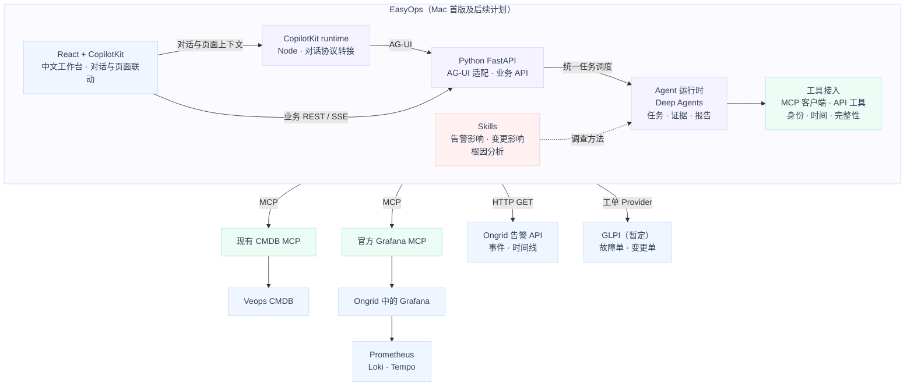

# EasyOps AI 运维平台总体设计

> 公开副本说明：本文件保留历史设计的版本、架构决策与已实现/待验证边界，现场标识和私有材料索引已去除。服务A、服务B等名称仅是独立示意，不能据此反推某个环境。当前主入口为“运维工作台”，用户流程统一称“分析”；多用户、Chat 历史及附件以 [OpenSpec 主规格](../../openspec/specs/)为准。应用、数据库、执行器和测试面向 Mac 本机；外部源只读访问。历史设计不能代替当前规格或验收，当前公开部署参数见 [README](../../README.md)。

版本：v0.5
更新日期：2026-10-23，Asia/Shanghai（规划修订；保留 v0.5 架构基线）
状态：v0.5 设计基线及后续阶段计划。首版工作台已在 Mac 本机实现并启动，覆盖 Skill/MCP 管理、模型设置、持久任务与告警调查入口；实际验证、失败记录及剩余范围以[首版交付状态](../status.md)为准。未宣称全量 E 案例或用户验收通过。文件路径沿用 v0.1，便于既有引用继续访问。

EasyOps 采用 React + CopilotKit + Python Deep Agents，第一版即支持边聊边调查和页面联动，系统整体以简体中文向用户提供服务。Python Deep Agents 构建服务端运维 Agent：复用现有 Veops CMDB MCP，使用官方 Grafana MCP 查询指标、日志和 Trace，通过 Ongrid HTTP API 读取告警与事件，通过工单工具接入暂定的 GLPI。告警影响、变更影响与根因分析流程放在 EasyOps 的 Skill 中，由 Agent 调用工具执行，平台保存和校验证据。

Veops 是配置与依赖关系的数据来源；Ongrid 继续承担集中采集、遥测存储和监控告警；GLPI 暂定承担故障与变更工单。EasyOps 负责把这些信息关联成一次可追踪的调查。后续若 GLPI 不适合，可替换工单适配器并接入轻量 API 服务。

本次变更：按用户要求把 Skill、MCP 的在线查看、调用和配置纳入首版工作台，补齐草稿/发布/回退、依赖检查、指定 Skill 执行、工具试调、配置快照与调用记录；配套补充模型设置和基础运行概览设计。详细交互、服务端落点及验收见[工作台 Skill 与 MCP 管理设计](工作台Skill与MCP管理设计-v0.1.md)。后续实现见[Mac 应用说明](../../README.md)，设计要求与已验证范围分别记录。

历史来源边界：CMDB 的持续同步由独立基础设施负责。EasyOps 消费只读接口，来源系统的同步验证不等于应用、工单接入或业务分析验收。公开设计不包含该环境的资产数量、节点标签、部署版本或实施索引。

开发阶段部署决定：应用、数据库、执行器与测试均在 Mac 本机；外部 CMDB、监控和告警接口保持只读接入。首版代码和历史验证范围见[应用入口](../../README.md)，设计条目本身不代表全部功能已验收。

## 1. 目标与首期边界

### 1.1 三类业务目标

| 场景 | 输入 | 用户需要的结果 |
| --- | --- | --- |
| 告警影响分析 | Ongrid 告警、分析时间窗 | 告警对应哪个资源；哪些服务可能受影响；哪些异常已经观测到；涉及谁；有哪些数据缺口 |
| 变更影响分析 | GLPI 变更单、计划或实际执行时间 | 变更对象与内容、潜在影响范围、关注的依赖和指标、验证与回退建议；实施后补充实际观测 |
| 故障根因分析 | 告警或故障描述、故障时间窗 | 故障时间线、候选原因、支持与反驳证据、排除项、下一步检查和根因确认程度 |

### 1.2 实现顺序

先完成“人工选择一条告警或用中文提出调查请求 → 确认目标与窗口 → 边聊边查询依赖、遥测和相关工单 → 联动展示过程、影响报告与证据”的闭环；随后扩展变更影响分析和 RCA。对话、页面联动以及 Skill/MCP 在线管理均为首版能力，Webhook 自动触发在人工链路稳定后接入。

首期以一个服务端 Agent、少量并发、只读调查为边界。应用运行在 Mac，模型推理使用外部模型 API。用户入口为 EasyOps Web 页面及其后端 API。

前端采用 React + TypeScript + CopilotKit，普通业务组件默认使用 shadcn/ui；Node CopilotKit runtime 对接 Python FastAPI 的 AG-UI 适配入口。用户可以在同一调查中查看实时进度、追问、补充条件、选择歧义对象，并从回答定位到 CI、时间线和证据。具体交互及执行边界见第 8.4～8.6 节。

工作台还提供 Skill 管理、MCP 管理、模型与运行配置、调用记录及基础运行概览。用户可在线编辑和发布 Skill、选择版本发起调查、配置 MCP 连接并试调只读工具；配置生效和运行中任务的版本边界见第 8.7 节。MCP 配置管理的是 EasyOps 连接及工具开放范围，远端服务的安装升级仍由部署操作管理。

首期不实现自动修复、SSH/Shell 执行、自动审批或修改源系统状态；不重新建设监控采集和 CMDB；不把多 Agent、向量数据库和知识库检索设为前置依赖。实验数据准备与故障注入独立于调查工具，后续实施时按明确的实验范围执行。

### 1.3 设计基线中的基础与建设范围

| 部分 | 当前基础 | 本项目需要完成 |
| --- | --- | --- |
| Veops / CMDB MCP | 历史设计已有配置关系和只读工具接入基础 | EasyOps 客户端、身份映射、Skill 与校验逻辑迁移；各部署自行核对工具目录 |
| Ongrid | 历史设计参考既有监控与告警能力 | Grafana 数据源核对、告警 API 接入、身份映射与场景验收；源码能力不代表现场启用 |
| 官方 Grafana MCP | 历史预研有独立部署和信号对照记录；具体环境不公开 | 应用工具白名单、窗口/预算包装和证据服务；预研不等于完整分析验收 |
| GLPI | 用户暂定选型；本轮明确暂不部署工单系统 | 后续单独安排部署、最小组织与用户配置、工单字段核对、API 接入、实验数据准备 |
| EasyOps / Deep Agents | 已实现 Mac 首版单执行器、任务、证据、报告、配置和 PostgreSQL | 完整业务案例和后续恢复验收，见交付状态 |
| React / CopilotKit | Mac 中文工作台已集成，Node/AG-UI 读取同一持久任务；已做真实浏览器检查 | 持续按实际业务场景验证，不以构建通过代替调查正确性 |
| Skill / MCP 在线管理 | Mac 首版已实现管理、版本发布、依赖校验、试调、审计及配套设置 | E16～E21 的全量组合验收与后续案例扩展 |

上述“已有”描述历史设计基础，不代替具体场景验收。自动 RCA 是否启用及诊断是否正确需要单独验证；GLPI 尚未接入，应用首版在 Mac 运行。历史首败和已验证范围见[交付状态](../status.md)。

## 2. 总体架构与职责

这是逻辑调用图，实线箭头表示请求方向，虚线表示调查方法约束，反向消息与状态流省略。React 提供业务工作台，CopilotKit 负责对话、共享状态与交互组件，AG-UI 连接页面交互和 Python Agent；MCP 连接 Agent 与数据工具。任务、证据、报告与校验由 EasyOps 实现，Skill 提供方法，实际调用由运行时完成；告警 API 工具位于 EasyOps 进程内。工单 MCP 初期也随应用进程部署，部署边界见第 11 节。Grafana MCP 通过 Grafana 数据源接口/代理访问三个后端，不经过 Ongrid AI，也不依赖再接一套 Prometheus MCP。

公开 [PNG 架构图](assets/architecture-v1/EasyOps-AI运维平台架构-v1.png) 已替换为完全新制的通用职责示意，不是部署截图或历史验收证据；技术选型以本节逻辑图、正文和当前规格为准。

| 模块 | 负责 | 主要产出 |
| --- | --- | --- |
| React 工作台 / CopilotKit | 中文对话、调查过程、页面联动、Skill/MCP/模型配置与调用记录 | 用户请求、版本草稿、调查与试调入口、证据视图、交互卡片 |
| Node runtime / Python API | AG-UI 转接、业务请求、消息接收、状态映射与鉴权 | 关联到任务的消息和事件；统一进入服务端调度 |
| Agent Runtime | 模型调用、Skill 加载、工具执行、上下文管理 | 一次调查的执行状态与结构化分析 |
| 任务与检查点 | 排队、执行租约、超时、取消、恢复 | 可持久化的 run 与检查点 |
| 身份与时间关联 | 统一 CI、服务、部署、告警目标和工单引用 | 身份解析结果、固定分析窗口 |
| 证据与报告 | 保存工具输入输出、检查完整性、渲染事实与分析 | 原始证据、结构化报告、中文报告 |
| 工具接入层 | 加载 MCP 工具、调用 Ongrid API 与工单 Provider，校验请求并记录结果 | 保留原生返回的证据记录及模型视图 |
| 能力与运行配置管理 | Skill 内容、MCP连接/工具目录、模型配置、版本发布和依赖校验 | 不可变版本、生效配置、凭据引用、变更记录；管理请求走业务 API |

EasyOps 的结果先在自身页面展示。首期不回写 Ongrid 调查报告或 GLPI 工单；源系统写回以后作为独立功能设计。

## 3. Agent 与 Skill 设计

### 3.1 Deep Agents 的使用方式

采用 Python Deep Agents SDK 嵌入 FastAPI 后端，其底层 LangGraph 用于执行状态与检查点。React + CopilotKit 提供交互，Python AG-UI 适配层对接统一任务管理和业务 API；不以封装 Qoder 界面或后台启动 Qoder CLI 的方式运行平台。CopilotKit 的框架中间件负责协议与上下文适配，不替代任务租约、预算或证据校验；适配层不得绕过队列直接启动第二个调查执行器。

首期只有一个调查 Agent，按任务类型或用户选择的版本显式加载相应分析 Skill，并可加载通用 CMDB 查询方法。指定 Skill 必须实际进入当前 attempt，不能仅作为可选名称由模型自行决定是否读取。关闭非必要的通用子 Agent 和任意代码执行能力；为读取 Skill 保留必要的受限文件读取。工作台管理模块可以编辑草稿、发布版本，调查执行器只读访问所固定的版本，调查产物进入独立目录。

源系统权限、时间窗校验、结果预算和报告完整性检查由程序执行。Skill 提醒模型遵循方法，不能代替这些约束。

日志、工单正文及源系统返回中的命令、链接和指令都作为数据处理，不成为 Agent 的新指令。仅注册所需只读工具，任意终端、网络地址访问和源系统写入不进入工具面。

### 3.2 Skill 清单

| Skill | 调查方法 | 必须交付的内容 |
| --- | --- | --- |
| `cmdb-query` | 发现模型/schema，查询 CI，按关系方向查全声明范围 | 资源、登记关系、来源时间、完整性与未知项 |
| `alert-impact-analysis` | 定位告警目标，查询反向业务依赖及相关遥测 | 潜在影响与已观测影响分别列出 |
| `change-impact-analysis` | 读取变更对象/计划，检查依赖和风险，实施后核对遥测 | 计划与实际时间、影响范围、验证与回退建议 |
| `incident-rca` | 建立时间线，提出假设，取证并寻找反证 | 候选原因、证据引用、排除项、确认程度 |

三个分析 Skill 不等于三个独立 Agent。首期任务类型由用户入口确定，避免仅靠模型猜测任务类别。RCA 的步骤、分支、反证与报告要求详见第 7 节；它们将写入版本化 Skill，不另实现一套由 Ongrid AI 代跑的根因分析入口。

Skill 的输入至少包含任务类型、目标/事件/工单引用、环境、固定分析窗口、可用工具清单和预算；输出遵循统一报告结构。工具名称、标签和查询模板从已核对的工具清单及查询目录读取。Skill 不能将 Ongrid 内部工具名称当作 EasyOps 已具备的工具。

首期结构为每个分析 Skill 的 `SKILL.md`，附少量 `references/` 保存工具映射、报告示例和查询目录引用。共同的身份、时间与完整性规则由平台提供。Mac 首版已创建并发布 `cmdb-query` 和 `alert-impact-analysis`；变更与 RCA Skill 属后续 P3。

在线管理补充内容浏览/编辑、导入草稿、校验、版本差异、发布启停和试运行。标准 Skill 内容与 EasyOps 的输入 schema、必需/可选工具绑定分别存储；正文及 `allowed-tools` 声明不授予工具权限。草稿试运行冻结测试快照并进入统一队列，正式任务引用已发布版本。详细规则见[管理设计第 2 节](工作台Skill与MCP管理设计-v0.1.md#2-skill-内容依赖与执行)。

### 3.3 既有 Skill / Guard 方法迁移

保留现有动态模型发现、顺序查询、分页收齐、范围对账、来源时间与未知项处理方法。移除只适用于 Qoder 的调用入口、Hook 安装路径和本机文件预览约定。

原 Guard 的参数前检、证据续读与校验、查询范围对账、独立事实保存，由 EasyOps 的工具包装器和证据服务承接。现有 CMDB MCP 的六工具签名、权限和结果保持兼容；新增统一字段放在 EasyOps 的证据记录中，不强改源 MCP 契约。

迁移验收使用已有 CMDB 问题及失败样例，分别检查工具结果与自然语言首答。复制 `SKILL.md` 或接通 MCP 不视为迁移完成。

## 4. 工具接入：MCP 与 HTTP API

现有 CMDB 工具沿用原契约；Grafana 工具名来自官方实现，按选定版本的 `tools/list` 核定。Mac 首版已实现 `alert_detail` 进程内只读调用及告警列表入口；其余 `alert_*`、`ticket_*` 仍按后续计划。远程 MCP 使用 Streamable HTTP，已有 CMDB MCP 沿用当前 HTTPS 与证书校验，无需新建告警 MCP Server。

业务调用由服务端执行。工具包装仅处理参数校验、环境配置、预算、结果保存与必要的模型视图，不复制官方查询实现，不新增一个转发官方 MCP 的网关服务。源系统地址和凭据不交由模型自由指定。

用户在工作台配置服务地址、认证引用、超时和工具白名单，Python 后端执行连接测试、完整工具发现及试调。目录保存每个服务下的原工具名与 schema 快照，跨服务同名工具用稳定别名区分；新增工具或 schema 变化先显示差异，不自动扩大开放范围。只读属性不能仅依据源端 `readOnlyHint` 判断。MCP 原生协议调用、人工试调和 Agent 调用共用校验/证据逻辑，详见[管理设计第 3 节](工作台Skill与MCP管理设计-v0.1.md#3-mcp-连接工具发现与试调)。

### 4.1 CMDB MCP

继续使用现有工具：`cmdb_list_models`、`cmdb_get_model_schema`、`cmdb_search_cis`、`cmdb_get_ci`、`cmdb_query_aggregates`、`cmdb_query_relations`。

遵循当前“发现 → schema → 定位 → 关系/统计 → 对账/报告”的契约；保留原始 `request_id`、来源信息、`partial`、`mixed_revision` 和不支持历史查询等状态。首期对 CMDB 业务工具顺序调用。

依赖图的原始方向保留。例如 `服务A → 服务B → 数据库` 表示前者依赖后者；从数据库分析可能受影响的调用方，需要沿相应依赖边反向查找。部署、归属和管理关系不能全部当作调用依赖使用。

### 4.2 官方 Grafana MCP

采用 [grafana/mcp-grafana](https://github.com/grafana/mcp-grafana)，复用 Ongrid 部署中的 Grafana 及其数据源。P0 选择通过兼容验证的发布版本，固定镜像版本/摘要及工具 schema；不把当前主分支能力直接当成所有发布版本的保证。首期不另部署 `prometheus/prometheus-mcp`，避免同一信号重复暴露两套查询入口。

| 用途 | 官方工具候选 | EasyOps 使用约束 |
| --- | --- | --- |
| 数据源、指标及标签发现 | `list_datasources`、Prometheus 元数据/标签工具、Loki 标签工具、Tempo 属性工具 | 仅开放示例服务场景需要的发现工具；记录数据源 UID、实际标签、单位和版本 |
| 指标查询 | `query_prometheus` | 明确 instant/range；range 使用绝对 `startTime/endTime` 和 `stepSeconds`，instant 使用明确评估时间 |
| 日志查询 | `query_loki_logs` | 显式 `startRfc3339/endRfc3339`、对象筛选与 `limit`；保存原生截断、范围和紧凑格式元数据 |
| Trace 检索 | `search_tempo_traces` | 显式 `start/end` 与实际 TraceQL；按选定 schema 使用参数，不能假定它支持自定义 `limit` 或分页游标 |
| Trace 详情 | `get_tempo_trace` | 使用实际 schema 的 Trace ID 字段；保留服务、span、父子关系及字段缺失情况，不假定搜索摘要等于完整 Trace |

这些工具名和参数由 2026-10-21 官方源码核对，实际注册以 P0 锁定版本为准。启动配置仅启用所需数据源与查询类别、禁用写工具；EasyOps 再按确切工具名筛选，Grafana 告警、Incident、管理和写入工具不进入本项目告警链路。源端使用专用查询身份，并验证该身份能读取目标数据源。

每个部署应读回实际数据源 UID、版本、Grafana 子路径和访问权限，由仓库外配置提供。数据源后端地址及必要路径前缀由部署者确认，EasyOps 不预置 UID、版本、主机或存储端口。

P0 为示例服务场景维护一份小型查询目录：指标/标签/单位、服务到遥测标签的映射、经过核对的 PromQL/LogQL/TraceQL 示例及适用窗口。先复用官方发现能力和配置，模型不得根据服务名猜造指标；目录仅覆盖实验场景。

**结果边界：** 当前官方 Tempo 工具请求 `application/vnd.grafana.llm` 简化格式；Tempo 文档说明它可能变化，不适合作为稳定的程序契约。保存 MCP 原生返回、版本和解释器版本；模型阅读视图与可用于程序核验的字段分开。关键字段缺失时报告缺口，不补造 span。若案例确实要求完整机器可读 Trace，而选定工具无法提供，单独增加标准 JSON 查询作为有验收依据的补充，不预先重写整套可观测 MCP。[Tempo API 格式说明](https://grafana.com/docs/tempo/latest/api_docs/)

Grafana MCP 的日志限量/紧凑返回等能力优先使用，平台仍保存实际限制。所有带窗口查询必须由调用包装器核对绝对时间；Trace ID 查询按后端语义检索，并单独标记该 Trace 与故障窗口的关系。首版为一个实验域，不把任意查询表达式的标签注入宣称为多租户隔离。

### 4.3 Ongrid 告警 API 工具

在 `easyops-app` 内实现轻量 `OngridAlertClient`，将现有 HTTP API 登记为 Deep Agents 可调用的只读工具。Ongrid 已有 `query_incidents`、`get_incident_detail`、`correlate_incident` 等内部工具；本版复用事件数据和 API，不重建告警子系统，也不假定这些内部函数已经有对外 MCP 接口。

| 拟定工具 | 功能 | 已有 HTTP 路由 |
| --- | --- | --- |
| `alert_search` | 查询候选事件，保留分页、实际筛选和扫描范围 | `GET /v1/alerts/incidents` |
| `alert_get` | 读取目标、标签、阈值及发生时间 | `GET /v1/alerts/incidents/{id}` |
| `alert_get_timeline` | 读取触发、确认、静默、恢复、通知等事件 | `GET /v1/alerts/incidents/{id}/events` |

以下是历史接入评估发现的限制类别。各部署必须按实际运行版本复核，不将这些历史观察直接推广为所有版本的接口保证：

- 列表实际下推 `status/severity` 和 `page/page_size`；HTTP 虽读取 `query`，当前 Service 未将它用于过滤。不要把关键词、时间、设备筛选宣称为已生效。需要这些条件时，在明确预算内逐页读取并过滤，回显原生筛选、平台筛选、已扫描页与未覆盖部分。
- API 使用 `fired_at/last_fired_at`，目标为 `target_type/target_id` 加 `labels`；平台保留原字段再建立 CI 映射。不能把内部工具的字段名或设备编号直接当作 Veops CI。
- 列表 `total` 在计数失败时可能退化为本页条数，因此仅作源端提示；不凭它证明搜索完整。分页期间也无跨请求快照保证。
- 时间线当前提供 `limit`，没有已核对的续读游标；响应 `total` 是本次返回数。达到上限或无法证明覆盖时，标记局部时间线，不能声称事件历史已查全。
- `last_fired_at` 落在窗口内、`fired_at` 落在窗口内和“窗口内曾处于告警状态”是不同条件。复发事件需参考事件时间线；无法重建完整状态时只报告已观测事件，不能把过滤结果当作全量历史状态。

地址前缀、认证方式、证书和权限沿实际部署核对；失败不能伪装为零事件。首期手工选择确切 incident ID 发起调查，可直接读取详情与时间线，不依赖先完成全库告警搜索。

Ongrid 的 `GET /v1/alerts/incidents/{id}/investigation` 可读取已有分析，作为以后对照评测的可选来源；主 RCA Skill 默认不读取它，避免把另一份 AI 判断当作独立证据。首期不暴露确认、静默、关闭或 `POST .../investigation` 重跑工具。Ongrid 原有自动调查开关不在本次接入中修改。

### 4.4 工单 MCP 与 GLPI 可替换适配器

工单 MCP 对外暴露稳定的故障/变更语义，对内通过 `TicketProvider` 调用 GLPI。初期随 `easyops-app` 同进程挂载独立 MCP 端点，保留独立工具契约，不建设混合可观测与告警的通用 MCP 服务。轻量 API 替代方案实现相同 Provider 和字段语义，无需更改分析 Skill。

| 工具 | 功能 |
| --- | --- |
| `ticket_search_incidents` | 按声明条件查询故障工单，支持续读 |
| `ticket_get_incident` | 获取故障详情、人员、时间、关联对象和解决内容 |
| `ticket_search_changes` | 按对象、状态或时间语义查询变更单 |
| `ticket_get_change` | 获取变更内容、实施/回退计划、计划和实际时间、审批及执行状态 |
| `ticket_get_history` | 读取指定故障/变更的跟进、任务及可用状态历史 |

统一工单视图至少包含 `source_system/source_id/type/title/status/priority`、人员、创建/更新时间、关联 CI 引用、处理记录。变更另外包含 `planned_start/planned_end/actual_start/actual_end`、实施/回退计划和执行结果；无法取得的字段返回 `null` 并说明原因，不从审批或关闭时间推算实际执行时间。

Provider 同时保留 `source_status/source_priority` 与规范化字段。通用 `status` 使用 `new/in_progress/pending/resolved/closed/cancelled/unknown`；`priority` 使用 `critical/high/medium/low/unknown`。变更另外提供 `change_phase`，区分草拟、评估、审批、计划、实施、复核、结束、拒绝/取消和未知；映射表随 Provider 版本保存，不识别的新源状态标为未知。

流程状态与实际执行分开：`execution_state` 仅在有执行记录时映射为 `not_started/in_progress/completed/failed/rolled_back`，否则为 `unknown`。批准、计划或关闭状态本身都不能证明已经执行；Provider 替换验收需保持这些语义，而不只是字段同名。

搜索变更必须区分计划窗口与实际执行窗口；创建时间不能代替发生时间。源端无对应字段或筛选时，返回不支持/未知或受限扫描结果。

GLPI 暂定使用其受支持稳定版本。实施前核对故障、Change、跟进/任务等对象在所选 API 版本中的读写覆盖。新旧 API 不假定等价；新版 OAuth2 的 client credentials 不泛化为普通工单访问方式，按实际支持的用户身份认证接入，凭据只在适配器侧管理。

Veops 继续作为权威 CMDB。GLPI 仅保存必要的 CI 外部引用；如需本地最小资产引用或自定义字段，先验证其实现方式，不同步出第二套权威拓扑。首期不暴露工单创建、审批、派单或关闭工具；实验数据由独立准备入口写入。

## 5. 跨系统身份与时间

### 5.1 资源身份

EasyOps 保存轻量映射索引，不保存整套 CMDB 副本。映射记录包含：外部系统/实例、对象类型、原生 ID、环境/集群/命名空间、Veops CI 身份、匹配来源、验证时间与状态，以及不可变映射版本和可取得的 `valid_from/valid_to`。修改映射产生新版本，保留旧记录；有效时段未知时留空，不把验证时间当作历史生效时间。

| 对象 | 优先使用的身份 | 需要保留的边界 |
| --- | --- | --- |
| 逻辑服务 | 既有稳定业务 service-id、环境、服务命名空间 | `服务A` 等名称只作辅助，不能跨环境全局唯一 |
| K8s 工作负载 | 集群身份、namespace、kind、UID | Pod 重建和同名对象需区分，不能只按 IP |
| 节点/主机 | 当前 Node UID、主机稳定身份及已有 Veops 映射 | Ongrid device_id、Veops CI ID、Node UID 不是同一个编号 |
| 遥测服务 | 实际 `service.name`、`service.namespace`、环境/集群标签 | 三后端标签名可能被规范化，需记录真实映射 |
| 工单对象 | `source_system + source_id` 与明确的 CI 引用 | 数字 ID 不得跨 GLPI、Veops、Ongrid 直接等同 |

优先使用显式 ID 映射；无 ID 时采用环境等约束下的唯一匹配。多个候选时保留候选并进入 `needs_input`，无映射时给出缺口，不静默选第一个。名称模糊匹配只能产生候选。历史调查还需确认映射适用于故障窗口；只有当前名称唯一或当前部署关系，不能证明旧故障属于该对象。缺少历史身份依据时保留当前候选，关键归属未定则进入 `needs_input`，不关联到同名新 Pod/Node。

### 5.2 时间语义

后端统一保存 UTC/RFC3339，页面默认显示 Asia/Shanghai。每次任务开始前固定主故障窗口 `analysis_start/analysis_end`。人工指定窗口优先；只有 incident 时，拟默认取 `fired_at` 前后各 15 分钟，结束不晚于任务开始时间，并向用户展示。该起始值在 P0 按告警延迟及保留期验证；时间异常或事件跨多个故障时段时，保留歧义并要求明确目标时段。

同一故障范围的指标、日志、Trace 使用同一个绝对窗口。基线、实际变更检索和恢复验证允许有不同窗口，但每次调用必须记录 `window_kind=fault|baseline|change|validation`、绝对起止时间和选择原因，由程序检查范围及预算。基线通常取故障前等长窗口，但必须检查是否已有异常、负载是否可比；不把“更早”自动等同健康基线。扩窗是显式补查，不覆盖原故障窗口；不允许各工具自行使用随调用时刻漂移的 `now-15m`。

同时保留事件发生时间、源端采集/观察时间、源端修改时间和本次读取时间。CMDB 没有历史快照时，只能引用“当前登记关系＋其来源时间”辅助分析，不能重建故障当时拓扑。Ongrid 的变更工具仅查询产品自身操作审计，不能代替业务发布和变更工单。

遥测保留期以已核对配置及后端能力登记；仅凭空结果不能区分无流量、采集缺失和数据过期。不能证明原因时报告“该窗口未取得数据，原因未知”。

## 6. 工具结果与证据契约

### 6.1 EasyOps 证据视图与原生响应

统一字段属于 EasyOps 保存的证据视图，不要求官方 Grafana MCP 或现有 CMDB MCP 改动契约。视图包含 `schema_version/evidence_id/source_system/source_instance`、工具及 schema 版本、`effective_query`、窗口类型、`read_started_at/read_finished_at`、原生响应引用、可核验数据、`warnings` 和 `completeness`。`request_id`、游标及截断字段仅在来源提供或平台确实实现相应语义时记录，不伪造源端能力。

Ongrid API 工具和自研工单 MCP 同样经过这个记录过程。MCP 文本、结构化内容和错误分别保存；若从文本提取程序字段，记录解释器版本和提取失败。无法可靠提取的内容可作为带来源的阅读材料，但不能直接进入自动计数或拓扑事实。

`completeness` 必须包含状态、限制范围和原因。允许状态为 `complete/partial/unknown`：`complete` 仅表示完成所声明的查询，不表示全局没有遗漏、监控健康或根因确认。按第 6.3 节区分原生响应与处理后的保存副本；平台不能因调用成功就把未知覆盖提升为 `complete`。

| 结果情况 | 处理 |
| --- | --- |
| 查询成功但结果为空 | 保留实际范围和覆盖信息，不推断业务正常或关系不存在 |
| 达到条数/字节/时间预算 | 标 `partial`，列出已取内容和未覆盖部分 |
| 源端无法证明覆盖 | 标 `unknown` 或带具体限制的 `partial` |
| 参数、权限、超时或后端错误 | 保留 MCP/API 错误与平台结构化错误码，不伪装为空数组 |

认证失败和校验失败不自动换数据源重查。仅明确的可重试错误允许有界重试，遵守任务总预算；所有失败和重试均留存。

### 6.2 分页与源端限制

先核对工具实际暴露的能力，官方工具没有游标时，不在证据视图中虚构一个。日志可按明确子窗口补查，但必须处理边界重叠、同时间戳、多流和重复记录，不能使用“上一条时间＋1ns”冒充可靠翻页。无法证明收齐时保留截断范围。Trace 搜索不保证穷举，单条 Trace 也需说明采样、字段和 span 覆盖。Prometheus 范围查询的完整性指指定 step 和范围，不等于返回所有原始采样。

对确实提供游标的工具，游标绑定数据源、身份范围、原查询和窗口，不能在续读时更换条件；保存每页及汇总后的原始结果。查询期间数据仍可能变化，不宣称跨系统原子快照。

### 6.3 EvidenceRecord

EasyOps 为每次调用生成 `invocation_id`，为可保存的证据生成 `evidence_id`，保存 `purpose/config_revision`、工具名/版本、实际参数、数据源 UID 或 API 路径、原始响应、可取得的来源请求编号、读取时间、原始字节摘要和完整性。调查调用关联 run/attempt，手工工具试调关联独立 Invocation；预检拒绝等未取到响应的记录没有原始证据，不能补造。正文引用 `evidence_id`，页面可打开对应证据。官方 MCP 返回是该次调用的原始响应，不因此称为未经转换的后端原始遥测。

工具包装器在模型返回报告前保存证据；模型只能引用本次 run 已注册且可访问的证据。SHA-256 用于发现保存后的内容变化，不证明源系统数据真实或因果成立。

原始响应受文件大小及磁盘配额约束。被拒绝、校验失败或单个逻辑响应的传输分段尚未收齐时，不引用其内部片段作为事实；已有 CMDB 的 delivery 续读沿用原整体验证要求。业务分页未全部完成，但某些页面已完整保存并验证时，可以引用这些记录的个体事实，明确整体为 `partial`，不得据此给出全量名单、精确总数或全局不存在的结论。

凭据、认证请求头不写入证据。允许整体保存的响应标记为 `retention_mode=original`；必须在保存前脱敏或删减的响应标记为 `redacted`，记录处理规则版本、删减字段/范围和对核验的影响，证据页面明确显示“处理后副本”。若删去身份、时间、计数等必要字段，相应事实不可据此核验，不能继续宣称该项完整。保存副本与模型视图分别记录版本/摘要；即使保留接收时摘要，也不能据此宣称未保存的原文仍可复核。报告不记录模型隐藏推理链，只记录调查步骤、假设摘要、工具输入输出和用户可复核的依据。

## 7. 三类调查流程

### 7.0 参考 Ongrid 的方法与 EasyOps 的补齐

流程参考 Ongrid 的事件调查、信号关联、拓扑扩展与报告组织方法，并保留各方法的边界。EasyOps 自行实现任务、证据和报告契约，不引入来源系统的内部设备编号或整个运行时。

| Ongrid 可借鉴的做法 | EasyOps 的采用方式与补齐 |
| --- | --- |
| 先读取具体事件，再围绕窗口收集多类信号 | 用 Ongrid API 定位事件，用官方 Grafana MCP 按目的取证；每步明确对象、窗口和待回答问题，不为凑信号数盲查全部工具 |
| 用拓扑上溯原因、向外分析影响 | 以 Veops 关系语义为准；调用依赖、部署和归属分层，保留原边方向与来源。Ongrid 拓扑只作后续可选来源，不能自动替代 CMDB |
| 排时间线、逐层追查候选原因 | 补入指标基线、采集延迟/时钟误差、健康对照和反证。最早观测异常只能用于排序候选，不能直接确认根因 |
| 查询告警附近的变更 | 读取 GLPI 实际实施记录与目标，必要时用遥测核对生效；Ongrid 的产品审计只覆盖经其 UI/API 发起的操作，不能代替业务发布历史 |
| 上溯到具体对象或信号不足时收敛 | 能指向对象不等于因果确认；“拓扑没有更多边”可能是数据缺失，停止时保留最深可证实事实和未验证假设 |
| 限制重复空查、输出证据与建议 | Skill 规定转向和收尾方法，运行时执行调用/时间硬预算。原始证据保留，报告通过引用、范围和事实核验后展示 |
| 按需查知识或委派专家 | 首期用已知工单和查询目录作线索，不建设必选 RAG，不启用多 Agent；主机进程、文件或 K8s Events 工具缺席时明确缺口，不偷偷改用 Shell |

Ongrid 自带 `related_alerts` 在所核对版本中主要按同设备/同无设备标识和邻近时间检索；EasyOps 不将它当作全业务关联结果。告警、CMDB、工单和遥测各自保留来源，冲突不由模型静默覆盖。

### 7.1 告警影响分析

`alert-impact-analysis` 按以下步骤组织调查：

1. **定事件。** 读取指定事件和时间线，确认告警规则、目标、实际发生时段与复发情况；区别阈值触发、通知时间和业务开始异常时间。
2. **定对象。** 将告警目标和标签映射到 Veops CI、环境及部署对象；名称重合或映射冲突进入 `needs_input`，保留已经取得的事实。
3. **列潜在影响。** 读取模型和关系语义，从候选故障资源反向找调用方，分别记录业务依赖、部署与归属路径。按 CI 去重并处理环路；若跳数、分页或节点预算不足，则只给已遍历范围，不声称全量影响名单。
4. **验证实际异常。** 对入口和关键依赖查询请求量、错误率、延迟、可用性等适用指标，再根据异常选择日志和 Trace。共享主机上的其他服务可作为对照；抽查代表性服务只能证明这些服务，不能自动推广到整张图。
5. **补业务信息。** 查询负责人、业务归属及关联故障/变更单；没有工单接入时说明该维度未检查，不写“没有近期变更”。业务交易量和损失只在存在已验证业务指标时估算。
6. **分层输出。** 分别列出登记依赖上的潜在影响、遥测支持的已观测异常、已查询但未发现异常、尚未查询/无法判断的对象；附路径、时间窗、证据和覆盖限制。

程序核对名单、方向、分页和引用，Skill 负责判断接下来查什么及如何解释。共享节点表示共同风险；“依赖存在”与“业务已经受影响”须各有相应证据。

### 7.2 变更影响分析

`change-impact-analysis` 先区分实施前评估与实施后复核：

1. 读取变更单、目标 CI、内容、计划/实际时间、实施步骤、回退计划和执行记录；批准、关闭与实际实施保持独立语义。
2. 在 Veops 上分析目标的调用依赖、部署范围及业务归属，标注当前登记关系的时效，列出需要观察的入口与下游。
3. **实施前：** 根据变更机制列出风险假设、可比较的指标基线、验证条件及回退观察项。未来窗口无遥测时输出预测性影响，不虚构实施效果；回退条件结合工单计划和已验证阈值，不临时编造 SLA。
4. **实施后：** 按实际执行时段比较实施前、实施中、实施后的指标和相关事件，查询异常日志/Trace；核对流量、版本、其他同期变更及已有故障等干扰因素。
5. 有异常时可转用 `incident-rca` 的候选检验方法，复用已存证据并记录窗口，避免重复查询；变更影响报告本身不自动升级为根因报告。
6. 输出预期影响、已观测变化、未验证对象、证据和后续检查。实际执行时间或结果不明时明确保留未知，工单关闭不能证明成功或恢复。

### 7.3 故障根因分析

`incident-rca` 使用“症状界定 → 时间线 → 候选 → 有目的取证 → 反证 → 分级报告”的循环。它是可选择分支的调查方法，模型可按已取得证据调整顺序；固定输入、范围、预算和证据规则由运行时执行。

| 步骤 | Skill 要求的动作 | 需要留下的结果 |
| --- | --- | --- |
| 1. 确认问题 | 读取事件及目标，固定窗口；先判断已有证据描述的是业务故障、告警规则问题还是采集缺失 | 具体症状、身份、时间和当前缺口；不先预设某个组件故障 |
| 2. 建立基线和时间线 | 对入口及关键依赖比较故障/基线指标，整理日志、Trace、告警和实际变更的发生时间 | 带来源的时间线，区分事件时间、入库时间和读取时间；标注采样/时钟/告警评估延迟 |
| 3. 提出少量候选 | 结合依赖、最早观测异常、实际变更、错误特征提出可检验机制；初始最多保留 3 个活动候选 | 每个候选写明“若成立应看到什么、什么证据会反驳、下一步检查什么” |
| 4. 逐步检验 | 每次选择最能区分候选的查询：指标趋势、相关错误、同一 Trace 的调用关系、受影响/对照实例、实际实施记录等 | 支持证据、反证、尚缺信息；避免每轮把所有工具重查一遍 |
| 5. 沿因果候选继续追查 | 按 CMDB 的关系语义和 Trace 调用关系决定是否追查依赖；区分数据库、客户端、网络和资源竞争等可能机制 | 每条候选因果边说明机制和证据，登记关系与实际调用分别引用；冲突先保留并检查 |
| 6. 检查替代解释 | 主动检查至少一个与当前主要候选竞争的解释；利用健康实例、其他路径或已执行的恢复/对照记录检验 | 为什么支持该候选、为什么其他候选被削弱；无法检查时明确证据缺口 |
| 7. 判断是否可以收敛 | 检查证据是否能解释症状及影响范围；若数据、权限、工具或预算不足，停止该分支并保留尚未排除项 | 候选状态、最深可证实事实、限制和可执行的下一步检查建议 |
| 8. 生成并核验报告 | 将事实、假设、因果判断和建议分开，引用本次 run 的证据；程序检查对象、窗口、引用和覆盖 | 分级 RCA 报告及可打开的原始证据，不输出隐藏推理链 |

候选记录使用 `hypothesis_id/target/mechanism/supporting_evidence/counter_evidence/missing_evidence/next_check/status`；这是可审阅的调查摘要。状态可为 `open/supported/rejected/unresolved`，用于表达候选进展，不代替最终根因确认程度。多个原因可以并存，不强行选出唯一源头。

必须补齐的判断规则：

- **时间先后只是一项条件。** 最早被观测到的异常可能受采样、日志延迟、告警周期和时钟影响；若时间精度不能区分先后，就保留未知。最慢 span、最高 CPU 或最近变更均不能单独确认根因。
- **图的尽头不代表因果的尽头。** CMDB 无更多登记关系、Trace 采样缺失、工具不可用时，只能写“目前无法继续验证”。人工声明关系不能自动升级为故障时实际调用。
- **变更必须核对目标与实际生效。** 工单标题相似、计划时间接近、审批或关闭均不足；需要实际实施记录、版本/配置证据或能够解释故障机制的其他证据。历史工单是线索，不是本次原因证明。
- **统计与样本分开。** 错误量/比例优先用范围明确的指标或日志聚合；日志样本和选出的 Trace 用于解释机制，不能用于直接推算全量故障占比。低流量下的分位数和基线比较需说明限制。
- **区分组件耗时和故障位置。** 示例调用链的数据库 span 覆盖 服务B 客户端连接、执行和取结果，不等于 PostgreSQL 内部执行耗时。没有数据库服务端、客户端或网络侧证据时，可定位到调用阶段，但不能声称已经证明数据库内部根因。
- **复用证据不能制造独立验证。** 同一条数据经多个工具或另一份 AI 报告转述仍是同一来源。恢复验证只使用已经发生且可核对的操作/对照记录；本 Skill 不执行故障注入、修复或回滚。

最终 `root_cause_status` 使用下列分级，避免把模型自行给出的百分比当准确率：

| 分级 | 判定要求 |
| --- | --- |
| `suspected` | 有可解释症状的候选及部分线索，缺关键机制证据或反证检查 |
| `supported` | 关键证据在对象、时间和机制上相符，检查了适用替代解释，但尚缺足够独立验证 |
| `confirmed` | 有直接机制证据，并有可核对的恢复、对照或等效独立验证；同时修改多项后的恢复不能单独证明某一项就是原因 |
| `undetermined` | 无法形成足够支持的候选，或重要证据冲突尚未消除 |

只读首期可以合理结束为 `supported` 或 `undetermined`。根因分级与任务运行状态分开：任务执行完毕不表示根因已确认，也不表示业务已恢复。

### 7.4 Skill 使用的工具映射

| 调查目的 | EasyOps 入口 | 与 Ongrid 参考流程的区别 |
| --- | --- | --- |
| 事件与时间线 | `alert_get`、`alert_get_timeline`，按需 `alert_search` | 调用 HTTP API；不假定内部 `get_incident_detail` 能远程直接调用 |
| 关联信号 | `query_prometheus`、`query_loki_logs`、`search_tempo_traces`、`get_tempo_trace` | 用官方工具按明确目的取证，替代对内部 `correlate_incident` 的依赖 |
| 身份与依赖 | 现有六个 `cmdb_*` 工具 | 按 Veops 模型、方向、关系层和完整性展开，不复制 Ongrid 的方向默认值 |
| 实际变更及历史故障 | `ticket_search_changes`、`ticket_get_change`、`ticket_get_history`、故障工单工具 | 增加 ITSM 上下文；工单事实仍需与实际执行证据核对 |
| 进程、文件、K8s Events、外部发布记录等 | 首期没有默认入口 | 必要时报告缺口；后续因案例需要才增加相应只读工具，不使用任意 Shell 兜底 |

工具清单或 schema 变化时更新映射和对应 Skill 示例，不让 Skill 引用未注册工具。GLPI 未接通时，告警/遥测分析可继续，但所有依赖工单维度的结论必须标明未检查；完整变更场景验收须待工单工具可用。

### 7.5 停止条件与交付内容

沿用 Ongrid 避免空转的思路：同一方向连续两次查询失败或无新证据后，检查数据源/标签/时间范围，选择有依据的新方向或停止该分支。正常的分页续读、有明确理由的时间窗对照不算无意义重复。完全相同请求的重复次数和总调用预算由程序限制；“下一步是否有信息增量”由 Skill 根据已有证据判断。

每个分支必须有清楚的问题和下一步检查。拟以 18 次调用作为 RCA 收敛目标，不作为因果正确性的条件；硬预算仍为第 8 节的 40 次调用/5 分钟。接近预算时优先整理已得事实，不能为了结束而虚构根因。身份不明、依赖数据缺失、证据冲突或没有可用工具均有明确终止原因，并按第 8 节转为适当状态。

报告至少回答：发生了什么、潜在和已观测影响、当前最有支持的解释及分级、关键证据/反证、哪些候选尚未排除、覆盖和数据缺口、下一步怎样验证。不同场景省略无关字段；候选表和调查步骤可展开查看，正文保持简明。

## 8. 任务、恢复与报告

### 8.1 任务状态

本版 `task/run` 均指同一调查任务，以 `run_id` 标识；`attempt` 是该任务基于一组固定输入和预算进行的一次执行尝试。以下状态约束作用于 attempt，任务列表显示当前 attempt 状态，旧 attempt 的终态、报告和证据不覆盖。

`queued → running → succeeded | partial | failed | needs_input | cancelled`。

`succeeded` 表示本次尝试按声明范围完成，不表示故障恢复或根因确认。`partial` 仍可交付已确认事实与缺口；无法取得必需输入或身份不明时进入 `needs_input`。补齐必需输入、修正目标或范围、改变主窗口、人工重跑均创建新 attempt，即使窗口保持不变也不恢复已终止的旧 attempt。新 attempt 取得新预算；引用旧证据时保留原 attempt、窗口与读取时间，重新检查其适用性。

| 终止条件 | 状态与保留行为 |
| --- | --- |
| 排队中取消 | 直接 `cancelled`，不领取执行 |
| 执行中请求取消 | 持久化 `cancel_requested`，停止派发新调用；尽力取消在途调用，收尾后 `cancelled`，保留已有证据 |
| 时间/调用预算耗尽，或恢复后无法补取源数据 | 有可交付的已验证事实则 `partial`，否则 `failed`；记录具体原因 |
| 身份歧义或缺少必需用户条件 | `needs_input`，保留候选与已取得证据 |
| 检查点不可信或版本不兼容而无法恢复 | 停止自动执行；已有可独立验证事实则 `partial`，否则 `failed`，原因明确为恢复失败 |

终态以数据库条件更新提交，取消与完成竞争时只允许一个终态；终态后不再发布新报告或修改既有事实。在途调用超时后不能继续把任务挂成 `running`。取消记录不是业务失败，也不表示源系统操作已回滚。

任务保存主分析窗口及具名补查窗口、触发来源、目标身份、模型/Skill/工具/schema 版本、`config_revision`、预算和报告版本。首期设计为调查、Skill 试运行、人工工具试调及模型样本测试共享一个执行槽，排队总计最多 10 项；默认调查执行窗口为 5 分钟、最多 40 次工具调用，参数可配置。`tool_call_count` 计执行器发起的工具请求，发现类工具、显式续读和工具重试均计次；18 次收敛目标使用同一口径。MCP 协议握手/`tools/list` 等控制请求单独限流计数，不混作模型工具调用；连接探测不启动第二个调查执行器。

另记 `source_request_count`，限制 EasyOps 直接向 Ongrid/GLPI 发起的 HTTP 请求，拟初始上限为每次调查 40 次，包含工具内部翻页和重试。这样一次 `alert_search` 不能隐藏无限扫描；达到任一预算即停止新请求。官方 MCP 内部向后端发出的请求不可由 EasyOps 完整计数，不宣称这个计数覆盖它们，而以所选工具的范围、限量和调用超时约束。

预算按 attempt 独立累计，由运行时计数并停止派发，不能只写在 Skill 中；5 分钟到期进入有界收尾，拟最多再用 30 秒完成在途调用取消、证据落盘和报告校验，超时则保留可验证证据并按终止规则落状态。收尾不追加取证或新的模型调用；模型报告未完成时，用已验证结构化事实生成简要事实与限制页。运行截止时间与累计调用数持久化，进程恢复不重置预算。这些是待验证起始值，不是现有容量结论，不能为了通过预算静默缩小调查范围。

### 8.2 持久化与进程恢复

采用 EasyOps 独立 PostgreSQL 保存任务、会话、消息、执行租约、事件、身份索引、报告索引、配置版本/凭据密文/变更审计和 LangGraph 持久检查点；原始证据及不可变 Skill 制品保存到独立持久卷。凭据主密钥独立于数据库配置，详见管理设计。数据库同时承担初期任务和消息队列，EasyOps 应用暂不引入 Redis/RabbitMQ；外部基础设施的队列不属于此项选择。CopilotKit Node runtime 的内存状态不是任务或聊天记录的权威存储。

实验版 API 和单调查执行器可在一个服务进程运行，领取任务必须先提交执行租约。进程重启后核对租约与检查点恢复；发现不兼容版本、无法确认的检查点或完整性问题时停止并显示原因，不直接重放未知状态。

恢复语义是至少一次执行，读取可能重复，模型输出可能变化，不承诺严格一次。证据以调用/attempt 编号去重，已保存内容不可覆盖。检查点、业务表与证据文件不是一个原子事务，恢复时要对账：调用结果未落盘则重新查询并记录新时间，不能假装原查询仍然成立。

进程恢复沿用原 attempt、输入、`analysis_start/end`、累计计数和截止时间；实际执行时间超过分析窗口结束不影响历史调查本身，但超过执行截止时间后只进入收尾。补充或修改输入、调整主窗口和人工重跑按第 8.1 节创建新 attempt。源数据已过期或不能补取时，保留原证据并按上表结束；版本/检查点无法恢复时也先明确结束旧 attempt，再由用户决定是否新建。

### 8.3 报告与界面

报告采用“结构化事实＋Agent 分析＋确定性渲染”。事实部分从已验证证据生成，分析部分必须引用证据；程序校验对象数量、引用、范围和来源状态。自然语言是否忠实仍单独验收，程序通过不能替代回答质量。

报告包含结论、主窗口及补查窗口、目标与身份解析、潜在/已观测影响、时间线、候选原因及支持/反证、根因分级、未知项、建议和证据索引。Ongrid 外部报告如在对照阶段使用，另记来源，不混入独立证据。非适用栏目省略，不用长篇工具日志填充正文。

Web 首版页面：调查列表、告警/工单入口、含对话区的调查详情、报告与证据、Skill 管理、MCP 管理、模型与运行配置、调用记录及基础运行概览。调查详情将中文对话与目标摘要、调查步骤、依赖关系、时间线和证据详情放在同一工作区。进度用 SSE 输出已持久化的事件序号，断线可续读；用户离开页面不自动取消后台任务。已存密钥不回显到页面或事件流。

### 8.4 首版对话调查与页面联动

第一版就支持边聊边调查。用户既可从告警入口发起，也可用简体中文描述问题；通过对话得到的目标、任务类型和分析窗口须转为可见的结构化输入，缺少必需条件时追问，身份歧义时展示候选卡片，不能仅凭自然语言猜定对象。

| 用户操作或调查事件 | 对话与页面行为 | 服务端处理 |
| --- | --- | --- |
| 选择告警、CI 或工单 | 将对象与环境显示为上下文标签；用户可在发送前检查 | 校验对象身份与访问范围，记录提交时的上下文版本 |
| 发起调查、执行工具 | 对话流展示阶段说明；步骤卡显示等待、执行中、完成、失败及已取得证据 | 状态与证据先持久化，再发布对应事件；不展示模型隐藏推理 |
| 运行中追问“为什么怀疑数据库”等 | 立即显示消息已接收/待处理；回答引用已保存证据并可定位相关卡片 | 同一执行器在当前工具调用结束后的安全边界处理，不并行启动另一条调查；模型调用仍受原预算和截止时间约束 |
| 运行中请求补查相关对象 | 显示待处理请求、采用的窗口与检查范围 | 不改变既定目标/范围且预算允许时，纳入当前 attempt 的待办并计次；新增窗口作为具名补查窗口保留。改变主目标、任务类型、声明范围或主窗口时按新 attempt 排队，不能静默改写当前输入 |
| 点击回答中的 CI、Trace 或证据引用 | 定位依赖图节点、对应时间线或证据详情；显示来源、查询时间和适用窗口 | 按稳定 ID 读取真实对象和证据；未取得的数据明确显示缺口 |
| `needs_input` 后选择候选或补齐条件 | 卡片提交后显示与原尝试的关联和新的执行状态 | 原 attempt 保持终态，按第 8.1 节创建新 attempt；不得把通用 HITL 示例的原尝试恢复语义直接套入本契约 |
| 调查完成后继续追问或补查 | 可继续阅读和定位原报告；需新模型回答或取证时显示新的 attempt | 基于固定输入创建新 attempt，并标明所引用旧证据的来源；不覆盖旧报告 |
| 修改页面选择但尚未提交消息 | 更新待发送上下文，已有调查仍展示其实际目标和窗口 | 页面浏览状态不直接修改运行中任务 |

前端只注册受约束的展示组件，例如目标选择、调查步骤、影响列表、时间线和证据卡。Agent 返回组件类型和结构化数据，由 React 渲染；CI 数量、关系方向、来源时间和完整性状态来自已验证数据。共享状态中区分用户的页面选择与后端发布的调查事实，前端工具仅处理定位、展开和输入，不直接查询源系统或修改报告事实。

运行中的待处理消息须持久化、顺序消费，并显示处理结果；已入收尾或预算不足时明确说明未处理原因，不为回答追问延长原截止时间。新 attempt 在原 attempt 结束后执行，仍遵循单调查并发与队列上限；队列满或请求不适用时给出中文原因，不显示为已成功补查。取消调查使用明确的服务端取消动作；停止播放文本、切换页面或关闭连接不等于取消任务。

### 8.5 接入、状态与重连契约

采用“React CopilotKit → Node CopilotKit runtime → Python FastAPI AG-UI 适配层 → EasyOps 统一调度 → Deep Agents”的对话路径。告警列表、报告、证据、Skill/MCP/模型配置及调用记录通过同源业务 REST API 访问；管理动作不通过模型生成执行。Node 服务提供静态 React 产物与统一入口，代理业务 API/SSE，浏览器不直接连接数据源。前端默认 React + TypeScript + Vite；无需为首版引入 SSR。

Python AG-UI 适配层负责消息接收、调度提交和事件投影，不能把每次浏览器连接当作一次新的 `agent.invoke`。先固定 Deep Agents、CopilotKit、AG-UI 桥接及前后端包的兼容版本，核对自管任务模式；官方默认示例仅作为协议参考，不直接采用其内存 runner 或内存检查点作为生产状态。

- **关联标识：** `thread_id` 标识一个调查会话，关联一个 EasyOps `run_id`；该任务可以有多个 `attempt_id`。AG-UI 的协议运行标识单独映射到相应 attempt 和对话轮次，不与业务 `run_id` 混用。LangGraph 检查点按 attempt 隔离命名空间，跨 attempt 仅显式引用消息和适用证据。
- **提交与幂等：** 消息携带 `client_message_id`、目标 attempt、页面上下文版本和选中对象；后端鉴权并持久化后返回接收状态。重复提交复用收据，不重复入队；旧页面提交到已结束或已替换的 attempt 时返回当前状态，不能猜测改投其他任务。
- **事件与恢复：** 业务事件保存 `thread_id/run_id/attempt_id/event_seq` 及类型，`event_seq` 在同一任务内单调递增。AG-UI 消息/工具/共享状态事件是同一已保存状态的投影，不能再启动独立执行；普通业务 SSE 与 AG-UI 同时消费时按稳定事件 ID 去重。刷新或重连先读取消息与状态快照，再从快照序号续读；仅断开订阅不重放模型调用。
- **流式文本：** token 增量属于临时展示，完成的消息和工具状态持久化。若断线时某段文本尚未保存，重连显示已保存内容和正在执行状态，不伪装成完整回放；关键状态、接收的用户消息和证据事件不能只存在于 token 流中。
- **鉴权与事实：** Node 与 Python 校验同一用户会话及会话/任务归属；共享状态写入采用字段白名单和版本校验。目标、预算、终态与报告事实由后端决定，不能相信客户端提交的调查状态。密钥和未经筛选的内部配置不进入 AG-UI 上下文。

首期自管会话、消息和任务列表，基础对话与页面联动不依赖 CopilotKit Intelligence 云服务；平台 Threads/Inspector 不是本项目已具备能力。P0 必须验证所选版本在该部署方式下可完成首版路径，协议桥与队列适配尚属待开发、待验收能力。

**P0 历史协议观察：** 当时所选官方桥可传中文消息、工具结果与状态；默认 Node runner 拒绝同 thread 运行中再次 run，客户端可能收到 HTTP 200 空 SSE。正式实现选择同源业务消息入口先持久化并返回幂等收据，再由统一执行器消费；AG-UI 与自定义 runner/connect 投影同一权威状态，不以默认 run/supersede 接收补查。早期 SQLite 样本只验证连接方法，未验证 PostgreSQL、完整进程恢复、生产租约或模型理解补充消息；后续结果见[交付状态](../status.md)。

### 8.6 全系统简体中文服务

EasyOps 用户服务语言统一为 `zh-CN`，覆盖 React 工作台、CopilotKit 默认文案、对话回答、调查步骤、工具状态、候选选择、表单校验、空态、加载与重连、错误和超时、报告及导出、用户可见通知。不能只汉化导航，而让组件默认提示或后端错误仍直接显示英文。

前端使用统一中文文案资源并设置页面语言；后端返回稳定错误码、可理解的中文说明和必要的下一步。模型系统提示词、分析 Skill 和报告模板统一要求简体中文输出。机器字段、协议枚举与工具标识保持稳定，通过映射呈现中文状态，例如 `needs_input` 显示“待补充信息”，`partial` 显示“部分完成”。

产品名、CI/服务名、API 路径、PromQL/LogQL、Trace ID、错误码及原始日志保留原文；中文解释与原始证据并列，不能为汉化改变查询或事实。源系统返回英文错误时，由平台提供中文说明并保留可展开的原始详情；对第三方原生页面的外链标明来源，语言验收范围为 EasyOps 自身服务及嵌入组件，不宣称外部产品已全部汉化。

用户可见时间明确使用 `Asia/Shanghai` 并标注时区，后端仍保存带时区时间及原始分析窗口。中文流式文本、输入法组合输入、长服务名和含英文证据的布局纳入真实浏览器验收。

### 8.7 Skill、MCP 与模型在线管理

首版增加在线查看、调用和配置的完整闭环，详细页面、版本实体、接口草案及状态规则见[工作台管理设计](工作台Skill与MCP管理设计-v0.1.md)。

| 对象 | 用户操作 | 执行与生效 |
| --- | --- | --- |
| Skill | 查看正文/引用/版本，编辑或导入草稿，校验、发布、启停、回退，选择版本发起调查 | 正式版本和草稿测试快照分开；确保指定内容加载，依赖缺失显示原因 |
| MCP | 配置连接/认证/超时/工具白名单，查看工具/schema，发现差异和试调 | 后端调用，不直连浏览器；试调复用正式校验及证据管道，默认不调用模型 |
| 模型与运行设置 | 配置 Provider/模型/凭据引用及支持的参数，测试中文工具往返，设置默认预算 | 每个 attempt 固定版本；失败不静默更换模型，用量缺失标未知 |
| 调用记录与运行概览 | 查看调查/试调来源、状态、用量、错误、依赖可用性和配置变更 | 可追溯至版本及证据，重试新增记录；连接、查询、业务验收分开展示 |

保存草稿不影响生效配置；“发布并启用”原子更新整组引用，只影响后续提交。排队和运行中的 attempt 固定 Skill 内容、MCP/工具目录、模型及预算，恢复仍用该快照；远端工具本身变化无法由本地版本阻止，发现不兼容时停止受影响调用并显示缺口。普通停用阻止新提交，立即阻止/凭据撤销优先于历史快照并停止后续派发。并发编辑用修订号校验，回退保留历史。

MCP 工具试调创建独立持久任务并共享单执行槽，默认一个工具请求、30 秒等待及 1 MiB 保存上限；具体值按实施验证调整。Skill 试运行按调查任务预算执行；模型样本测试同样持久化排队并限制请求数/时间/输出，用固定测试工具验证协议，业务效果另验。配置编辑与本地校验不占执行槽；探测与目录发现是有界控制请求。首版只读范围对人工试调同样适用。

在线凭据支持新增、替换和撤销；新输入只提交后端、提交后清空，已有值不回显，日志/导出/证据不包含密钥。版本与任务仅保存凭据引用，撤销后不能通过旧配置回退绕过。归档保留历史引用，备份恢复覆盖数据库、Skill 制品、证据及独立密钥材料。

## 9. 告警自动触发

人工闭环稳定后增加 Ongrid Webhook 接收入口。收到事件后先校验签名/来源，持久化、去重，再入队并返回接收结果；Webhook 请求不等待 LLM 完成调查。

去重键优先使用来源事件 ID；无稳定事件 ID 时由来源实例、incident ID、事件类型、原始发生时间和稳定载荷摘要组成，明确该策略的边界。不能只按 incident ID 去重，否则会吞掉重复发生、重新打开或恢复事件。

同一告警的重复通知可以关联到已有调查，新的故障时段建立新 attempt；恢复通知更新事件时间线，是否触发复核独立配置。EasyOps 不自动改告警状态。真实载荷字段、签名算法和重试行为须用所部署 Ongrid 的受控通知验证后固化。

## 10. 实验数据与业务验收

### 10.1 GLPI 实验数据

围绕 `服务A → 服务B → 数据库` 准备少量故障和变更工单，至少包含一个历史故障、一个计划变更、一个已实施变更，以及明确未实际执行的干扰变更。

每条记录保留 `scenario_id/is_simulated`、源单编号、目标 CI 引用、计划/实际时间和处理内容。标记的 GLPI 落点可以是已验证的字段或独立映射表，不能假设自定义字段已存在。工单准备不通过调查 Agent 执行。

模拟工单和模拟故障属于实验材料；实际注入、恢复及其时间由独立实验记录证明。未执行的计划不能当作故障成因。验收答案和注入真值放在评测侧，不提供给调查 Agent，避免把题目答案泄露进工单或提示词。

### 10.2 最小案例矩阵

| 案例 | 检查重点 |
| --- | --- |
| E01 数据库告警影响 | 正确解释 服务B、服务A 的登记依赖，并以遥测区分潜在/实际异常 |
| E02 服务B 计划变更 | 能读取目标、计划、回退内容，给出受影响服务和检查项；不声称已实施 |
| E03 一次受控业务故障 | 对齐时间和身份，提出并检验假设；根因置信程度与证据一致 |
| E04 无关变更干扰 | 不因时间接近就归因，不把未执行计划当已发生事件 |
| E05 遥测过期/缺失 | 区分查无数据、保留期之外和查询失败，报告缺口 |
| E06 身份重名/变化 | 不跨环境误关联，不把重建 Node/Pod 与旧对象混为一体 |
| E07 预算、分页与源端失败 | 标记受限范围，保留首次失败，不把截断清单当查全 |
| E08 中断与重复通知 | 服务重启可恢复或明确停止，事件不重复建同一任务且不吞恢复事件 |
| E09 相关性与因果反例 | 最早异常、最慢客户端 span、最近变更都不能单独确认根因；保留至少一个竞争解释及其检验结果 |
| E10 拓扑冲突与方向 | CMDB 登记依赖、实际 Trace 和共享节点含义不混淆；冲突有来源，达到展开边界不宣布根因已找到 |
| E11 接口能力差异 | Grafana 工具 schema/Trace 字段变化、Ongrid 不生效筛选或受限时间线被明确处理，不虚构参数、游标和完整性 |
| E12 边聊边调查 | 运行中追问与补查有接收、排队、处理回执；单执行器顺序处理、计入预算；目标/主窗口变更与 `needs_input` 补齐创建新 attempt，旧终态不被覆盖 |
| E13 页面联动与事实一致 | 页面选中对象随消息提交，回答引用可定位 CI/时间线/证据；仅切换选择不改变运行中任务，陈旧上下文不误投，组件内容与已保存事实一致 |
| E14 会话与连接恢复 | 刷新、离页、断线及 Node runtime 重启后读回消息和状态并续接事件；重复消息不重复执行，断流不取消后台任务，AG-UI 与 SSE 不造成双执行或重复显示 |
| E15 简体中文服务 | 正常、缺数据、歧义、失败、超时、取消及重连路径的页面、对话、卡片、报告/导出、用户可见提示均为简体中文；技术标识和原始证据保真，中文输入法与流式显示可用 |
| E16 Skill 在线管理 | 查看/编辑/导入/校验/发布/停用/回退和指定版本运行；草稿试运行独立，正文确实加载，依赖缺失和不兼容有明确结果 |
| E17 MCP 在线管理与试调 | 服务端连接、完整发现、schema 表单/JSON、白名单及只读试调；参数、错误、耗时、截断与原生结果可查，不自动调用模型 |
| E18 配置生效与恢复 | 并发保存冲突、发布原子性、排队/运行/恢复固定配置；普通停用与立即阻止有区别，撤销凭据不能被回退绕过 |
| E19 工具变化与依赖 | 同名工具不误路由、发现不完整不误删、新工具不自动开放；schema变化和必需/可选依赖正确处理 |
| E20 模型与凭据管理 | 在线模型配置、实际中文工具往返、用量及未知项；密钥不回显/不入日志证据或客户端持久存储，失败不静默换模型 |
| E21 调用记录与运行状态 | 调查与试调的幂等、排队、取消、超时、中断、显式重试和证据存储失败可追溯；运行概览可定位实际失败来源 |

故障注入仍限定学习计划授权的实验对象，OpenMAIC 及其数据不参与实验；本设计不启动任何注入。

### 10.3 分开验收

1. **接口正确性：** 固定数据源、对象和绝对窗口，对照 Grafana/源 API 与 MCP 返回。至少覆盖指标范围查询、日志查询、Trace 搜索及详情、Ongrid 详情与时间线；检查身份、字段、限量、时间和错误语义。官方工具列出成功不算数据查询通过。
2. **联合分析：** 依据独立实验记录核对影响对象、方向、事实与因果，检查反例和未知项。
3. **任务与证据：** 原始结果可追溯，首答/重试分开保存，重启、取消与重复通知语义符合约定。
4. **用户可用性：** 在真实浏览器验证中文对话发起、运行中追问和补查、候选选择、页面联动、报告与证据打开、刷新重连及离页继续执行；覆盖 Skill/MCP 在线查看配置与调用、模型设置和调用记录；检查全系统简体中文文案和原始证据保真。用户对理解和使用的接受单独记录。
5. **配置生命周期：** 用有界案例验证草稿/发布/回退、版本固定、凭据轮换/撤销、工具变更与依赖检查；对应 E16～E21 的细节见管理设计。内容格式通过、连接成功与功能验收分别保留证据。

每轮固定代码、模型、Skill、MCP/schema、查询目录、数据源版本与实验时间；保留首答，不把修正后的结果回算成首次成功。记录影响对象的漏报/误报、关键事实与证据一致性、根因分级是否恰当、调用次数、耗时和模型用量；只报告实际样本内结果。

可用 Ongrid 原有 RCA 作为对照，但两边需使用相同事件范围并记录各自实际可见数据、工具和模型差异。Ongrid 报告不作为标准答案，也不提前提供给 EasyOps。测试范围随改动影响确定，不以接口返回 200、容器健康或一次演示代替业务验收。

## 11. Mac 本机部署与数据保护

### 11.1 拟定最小部署

| 服务 | 首期职责 | 部署选择 |
| --- | --- | --- |
| `easyops-web` | React 静态产物、Node CopilotKit runtime、同源入口与 API/SSE 代理 | Mac Node 原生进程，仅回环监听；端口由外部部署配置决定 |
| `easyops-app` | FastAPI、AG-UI、Deep Agents、配置管理、单执行槽与 API 工具 | Mac Python 原生进程；任务与证据统一管理，端口由外部部署配置决定 |
| `grafana-mcp` | 官方 Grafana MCP | 接入部署者提供的只读接口；需要隧道时显式外部配置，默认关闭 |
| `easyops-db` | 任务、检查点、配置、凭据密文、变更记录与报告索引 | 独立 PostgreSQL；可使用专属 Docker 数据库或显式外部连接 |
| GLPI 应用与数据库 | 后续工单 UI 与 API | 当前不部署；后续如实施亦遵守 Mac 本机约束 |
| 现有 CMDB MCP / Veops / Ongrid | 继续提供既有能力 | 复用原部署，不在本项目中重建 |

当前首版采用 Mac 原生应用进程和独立 PostgreSQL。Skill 制品、证据、附件、日志与主密钥保存在仓库外的状态目录，具体参数见[应用 README](../../README.md)。Node 与 Python 执行器独立重启，Node 重启不得导致后台任务丢失或重复执行。

EasyOps 及 GLPI 使用独立项目名、数据目录、数据库、凭据和日志；不复用示例调用链数据库作为平台数据库。Grafana 查询代理属于数据路径依赖，需用健康检查和真实查询分别检查连接与功能；资源占用在选定版本验证，不预先声明无成本或高可用。

### 11.2 资源与网络约束

EasyOps 在 Mac 本机运行，仅回环地址开放；Mac 休眠或离线会影响应用与可选转发。外部数据源有独立可用性边界，逻辑副本数量不能作为物理隔离的证明。

核对本机资源并给数据库使用独立卷和限额，不调整其他项目容器或全局 Docker 配置。应用和测试在 Mac 上执行，只读访问外部 API，不向源端安装应用或测试探针。持久数据按配额控制增长，容量结论以实际验证为准。

Grafana MCP 访问现有 Grafana，由 Grafana 访问遥测后端；Python 后端访问必要的 MCP、Ongrid API 与工单接口，页面不直连 Prometheus/Loki/Tempo。Node runtime 通过内部 AG-UI 入口访问 Python 后端，业务 REST/SSE 经同源代理；配置代理超时与关闭缓冲以支持长连接，并验证断开订阅不会取消任务。认证、TLS 和调用超时分别在各连接上配置。持久消息、证据和任务检查点拟默认保留 7 天，调查/Skill测试按 run 成组，独立工具/模型测试按测试任务及 Invocation 成组清理；运行中、人工保留或仍被有效报告引用的证据不自动删除。达到磁盘水位时拒绝所有需要留存的新调查和测试，不在证据无法保存时继续生成成功结果。配置历史按引用保留，不随调用过期误删。保留期与水位为实施前可调整参数。

EasyOps 首期采用单租户运维账户和服务端会话；对话、AG-UI、任务、SSE、报告、证据下载与配置接口均校验身份和访问范围。凭据通过受认证管理接口录入，服务端加密保存、主密钥独立注入；已保存密钥不回显、不进入客户端持久存储或 Agent 上下文。配置发布、停用、轮换和试调记录作者及版本。MCP 使用独立服务身份；“只读”限制同时落实在工具注册、适配器请求方法及源端可提供的权限边界上。

仅做读取连接不要求改变现有采集管道、重启 Docker 或迁移节点。若实际接入必须改源系统配置，应作为独立变更列出对象和验证方法。

## 12. 开发阶段与退出条件

### 12.1 原始设计阶段

下表保留 v0.5 的设计分期，不表示全部退出条件已通过。首版之后的实施顺序按 [开发路线图](development-roadmap.md) 和 [总 Issue #1](https://github.com/john-ops-lab/EasyOps/issues/1) 跟踪；当前已实现及待验证边界见[交付状态](../status.md)。

| 阶段 | 交付 | 退出条件 |
| --- | --- | --- |
| P0 连接与能力核对 | 官方 Grafana MCP 版本/schema、数据源 UID、Ongrid API 限制、CMDB/遥测身份与查询目录；React/CopilotKit/Deep Agents/AG-UI 兼容版本和自管任务接入验证 | 固定示例窗口内的数据可对照核验；中文消息可经 Node/AG-UI 到达统一调度并返回状态，核对运行中消息接收、共享状态、断连及无 Intelligence 云依赖路径，不出现双执行；缺失能力明确记录 |
| P1 工具与配置基础 | CMDB 与 Grafana MCP 客户端、Ongrid API 工具、证据/调用记录、Skill/MCP/模型配置版本及后端校验 | 参数/时间/范围、错误和受限返回符合契约；配置快照、凭据引用、工具目录/依赖可核验；不另建通用 MCP 网关 |
| P2 首版中文工作台 | 中文对话与页面联动、单 Agent、影响 Skill 与 CMDB 规则迁移、消息持久化/重连、Skill/MCP管理及试调、模型设置和基础运行概览 | E01、E12～E21 及相关身份/缺失/失败案例通过；在线管理闭环与调查同时交付，运行中可追问补查、区分潜在/已观测影响并打开证据；工单未接入时说明该维度未查 |
| P3 变更与 RCA | GLPI 版本/API/认证验收、工单工具及实验数据、两类 Skill、对照评测 | E02～E07、E09～E11 的适用项通过；原生分析不依赖 Ongrid AI，计划/实际/因果边界正确 |
| P4 自动触发与进程恢复验收 | Webhook、去重、Python 执行器检查点恢复的完整场景核验；基础持久化与前端重连已在 P2 交付 | E08通过，重复通知与恢复事件得到正确处理；重启后继续或明确停止均符合任务契约 |

每阶段评审具体交付，不因本设计完成而自动进入开发。P0 可以使用人工准备的固定数据；准备、执行、读取和验收的身份分别记录。

P2 的 E18 重点验证配置发布与恢复后版本引用不变；P4 的 E08 验证完整调查执行器的中断恢复和告警重复通知。配置快照读回通过不能代替完整执行恢复验收。

### 12.2 首版之后的开发路线图

2026-10-23 确认将后续工作拆为一个总路线图和十三个实施 Issue。R01–R13 是稳定工作包编号，GitHub 编号另行链接；M1–M4 表示成果阶段，不是版本号或日历承诺。

| 本轮阶段 | 工作项与 GitHub Issue | 对应原设计 | 重点 |
| --- | --- | --- | --- |
| M1 可信分析与数据边界 | R01–R04 及 R07，[#2](https://github.com/john-ops-lab/EasyOps/issues/2)–[#5](https://github.com/john-ops-lab/EasyOps/issues/5)、[#8](https://github.com/john-ops-lab/EasyOps/issues/8) | P0/P1/P2 的分析验收 | 独立基线、对象/时间/覆盖、证据与资料补读、报告核对，以及前移的 R07 源授权和模型数据出站 |
| M2 让工作台稳定好用 | R05/R06/R08/R09，[#6](https://github.com/john-ops-lab/EasyOps/issues/6)、[#7](https://github.com/john-ops-lab/EasyOps/issues/7)、[#9](https://github.com/john-ops-lab/EasyOps/issues/9)、[#10](https://github.com/john-ops-lab/EasyOps/issues/10) | P2 与 P4 的恢复部分 | 发布质量比较、管理组合、Chat/费用、历史/附件生命周期与一致恢复；R07 已前移 M1 |
| M3 扩展分析场景 | R10–R12，[#11](https://github.com/john-ops-lab/EasyOps/issues/11)–[#13](https://github.com/john-ops-lab/EasyOps/issues/13) | P3 | 只读工单、变更影响、根因假设与人工裁决；核心根因流程可先于工单接入 |
| M4 自动触发与显式协作 | R13，[#14](https://github.com/john-ops-lab/EasyOps/issues/14) | P4 的自动触发部分 | 事件链路、Case 显式共享/撤回与引用安全，前置 R04/R05/R06/R07/R08/R09；不必等待全部 M3 |

先推进 R01 → R02，R03 与 R07 随后并行，R04 消费证据契约；M1 退出同时要求源权限与模型数据出站通过。R05 消费 R01/R03，R09 消费 R05/R07/R08，R13 消费 R04/R05/R06/R07/R08/R09。R10 的真实接入验收需 R07，合成 Provider 契约可先准备；其他工作按硬依赖推进，集成依赖在对应阶段退出时核对。R01 关闭只代表案例、评分与当前基线已建立，不代表现有实现通过全部未来能力。已有 Chat、管理、归属隔离与持久化由增量工作补齐，不重新建设。

完整依赖表、逐项范围、验收条件、建议 OpenSpec 变更及候选方向统一维护于[开发路线图](development-roadmap.md)。每个实施 Issue 分别记录代码、检查、业务验收与用户接受；本次规划发布不改变主规格或运行实例。

### 12.3 研究缺口纳入后的增量契约

用户已授权把研究缺口补进现有工作包，具体见[可信分析与协作增量设计](可信分析与协作增量设计-v0.1.md)。本文新增段落均为后续目标，未实现/未验收；应用主规格和运行实例不因规划修订而改变。

- R07 前移 M1：明确主体、源范围、模型字段出站及会话内一致别名；映射只留服务端，最新撤权/禁止优先历史快照，并检查实际模型请求和异常出口。
- R01/R05：固定案例比较新旧 Skill、模型、schema、摘要与隐私策略；预先声明质量/成本门槛，重大退化阻止正式发布，未知或未执行不算通过。
- R03/R05：必要正文固定加载，references 仅在固定版本清单内按需读取；已丢弃的证据不能伪造补齐。
- R12：人工裁决锚定报告/结论版本，保存依据、身份与修订历史，独立于模型建议和用户接受；经验库仍后置。
- R13 与 R06/R07/R08：仅显式选择的报告/证据进入共享快照，逐次核对读者、源范围和材料权限，支持撤回，不隐式开放私有 Chat/附件。
- R05/R08/R09：统一 queue_limit，明确降低上限只拦新任务；按一致清单在隔离 Mac 恢复数据库、制品、Skill 与独立密钥，缺件不可报完整恢复。R01/R06 将实际用量、未知费用和有日期的价格估算展示给有权限的用户。

## 13. 已定决策与实施前待核对项

**已定架构：** EasyOps 采用 React + CopilotKit + Python Deep Agents，首版即支持边聊边调查、页面联动和全系统简体中文服务；AG-UI 连接交互层与 Agent，MCP 连接 Agent 与数据工具。根因及影响分析流程写入自有 Skill；现有 Veops CMDB MCP、官方 Grafana MCP、Ongrid HTTP API 分别提供配置关系、遥测和告警；GLPI 暂定工单系统并保留轻量 API 替代路径。首期不自研通用可观测 MCP，不新增告警 MCP Server，不以 Ongrid AI 调查代替 EasyOps 分析。

**新增已确认需求：** 工作台支持在线查看、调用和配置 Skill、MCP，纳入首版 P2 退出条件。版本发布/生效、依赖校验、试调、凭据及调用记录是配套方案；模型设置和运行概览已随 Mac 首版实现。实现不代替 E16～E21 全量组合验收，当前证据与缺口见交付状态。

**本版默认实现选择：** React + TypeScript + Vite + shadcn/ui 业务页面、CopilotKit 对话与共享状态、独立 Node runtime、Python FastAPI AG-UI 适配及业务 API、单 Agent/单调查执行器、Ongrid API 工具与工单 MCP 同 Python 应用进程、官方 Grafana MCP 独立容器、PostgreSQL 保存会话/任务/检查点、只读调查与独立实验数据准备。环境知识先放配置/查询目录，分析方法放 Skill，必须执行的校验放代码；按案例缺口补充工具。它们用于收敛首版，不是已部署事实。

| 待核对项 | 完成时点 | 处理原则 |
| --- | --- | --- |
| 模型、Deep Agents/MCP 客户端、官方 Grafana MCP 版本/schema | P0 | 用目标中文调用及三类信号样本验证，固定版本和工具清单；主分支文档不代替发布版能力 |
| React/CopilotKit/AG-UI 与 Python 中间件兼容版本、自管任务模式 | P0 | 核对消息/工具/共享状态映射、持久化快照重连和中断行为；默认 runner 不直接调用调查图，无云平台依赖路径必须实测 |
| 中文组件文案、模型中文输出和错误映射 | P0～P2 | 覆盖正常及失败路径，含第三方组件默认提示、中文输入法和含原文证据的展示；不以单次中文回答代替系统语言验收 |
| GLPI 版本、API 覆盖与认证 | P3 开始前；可在 P0 并行核对 | 不阻塞指定事件的遥测验证；不满足工单契约时切换 Provider 或轻量 API |
| Grafana 可达性、数据源 UID/查询身份、Ongrid API 前缀及实际过滤能力 | P0 | 读回当前配置，以固定对象和窗口验证；保留既有采集存储与证书边界 |
| 服务标识/标签到Veops CI的映射 | P0～P1 | 用当前实际数据验证，歧义不猜测 |
| 源端可查询历史、截断和保留期 | P0～P1 | 明确各自覆盖；不承诺历史CMDB快照或跨源一致性 |
| Tempo 返回格式、必需 span 字段和机器可解析性 | P0～P1 | 缺字段则保留缺口；仅在必需案例受阻时补标准 JSON 查询，不默认重写全部查询工具 |
| 查询预算、磁盘水位、证据保留期及容器资源上限 | 首次部署前 | 按实际负载和验收调整；本版起始值不当性能结论 |
| Skill 指定加载、内容快照和 SDK 缓存隔离 | P1～P2 | 按锁定版验证所选正文实际加载；新 attempt 与恢复不混用版本 |
| MCP schema/通知、工具别名及依赖变更 | P1～P2 | 核对实际协商协议，不套用新规范字段；发现不完整不发布全目录，新工具不自动开放 |
| 配置原子生效、并发编辑、凭据版本及备份恢复 | P1～P2 | 记录配置引用和作者，当前任务不偷换版本；撤销优先，密钥恢复独立核验 |

## 14. 依据与参考

### 项目材料

- [工作台 Skill 与 MCP 管理设计](工作台Skill与MCP管理设计-v0.1.md)：管理、版本、依赖、凭据和试调的设计要求。
- [当前主规格](../../openspec/specs/)与[交付状态](../status.md)：当前行为及历史验收范围。
- [通用架构图说明](assets/architecture-v1/说明与检查.md)：完全新制的公开职责示意，不含现场数据。

公开副本不提供私有预研、源配置、现场证据或其他项目的材料索引；这些内容不是本仓库的公开验收附件。

### 官方参考

- [Deep Agents SDK 与 MCP](https://docs.langchain.com/oss/python/deepagents/overview)、[Skill 加载](https://docs.langchain.com/oss/python/deepagents/skills)、[LangGraph 持久化](https://docs.langchain.com/oss/python/langgraph/persistence)：支撑执行底座、Skill与检查点选择；具体恢复策略由EasyOps实现。
- [CopilotKit Deep Agents](https://docs.copilotkit.ai/deepagents)、[Python/Node 接入步骤](https://docs.copilotkit.ai/deepagents/quickstart)、[LangChain CopilotKit 集成](https://docs.langchain.com/oss/python/langchain/frontend/integrations/copilotkit)：支撑对话、AG-UI、共享状态与页面组件选型；官方示例不等于本项目自管任务、持久化和中文交互已经验收。
- [GLPI 变更管理](https://help.glpi-project.org/tutorials/helpdesk/changes)、[GLPI REST API](https://help.glpi-project.org/documentation/modules/configuration/general/api/restful-api-v2)、[官方容器](https://github.com/glpi-project/docker-images)：支撑工单选型，实际字段与接口覆盖以选定版本为准。
- [Ongrid 告警说明](https://ongrid.cloud/docs/capabilities/alerts)：架构参考；本项目工具接入以当前部署源码和实际API验证为准。
- [官方 Grafana MCP](https://github.com/grafana/mcp-grafana)：Prometheus、Loki 和 Tempo 的工具选择、参数及原生返回参考，部署时以锁定版本为准。
- [Ongrid RCA](https://ongrid.cloud/docs/capabilities/rca)、[调查 Agent](https://ongrid.cloud/docs/agents/incident-investigator)、[拓扑分析](https://ongrid.cloud/docs/capabilities/topology)、[API](https://ongrid.cloud/docs/reference/api)：方法和产品能力参考，文档与运行版本的差异按实际核对结果记录。
- [Tempo API](https://grafana.com/docs/tempo/latest/api_docs/)：Trace JSON 与 LLM 简化格式的边界。

以上官方链接作为设计来源保留，本次去标识化未重新核验所有网页。各部署必须核对锁定版本、实际工具 schema 和源端行为；源码能力、历史观察与现场验收分别记录。

### 版本记录

| 版本 | 日期 | 变更 |
| --- | --- | --- |
| v0.1 | 2026-10-20 | 首版 Deep Agents、CMDB、Ongrid 与 GLPI 架构和只读调查设计 |
| v0.2 | 2026-10-21 | 采用官方 Grafana MCP 与 Ongrid API；分析流程归属 Skill，补充 Ongrid 方法映射、反证/停止规则、接口限制，并同步架构、证据、部署及验收 |
| v0.3 | 2026-10-21 | 确认 React + CopilotKit + Python Deep Agents，首版支持边聊边调查、页面联动及全系统简体中文；补齐 AG-UI/任务映射、消息与重连、Node 部署、开发阶段和 E12～E15 验收 |
| v0.3 P0记录 | 2026-10-21 | 记录信号对照、工单暂缓及默认 runner 限制，选择自管消息入口；保留恢复和用户体验未验收边界 |
| v0.4 | 2026-10-22 | 明确 CMDB 同步属于独立基础设施，来源同步结果不等于 EasyOps 应用验收 |
| v0.5 | 2026-10-22 | 首版加入 Skill/MCP 在线查看、调用和配置；补齐版本发布/生效、依赖校验、试调、模型设置和运行记录，新增管理设计及 E16～E21 |
| v0.5 Mac部署决定 | 2026-10-22 | 明确应用、数据库与测试面向 Mac 本机，外部接口只读接入 |
| v0.5 路线图登记 | 2026-10-23 | 同步一个总路线图、十三个实施 Issue 及 M1–M4 与原设计阶段的映射；仅规划登记，不代表新增能力已交付 |
| v0.5 研究缺口修订 | 2026-10-23 | R07 前置 M1；补齐质量门槛、数据出站、共享、人工裁决、受限资料、队列和一致恢复规划，未实现部分以增量设计及 Issue 验收为准 |
