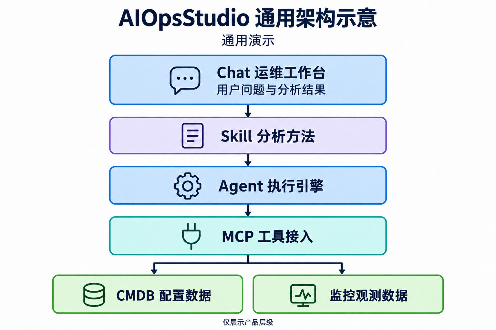

# AIOpsStudio 通用架构示意

图片为公开仓库完全新制的通用演示素材，不对应任何现场数据。图片和引用统一采用 AIOpsStudio 品牌，内容不表示某个部署拓扑。

## 阅读方法

- Chat 承担交互与结果展示。
- Skill 提供分析方法和约束。
- Agent 执行分析，MCP 提供工具接入。
- CMDB 和监控表示外部只读来源类别。

该图没有声明服务已部署、来源完整、业务结论正确或测试通过。具体选型、HTTP API 与持久化细节见[总体设计](../../AIOpsStudio总体设计-v0.1.md)，当前行为见[主规格](../../../../openspec/specs/)。

## 公开检查边界

素材按通用标签重新生成，去除元数据，不保留现场地址、设备名、账户、资产、业务数值或原值映射。图像识别和视觉核对由本次素材检查单独完成；这不替代源码、公开历史或远端对象扫描。

[生成要求](prompt.txt)和[整理说明](revision-prompt.txt)仅说明公开约束，不提供私有原图或原始材料索引。

## 2026-10-23 品牌修订

使用内置 imagegen 对公开通用原图进行 text-localization 编辑，仅将本项目名称改为 AIOpsStudio，保持通用标签、布局与职责关系。Chat 演示图同样处理，两个 Chat 引用使用相同字节。提示约束为：精确替换产品品牌，不引入真实地址、账户、资产、端点、业务指标或其他现场信息。

新图已逐张目视核对并经 macOS Vision 中英文 OCR 复核；仅保留 IHDR、IDAT、IEND，校验每块 CRC 和文件结束，无附加元数据或尾随内容。当前引用使用新文件名；旧路径和精确字节批准仅留在资产清单中供历史扫描，未改写历史图像。品牌修订不表示功能或业务验收完成。
