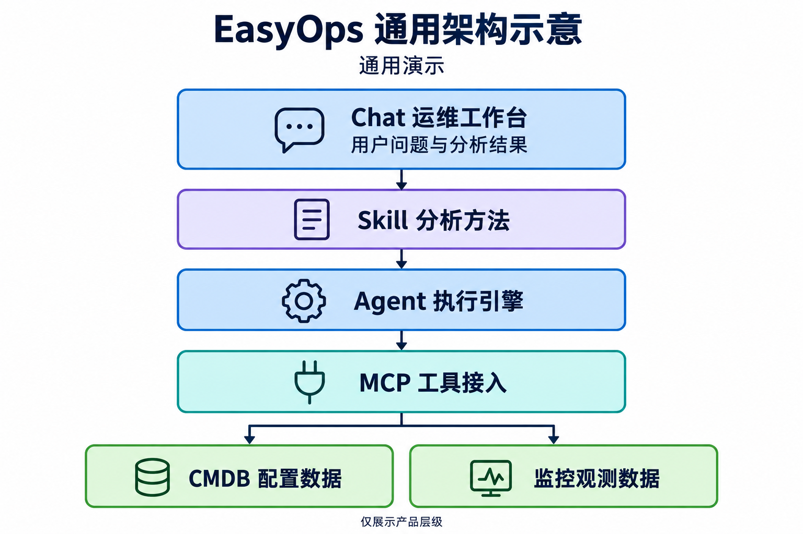

# EasyOps 通用架构示意

图片为公开仓库完全新制的通用演示素材，不对应任何现场数据。路径保留既有文件名，内容不再表示原版本部署拓扑。

## 阅读方法

- Chat 承担交互与结果展示。
- Skill 提供分析方法和约束。
- Agent 执行分析，MCP 提供工具接入。
- CMDB 和监控表示外部只读来源类别。

该图没有声明服务已部署、来源完整、业务结论正确或测试通过。具体选型、HTTP API 与持久化细节见[总体设计](../../EasyOps总体设计-v0.1.md)，当前行为见[主规格](../../../../openspec/specs/)。

## 公开检查边界

素材按通用标签重新生成，去除元数据，不保留现场地址、设备名、账户、资产、业务数值或原值映射。图像识别和视觉核对由本次素材检查单独完成；这不替代源码、公开历史或远端对象扫描。

[生成要求](prompt.txt)和[整理说明](revision-prompt.txt)仅说明公开约束，不提供私有原图或原始材料索引。
