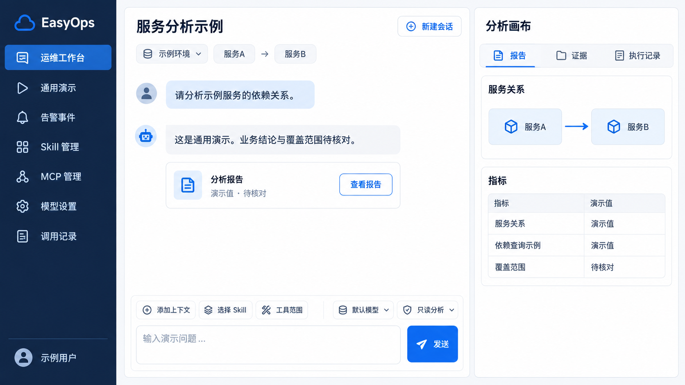

# Chat 工作台通用演示图

本图是为公开仓库完全新制的通用演示素材，不对应现场数据，也不是应用验收截图。文件名沿用原入口以保持链接可用；原图中的内容不作为本公开图的来源数据。

## 布局意图

左侧为导航与会话入口，中间为 Chat 和持续可用的输入区，右侧为可收起的分析画布。深色侧栏、白色内容区、蓝色动作和柔和边框表达工作台层次。

演示只使用“示例用户”“示例环境”“服务A”“服务B”“演示值”“待核对”等独立标签。用户示例请求为“请分析示例服务的依赖关系。”；回复说明“这是通用演示。业务结论与覆盖范围待核对。”。这些标签没有对应的真实对象或数值。

## 实现与验证边界

实际界面读取当前用户的服务端数据。输入框、多轮历史、附件、报告与证据的行为以 [Chat 规格](../../../openspec/specs/chat-workspace/spec.md) 为准，历史浏览器结果见[前端 QA](../../../web/QA.md)。公开图仅说明视觉布局；不能据图认定某个服务、模型、报告或业务结论已经验证。

[生成要求](20261022-Chat工作台Demo-v0.1.prompt.md)记录公开素材约束，不包含私有原型、现场截图或原值映射。
